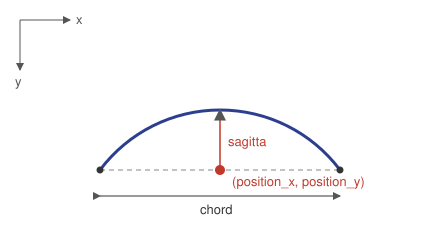
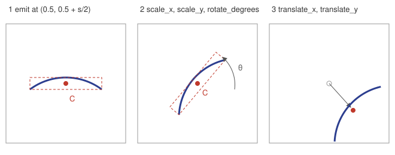
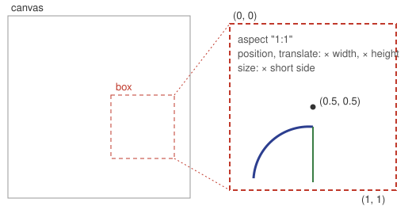

# inku Vocabulary Plugin Authoring Guide

Plugins are data-only vocabulary macros. A definition expands into ordinary DDL drawing instructions. New files use `inku.plugin-package.v2`; v1 files are neither read nor converted. See [SPEC §4](SPEC.md) for the boundary.

## 1. Steps

1. Write an `inku.macro-definition.v2` definition for an object or a scene (§2–3).
2. Put the definition, Japanese and English notes, optional examples and pictures in an `inku.plugin-package.v2` file (§5.1).
3. An administrator chooses the JSON or zip in Web settings. The Server checks shape, definition, and drawings of the examples before installation.
4. Call a visible name in braces: `｛星｝。` or `{stars}.`

## 2. Object example

This definition draws one yellow star. `id` is the stable lock identity; `names` are the visible DDL spellings. An object declares an aspect ratio, may declare a Japanese counter, and does not receive a `count` parameter.

```json
{
  "schema": "inku.macro-definition.v2",
  "namespace": "Sky",
  "id": "Stars",
  "names": {"ja": ["星"], "en": ["stars"]},
  "kind": "object",
  "aspect": "1:1",
  "counter": "general",
  "version": "1.0.0",
  "parameters": {},
  "components": {},
  "body": [{
    "op": "emit",
    "fields": {
      "shape": {"expr": "semantic_ref", "category": "shape", "id": "circle"},
      "movement": {"expr": "semantic_ref", "category": "movement", "id": "place"},
      "relative_scale": {"expr": "semantic_ref", "category": "relative_scale", "id": "small"},
      "color": {"expr": "semantic_ref", "category": "color", "id": "yellow"},
      "touch": {"expr": "semantic_ref", "category": "touch", "id": "pencil"},
      "surface": {"expr": "semantic_ref", "category": "surface", "id": "solid"}
    }
  }]
}
```

For an object example, write a position and a count, such as `Place 3 {stars} at the center.` The outer count repeats the whole object.

## 3. Definition rules

### 3.1 Top-level fields and a scene example

Write `schema`, `namespace`, `id`, `names`, `kind`, `version`, `parameters`, `components`, and `body`. `kind` is `object` or `scene`. An object needs `aspect` (two integers from 1 to 16 separated by `:`) and may have `counter` (`flat`, `long`, or `general`). A scene has neither.

```json
{
  "schema": "inku.macro-definition.v2",
  "namespace": "Sky",
  "id": "StarField",
  "names": {"ja": ["星原"], "en": ["star field"]},
  "kind": "scene",
  "version": "1.0.0",
  "parameters": {},
  "components": {},
  "body": [{"op": "emit", "fields": {
    "shape": {"expr": "semantic_ref", "category": "shape", "id": "circle"},
    "movement": {"expr": "semantic_ref", "category": "movement", "id": "place"},
    "position_x": {"expr": "exact_decimal", "value": "0.500"},
    "position_y": {"expr": "exact_decimal", "value": "0.250"},
    "relative_scale": {"expr": "semantic_ref", "category": "relative_scale", "id": "small"},
    "color": {"expr": "semantic_ref", "category": "color", "id": "yellow"},
    "touch": {"expr": "semantic_ref", "category": "touch", "id": "pencil"},
    "surface": {"expr": "semantic_ref", "category": "surface", "id": "solid"}
  }}]
}
```

### 3.2 Names and identifiers

`namespace` and `id` start with an ASCII letter and then use ASCII letters, digits, `_`, or `-`. `names.ja/en` contain visible names, with the primary name first. A name cannot be empty or contain control characters, braces, a dot, or a namespace. Matching normalizes NFKC, lowercases, and collapses whitespace. A plugin may not claim a core word. One catalog name belongs to only one definition, and a file claiming an installed plugin's name is refused.

### 3.3 Expressions

Every value is JSON naming its kind with `expr`.

| `expr` | Other fields | Meaning |
|---|---|---|
| `semantic_ref` | `category`, `id` | a meaning word (§3.8), for example `{"expr":"semantic_ref","category":"color","id":"red"}` |
| `exact_decimal` | `value` (string) | an exact decimal; write positions and dimensions with it, for example `{"expr":"exact_decimal","value":"0.25"}` |
| `integer` | `value` | an integer |
| `number` | `value` | a floating-point number, for `transform` amounts and the like |
| `boolean` | `value` | true or false |
| `list` | `items` | a fixed-length list |
| `cycle` | `items`, `index` | the item at `index` (a non-negative integer), wrapping back to the start; all items have the same kind |
| `parameter` | `name` | a declared parameter's value |
| `local` | `name` | the value of a `repeat` `index` or a `vary` `binding` |

There is no arithmetic. To combine numbers, write the values out as a `cycle` table or `vary` choices.

### 3.4 Parameters

For a scene word, unbound caller position, size, angle, and similar fields are omitted individually with a diagnostic; the definition body remains drawable.
For an object, caller position, size, angle, count, movement, and relations act on the outer box. Appearance words such as color reach its contents only when the definition declares a matching parameter.

`parameters` maps names to types. The types are closed:

| `type` | Other fields | What the call binds to it |
|---|---|---|
| `semantic_ref` | `category`, optional `dimension` | a word of that category written on the call; a color parameter takes "red" in `red {color stars}.` |
| `exact_decimal` | optional `dimension` | a number written on the call. `dimension` is `radius`, `diameter`, `length`, `side`, `width`, `height`, `chord`, `sagitta`, `position_x`, or `position_y` |
| `integer` | — | a number written on the call |
| `integer` (count) | `receives: "count"`, `minimum`, `maximum`, `omitted`, optional `counter` | the count written on the word (below) |
| `number` | — | a number written on the call |
| `boolean` | — | — |
| `list` | `length`, `items` | — |

- Every declared parameter except the count parameter is required. A call that does not write it is not drawn;
  no default is filled in silently.
- With two parameters of the same category, names never decide which one a word binds to. Declare one per category.
- An object word may take a color without declaring a color parameter. It replaces the definition's primary color: count the literal `color` semantic references in its body emits, including those in used components, repeats, varies, and transforms. The most frequent wins; a tie goes to the first in body order. An emit whose color comes from a parameter, cycle, or vary is not counted. Only marks in that primary color change; accent colors stay. Without a primary color, the unbound color is omitted with a diagnostic.
- A declared color parameter binds as before. An undeclared appearance word of another category, or an undeclared color on a scene word, is left out alone with a diagnostic; it does not override the definition.
- A sway parameter can name its part with `dimension` (`amplitude`, `frequency`, or `quality`), as in
  `{"type":"semantic_ref","category":"variation","dimension":"amplitude"}`.

**A scene parameter that receives the word's count.** A count written on a word (`5 {star field}.`, `5個の｛星原｝。`)
repeats the whole word from outside unless the definition declares that it receives it. To take it as the
inner count, declare an integer parameter with `receives: "count"` and its bounds, and read that parameter as
the `count` of a body `repeat`.

```json
"star_count": {"type": "integer", "receives": "count", "minimum": 1, "maximum": 9, "omitted": [3, 4, 5], "counter": "general"}
```

- Only one top-level scene parameter may declare it, never an object or component parameter.
- `minimum` is at least 1 and at most `maximum`; `omitted` is not empty and lists distinct integers inside the bounds.
- Make the `repeat` `maximum` at least the parameter's `maximum`.
- When no count is written, one of the `omitted` choices is chosen deterministically from the call's seed.
- A count outside the bounds leaves out only that word with the `macro_binding_count_out_of_range`
  diagnostic and draws the rest. It is never clamped.
- `counter` (`flat` for 枚, `long` for 本, `general` for 個) decides only the counter the underdrawing writes
  with a count in Japanese DDL.

### 3.5 Positions and sizes

- Positions inside a scene are fractions of the canvas; positions inside an object are fractions of its invisible box.
  In either case, `(0.0, 0.0)` is top left, `(1.0, 1.0)` bottom right, and `(0.5, 0.5)` the center. x is a fraction
  of the width and y a fraction of the height. A named `place` inside an object is a region inside that box.
- Scene dimensions are fractions of the canvas's short edge. Dimensions inside an object are fractions of the box's
  short edge. For example, `radius` 0.24 is a 120px radius when that short edge is 500px; a circle stays round
  even on a non-square canvas or box. A center plus a radius beyond the edge runs outside.
- `transform` `translate_x` and `translate_y` use canvas units in a scene and box units inside an object. Scaling
  the box does not change stroke width or texture fineness.
- A call to the whole object uses its `aspect` box for placement, count, movement, size, angle, and relations, as an
  ordinary rectangle would. Normal size and an explicit side use the box's long edge. An explicit width and height
  set both dimensions.
- Give a size either with a dimension such as `radius` or with `relative_scale`, not both.
- A shape without a size takes the same normal size as ordinary DDL. Writing `relative_scale` `normal`
  explicitly is not the same as writing nothing.
- The shapes are `line`, `circle`, `ellipse`, `triangle`, `square`, `polygon`, `arc`, `point`, and `cloudform`.
  A plugin cannot add a tenth.

### 3.6 Body statements

A statement names its kind with `op`.

| `op` | Fields | Meaning |
|---|---|---|
| `emit` | `binding` (a name or `null`), `fields` | one shape instruction; `fields` are in §3.7. Name a `binding` to point at it from a `relation` |
| `repeat` | `count`, `maximum`, `index`, `body` | repeats `body` `count` times (an integer expression). `maximum` is an upper bound of at least 1 that `count` may not exceed. `index` holds a number from 0 |
| `vary` | `binding`, `domain`, `choices` or `range`, `body` | chooses one value from the seed into `binding` for use in `body`. `choices` is a list of same-kind expressions; `range` is `{"start","end","step"}`. `domain` names the choice so it is kept apart from other `vary` statements |
| `use` | `component`, `arguments` | calls a component from the same definition's `components`, passing all of its parameters |
| `group` | `body` | groups statements; adds no placement |
| `transform` | `transform`, `body` | moves the shapes of `body` together. `transform` has at least one of `translate_x`, `translate_y`, `scale_x`, `scale_y`, `rotate_degrees` (numbers). Scaling and rotation happen at the group's bounding-box center; translation uses the units in §3.5 |
| `anchor` | `name`, optional `fields` | a non-drawing point; `fields` is either `place` or the pair `position_x` and `position_y` |
| `relation` | `kind`, `from`, `to` | a relation between two `emit` bindings or anchors; `kind` is a relation word from §3.8 |

- **`vary` chooses again every time it is reached.** Inside `repeat` it chooses for each repetition, and separate
  `vary` statements for x and y choose separately. Choosing between two position tables with separate x and y
  `vary` statements mixes the tables and can make shapes overlap. Fix positions with a `cycle` table, and use
  `vary` for things that may mix, such as size or color.
- The seed comes from the work's composition seed. The same seed draws the same picture; another seed chooses differently.
- A component cannot call itself, even indirectly, or a component of another definition.
- A `relation` works between adjacent `emit` statements of the same expansion. `connected`, `touching`,
  `not_touching`, `between`, `along`, and `cutting` are available. A relation that cannot hold is removed alone
  with a diagnostic and the shapes are still drawn. Two arcs joined with `touching`, the later one with
  `surface: solid`, fill their inside as one closed outline (the leaf form; [SPEC §4.11](SPEC.md#411-the-boundary-of-freedom)).

### 3.7 `emit` fields

An `emit` may have these fields and no others.

| Field | Value | Notes |
|---|---|---|
| `shape` | a `shape` word | required; one of the nine shapes in §3.5 |
| `movement` | a `movement` word | required. `place` places one; `scatter` scatters `count` of them (§3.10). `line_up` and `tile` are not checked in this guide |
| `place` | a `place` word | either this or the `position_x` / `position_y` pair: `center`, `top`, `bottom`, `left_edge`, `right_edge`, `top_edge`, `bottom_edge`, `corner`; inside an object it names a box region |
| `position_x`, `position_y` | `exact_decimal` | written as a pair; fractions of the canvas for a scene or the box inside an object |
| `radius`, `diameter`, `length`, `side`, `width`, `height`, `chord`, `sagitta` | `exact_decimal` | dimensions. `width` with `height` and `chord` with `sagitta` are pairs. A line takes `length`, an arc `chord` and `sagitta`, a point `radius` or `diameter` |
| `relative_scale` | a `relative_scale` word | a factor on the normal size |
| `color` | a `color` word | color |
| `touch` | a `touch` word | drawing medium |
| `continuity` | a `continuity` word | stroke continuity (solid, dashed, …) |
| `surface` | a `surface` word | fill: `none` for an outline only, `solid` for a full fill, or a texture word |
| `surface_intensity` | a `handling` word | texture strength |
| `angle` | an `angle` word | tilt; a point takes none |
| `thinness` | a `thinness` word | stroke thinness; on a closed shape it thins the outline |
| `fluctuation_amplitude`, `fluctuation_frequency`, `fluctuation_quality`, `ink_spread` | a `variation` word | sway amplitude, frequency, and quality, and bleeding. With amplitude alone, frequency is medium and quality the default |
| `proportion_aspect` | `ratio` `tall` or `wide` | tall or wide |
| `proportion_width_extent`, `proportion_arc_form` | a `ratio` word | full or half width; semicircle, waxing, waning, crescent |
| `shape_form` | `shape_form` `regular` | regular form |
| `sides` | an integer from 5 to 8 | polygon sides |
| `count`, `layout_direction` | integer (or the count parameter), an `angle` word | `count` is the number of marks of a `scatter` (§3.10); write counts whose members differ in shape with `repeat`. `layout_direction` is not checked in this guide |

A value whose category does not match the field is rejected (for example a `touch` word in `color`). A field
left out takes the same default as ordinary DDL.

### 3.8 Finding meaning words (semantic_ref)

A `semantic_ref` `id` is the English identifier of a word in the Saijiki
(`core/crates/inku-ddl/assets/saijiki-v2.json`): the word's `score_value` when present, otherwise its
`surface_en` with `-` and spaces turned into `_`. The table changes with the product, so print today's list
instead of copying one:

```sh
python3 - <<'PY'
import json
names = {"katachi": "shape", "katamuki": "angle", "tezawari": "touch", "tsuranari": "continuity",
         "omote": "surface", "sabaki": "handling", "kime": "fineness", "shitaji": "underlayer",
         "ji": "ground", "iro": "color", "yuragi": "variation", "basho": "place",
         "ugoki": "movement", "jun": "sequence", "wariai": "ratio"}
asset = json.load(open("core/crates/inku-ddl/assets/saijiki-v2.json"))
for category in asset["categories"]:
    ids = []
    for word in category["words"]:
        wire = word.get("score_value") or (word.get("surface_en") or "").replace("-", "_").replace(" ", "_")
        if wire:
            ids.append(f"{wire}（{word['surface_ja']}）")
    print(names[category["key"]] + ": " + ", ".join(ids))
print("relation: " + ", ".join(r["relation_type"] for r in asset["relations"]))
PY
```

Run it at the top of a product checkout. Each line starts with the `category`, and each item is
`id（Japanese word）`. `free_line` appears under `shape` but is not available to plugins (only the nine in §3.5).

Three categories outside the Saijiki are closed words defined by the core:

| Category | Words |
|---|---|
| `thinness` | `extra_fine`, `fine`, `thick`, `extra_thick` (Saijiki v3; without one, the tool's normal thickness) |
| `relative_scale` | `very_small`, `small`, `slightly_small`, `normal`, `slightly_large`, `large`, `very_large` |
| `shape_form` | `regular` |

### 3.9 Coordinates and shapes, in figures

**Figure 1: an arc's reference point.** An arc's `position_x` and `position_y` are the midpoint of its chord. The chord lies level and the arc bulges up (toward smaller y) by `sagitta`.
`chord` is the chord's length; a semicircle has `sagitta` exactly half of `chord`.



**Figure 2: making a tilted arc.** An arc between any two points is made with a `transform`.

1. Place it as a flat arc at the center of the canvas (of the box, in an object). For its bounding box's center C to be the canvas center (0.5, 0.5), `position_y` is 0.5 plus half the sagitta.
2. `scale_x`, `scale_y` and `rotate_degrees` act about C, the center of the group's bounding box.
3. `translate_x` and `translate_y` then move the whole (in the units of §3.5).

The flat arc must already fit the canvas (§3.10). Place a long arc shrunk and restore it with `scale_x` and `scale_y`.
For the calculation, see `Box.arc` in the examples' scripts ([docs/plugins/scripts/helpers.py](docs/plugins/scripts/helpers.py)).



**Figure 3: inside an object's box.** An object word draws inside an invisible box. Positions and `translate_x`, `translate_y` are fractions of the box's width and height; sizes are fractions of its short side (§3.5).



### 3.10 Rules for making a plugin

The checks look at shape and correctness, not at how a word looks. These rules were confirmed with the shared core while making the examples ([docs/plugins](docs/plugins/README.md)) (2026-11-01).

- **Draw to check.** How a word looks shows only when it is drawn. `inku-cli plugin preview FILE` draws a package, definition or export file without installing it, each word's example across several composition seeds, and writes SVGs with an `index.html` to view them side by side ([CLI reference](manual/en/cli-reference.md)). In the Web, put the definition in an export file (`inku.ddl-export.v2`, with `{definition, note}` entries in `plugins`) and draw it as one work through "Load" in the new instructions. An administrator can also see the example drawings on the "Add a plugin" check screen ("Cancel" ends without adding).
- **Stay inside the canvas.** A figure outside the canvas (the box, in an object) before a `transform` is dropped alone with `geometry_extent_out_of_bounds`. If any figure is outside the canvas after the outermost `transform`, nothing in that group is drawn (`numeric_transform_group_position_conflict`). Choose sizes that fit for every candidate.
- **Mind the rounding.** Dimensions are the `exact_decimal` values as written, and a semicircle whose sagitta rounds past half its chord cannot be drawn (`geometry_dimension_mismatch`). Use values that divide cleanly, such as chords in multiples of 0.002.
- **No branches.** A `repeat` with a count of 0 (a literal 0) makes the whole definition unacceptable. Write per-ring or per-line differences as `cycle` tables.
- **`cycle` indices are integers.** The value a `vary` `range` chooses is a decimal and cannot be a `cycle` `index`. Choose integer `choices` with `vary` and look the tables up with that value (see also the note in §3.6).
- **Tables instead of arithmetic.** A definition has no arithmetic, so positions, angles and sizes are computed outside and written as `cycle` tables. The examples are made with Python scripts ([docs/plugins/scripts](docs/plugins/scripts/README.md)).
- **Scatter.** With `movement` `scatter` and a `count` (an integer or the count parameter), one instruction scatters many marks. `place` sets the region, `length`, `radius` and `angle` the shape of one mark, and a `transform` can tilt the whole. The scattering follows the work's seed.
- **Thickness.** Write thickness with `thinness` (the table in §3.8). When a `cycle` table chooses the tool, write the thickness as its own `cycle` table too.
- **How fluctuation looks, roughly.** It depends on the shape and size, but `broadly` sways widely and `narrowly` slightly; `loosely` makes slow broad undulations and `tightly` fine crinkles, with no frequency word in between; `undulating` is a regular wave and `swaying` an irregular sway. `ink_spread` `bleeding` adds a soft haze around the line.
- **Place words.** `place` words are those in the list of §3.8; there is no word such as "lower right".
- **Object boxes.** Inside a box that is not square (an `aspect` such as `1:2`), a figure under a `transform` was not drawn, with no diagnostic. An object that uses tilted arcs takes a `1:1` box and keeps its shape in the middle of it. An object's normal size draws small, so try "large" and the like in its example.
- **Give an object's example a placing verb.** An object is placed like a square, so its bare name `{stone}.` draws nothing (`missing_place_action`). Write an object's example like `Place a large {stone} at the center.`
- **Objects and the figure count.** An object's content counts toward a work's figure instructions (64, §8). A work with an object that went over 64 lost the object or was not made. Keep the counts in the examples of large objects down.

## 4. Calling a plugin from DDL

The Web Saijiki and settings show the Japanese and English names, kind, note, example, and picture. The editor completes names after a brace and shows the shared core's marks, reasons, and hover preview. The note is used both in the underdrawing offer and in the word's description.

Put a visible name in braces: `｛星｝。` or `{stars}.` Modifiers attach to that call. An object's shape stays fixed while composition and rules act on its aspect rectangle. A scene stays an inserted drawing. Saved works retain their exact definitions and locks for replay.

## 5. Loading a definition

### 5.1 Adding a plugin file from the Web

Save this one-word file as `package.json` and choose it in Web settings. To include a picture, put `package.json` at the root of a zip alongside its PNG and write `"preview":"previews/stars.png"` in the word.

```json
{
  "schema": "inku.plugin-package.v2",
  "namespace": "Sky",
  "name": "night",
  "version": "1.0.0",
  "description_ja": "夜空の語。",
  "description_en": "Words of the night sky.",
  "words": [{
    "definition": {
      "schema": "inku.macro-definition.v2",
      "namespace": "Sky",
      "id": "Stars",
      "names": {"ja": ["星"], "en": ["stars"]},
      "kind": "object",
      "aspect": "1:1",
      "counter": "general",
      "version": "1.0.0",
      "parameters": {},
      "components": {},
      "body": [{"op": "emit", "fields": {
        "shape": {"expr": "semantic_ref", "category": "shape", "id": "circle"},
        "movement": {"expr": "semantic_ref", "category": "movement", "id": "place"},
        "relative_scale": {"expr": "semantic_ref", "category": "relative_scale", "id": "small"},
        "color": {"expr": "semantic_ref", "category": "color", "id": "yellow"},
        "touch": {"expr": "semantic_ref", "category": "touch", "id": "pencil"},
        "surface": {"expr": "semantic_ref", "category": "surface", "id": "solid"}
      }}]
    },
    "note_ja": "夜空に黄色い星を描く。",
    "note_en": "Draws a yellow star in the night sky.",
    "example_ja": "｛星｝を置く。",
    "example_en": "Place {stars}."
  }]
}
```

Top-level fields are `schema`, `namespace`, `name`, `version`, optional `description_ja/en`, `authors`, `license`, and `words`. A word has only `definition`, `note_ja/en`, `example_ja/en`, and `preview`. At least one note is required; each is at most 100 characters, and a missing language uses the other. A missing example defaults to `｛primary name｝。` or `{primary name}.` An explicit example must call the braced primary name. A preview is a PNG within a zip.

The checks run in order: file shape, shared-core definition validation, and drawing the Japanese and English examples. All must pass. Administrators can install, replace, disable, delete, replace preview pictures, and export a zip. Installed words enter the catalog for new works and the Saijiki; notes are also used in the underdrawing offer. The bundled `Nature.leaves` is a v2 file in core: it can be disabled but neither deleted nor given custom pictures. APIs include `POST /api/plugins/packages/validate`, `POST /api/plugins/packages`, and `GET /api/plugins/{id}/export`.

### 5.2 DDL export file

`GET /api/pipeline/history/{id}/ddl-export` emits `inku.ddl-export.v2`. Its `plugins` carry definitions selected by the saved locks as `{definition,note}`, independent of spelling in the DDL text. Import applies them to one new work without installing them. An imported definition wins over an installed one with the same id; a difference produces a diagnostic. Export a v1 file again as v2 before importing it.

### 5.3 Server manifest

An administrator may place definitions in `pipeline.definitions` and corresponding short notes in `pipeline.macro_summaries`. Mismatched list lengths cause `macro_catalog_summary_mismatch`.

### 5.4 Bundled words

The seven leaf words and their PNGs are in `core/crates/inku-ddl/assets/nature-leaves-v2/`. The shared-core `plugin_package` action `bundled_nature` hands them to the Server. Existing macOS and Android UI resources will follow the new names in a later step.

## 6. Writing a note

Write one sentence about what the thing is, in at most 100 characters per language. The same text is used in the Stage 1 offer and Saijiki description. State drawing facts such as place, material, or color rather than relying on seasonal or similar-word associations.

## 7. Checks and problem codes

### 7.1 Three checks

Shape problems do not hide definition and example problems when those can still be checked. Each problem has a path and code. An example is not drawn when its definition is invalid. The Web check screen explains codes in Japanese and English.

### 7.2 Definition codes

`invalid_canonical_definition`, `unknown_json_field`, `duplicate_qualified_name`, `name_taken`, `name_is_core_word`, `invalid_plugin_kind`, `invalid_plugin_aspect`, `invalid_plugin_counter`, `scene_has_aspect`, `scene_has_counter`, `object_count_parameter`, `unknown_semantic_id`, `unknown_semantic_category`, `unknown_semantic_field`, `semantic_field_requires_matching_reference`, `geometry_field_requires_exact_decimal`, `invalid_count_parameter`, `invalid_repeat_count`, `unbounded_repeat`, `undefined_parameter`, `undefined_local`, `undefined_anchor`, and `component_cycle` identify the relevant definition field.

Other definition codes: `anchor_requires_one_explicit_position`, `argument_type_mismatch`, `count_parameter_in_component`, `duplicate_alias`, `duplicate_anchor_or_binding`, `duplicate_count_parameter`, `duplicate_local_binding`, `duplicate_plugin_name`, `empty_cycle`, `empty_transform`, `empty_vary`, `external_component_reference`, `heterogeneous_cycle`, `invalid_alias`, `invalid_anchor_or_binding_id`, `invalid_component_id`, `invalid_cycle_index`, `invalid_emit_count_type`, `invalid_endpoint_target`, `invalid_local_binding_id`, `invalid_parameter_id`, `invalid_plugin_id`, `invalid_plugin_name`, `invalid_semantic_dimension`, `invalid_vary_domain`, `invalid_vary_range`, `invalid_vary_source`, `missing_argument`, `non_finite_number`, `path_position_requires_connected`, `path_position_requires_number`, `resource_bound_overflow`, `transform_requires_number`, `undefined_component`, `unknown_anchor_field`, `unknown_argument`, `unknown_schema`, `vary_choice_type_mismatch`.

### 7.3 File, example, and picture codes

File: `invalid_json`, `package_too_large`, `not_an_object`, `unknown_field`, `wrong_schema`, `rewrite_as_v2`, `definition_requires_v2`, `invalid_identifier`, `invalid_semantic_version`, `not_a_string`, `not_a_list_of_strings`, `text_too_long`, `no_words`, `too_many_words`, `namespace_differs_from_package`, `id_differs_from_directory`, `invalid_package_id`, `bundled_package_id`, `no_note`, `example_without_name`. `rewrite_as_v2` means to rewrite a v1 file as v2 and install it again.

Example: `macro_binding_count_out_of_range`, `macro_resolution_missing_lock`, `compiler_diagnostics`, `example_draws_nothing`, `example_not_drawn`.

Picture and zip: `not_a_png`, `image_too_large`, `preview_needs_zip`, `preview_not_found`, `invalid_preview_path`, `invalid_zip`, `not_base64`, `archive_too_large`, `too_many_archive_members`, `archive_without_package_json`, `not_utf8`. `not_base64` comes from the Server's request check.

## 8. Limits

File: 1,000,000 bytes; words: 64; `description_*`: 2,000 characters; `note_*`: 100; `example_*`: 500; `license`: 200. A PNG is at most 2 MiB and 4096×4096 pixels. A zip is at most 16 MiB, 256 members, and 64 MiB of PNG data. Preview frames are 216×92 pixels and twice that size.

## 9. Boundaries

A plugin cannot change the meanings of core words or primitives, run code, add hooks, or extend DDL syntax. V1 packages are not accepted.
