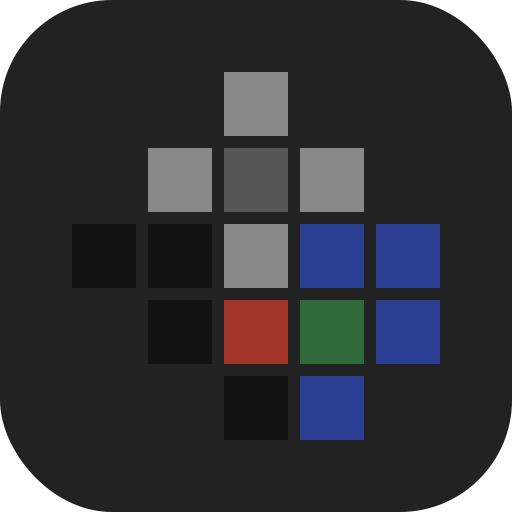
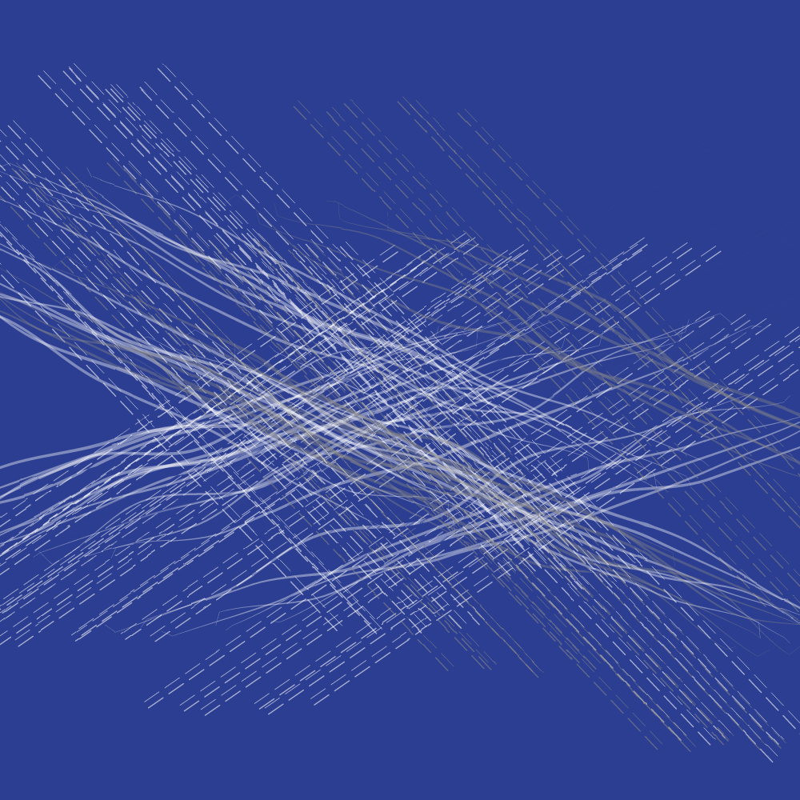
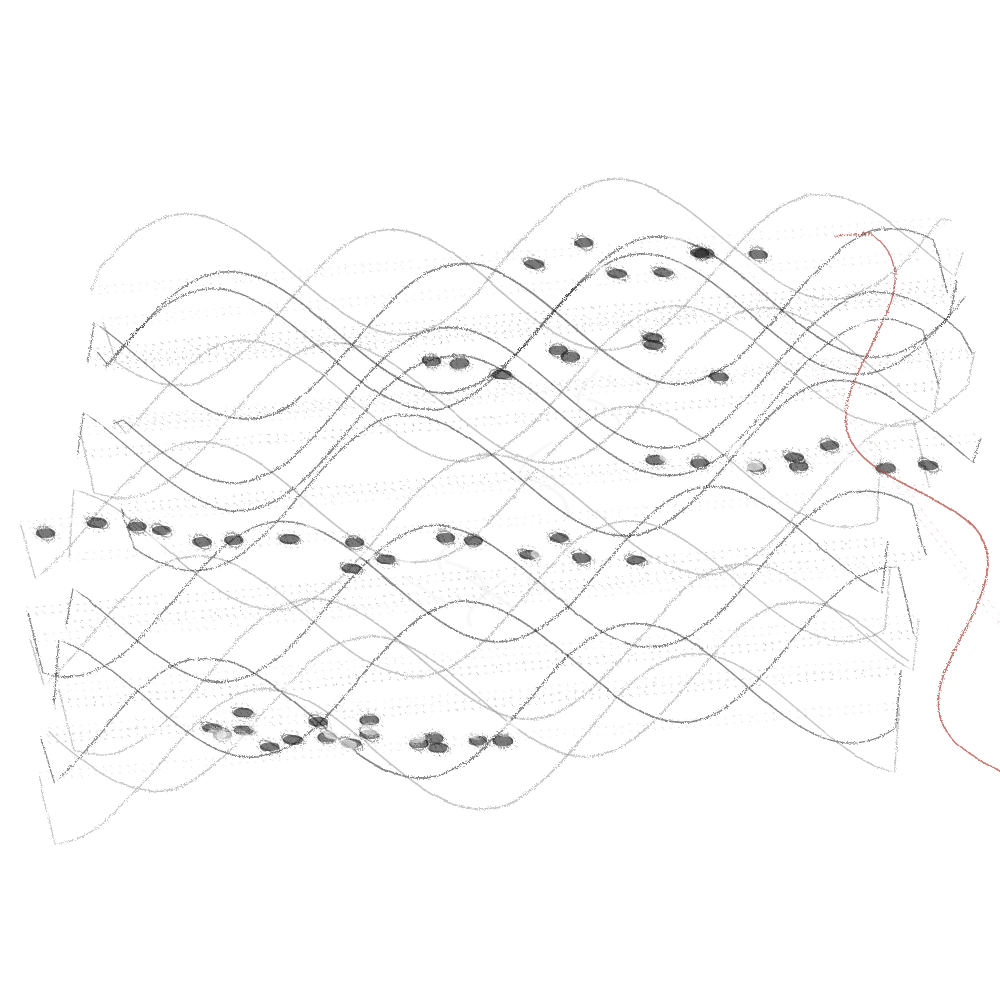
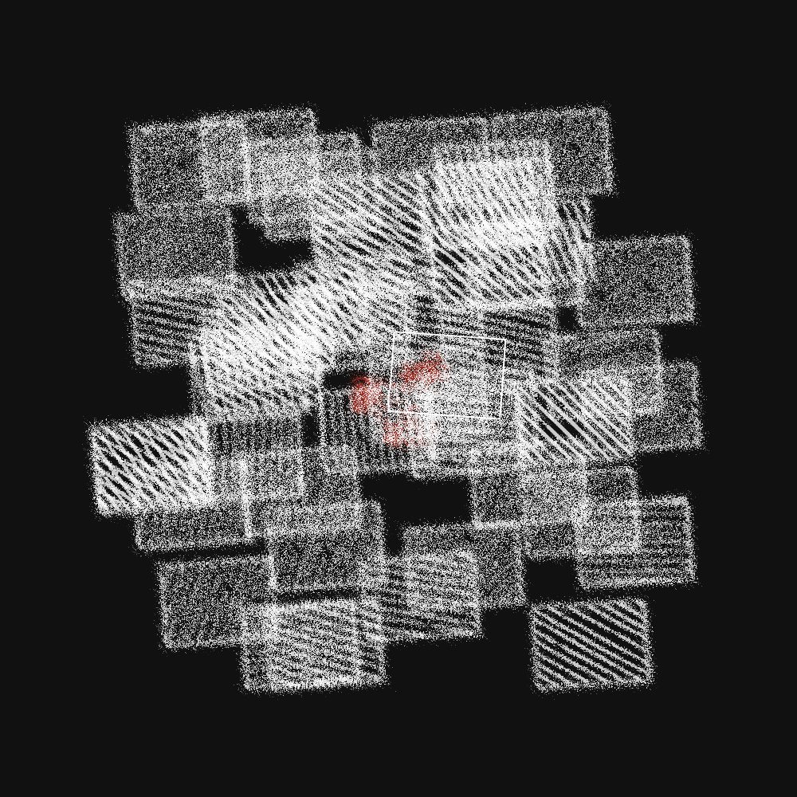

<p align="center">
  
</p>

<p align="center">
  <a href="README.md">English</a> ｜ <strong>日本語</strong>
</p>

# inku

**一文を、絵にする。**

LLM が言葉を読み、型付きコンパイラが指示書を確かめ、Rust のエンジンが描く。
**残るのは、人が読める指示書と、同じ作品を再現できる楽譜。** 抽象画のための描画言語 DDL と、その参照実装です。

<table align="center">
<tr>
<td width="33%"></td>
<td width="33%"></td>
<td width="33%"></td>
</tr>
</table>

---

## 一文から、指示書へ、絵へ

```
夜の港で、灯台の光だけが波を数えていた。
```

この一文を LLM が読み、**指示書（DDL）**を書きます。

```
画面比1:1。
背景を白で埋める。

「灯台」
画面の横0.6、縦0.4の位置に、幅0.1、高さ0.3の白の塗りの四角を1個置く。
画面の横0.6、縦0.22の位置に、直径0.08の黄の塗りの円を1個置く。

「波の筋」
下に灰の鉛筆の細い線を20本並べる。
線は細かく揺れる。
```

指示書は型付きコンパイラで**楽譜（JSON Score）**になり、Renderer が **SVG** として演奏します。

<!-- TODO(作者): この一文で実際に描いた作品の画像と、seed・色カタログをここに置く -->

指示書は日本語（または英語）の短い文で、予備知識なく読め、そのまま書き直せます。「灯台」の行は名札で、描画には関わりません。光も、数えることも、指示書には残りません。**残るのは形・画材・位置・揺らぎの語だけです。** 絵に何を運ばせるかは、作り手に委ねられます。

---

## 何が違うのか

| | 一般的な画像生成 | inku |
|---|---|---|
| 出力 | ラスタ画像 | **SVG**（ベクター。壁にも紙にも画面にも） |
| 途中の表現 | 見えない | **人が読める指示書**。読んで、直して、描き直せる |
| 再現性 | 同じプロンプトでも別の絵 | **同じ楽譜と seed から同じ作品** |
| 語彙 | 無制限 | **歳時記**の有限の語。物理と運動の語だけで、「美しく」のような評価語は持たない |
| 修正 | プロンプトを書き直して引き直す | 指示書の一行を直す。動かす軸と保つ軸を選んで推敲する |
| 作品の単位 | 一枚の画像 | **記述と楽譜**。SVG はその一回の演奏 |

着想の元は三つあります。

| 着想の元 | inku が借りたもの |
|---|---|
| **Sol LeWitt の指示書** | 記述そのものが作品であるという思想。書く人と描く手の分離 |
| **盆栽** | 限られた語彙のほうが、よい創造を生む |
| **短歌** | 短く、意味を多く含み、依拠する型を持つ文章 |

---

## こんな関心を持つ人へ

- **ジェネラティブアート／クリエイティブコーディング** — コードではなく文章で書くジェネラティブ作品。seed 駆動の揺らぎ、11 種の画材を描き分ける筆致エンジン、7 種の支持体（和紙・カンバス・メゾチントなど）、13 本の色カタログ。→ [しくみの詳細](docs/guide/how-it-works.ja.md)
- **言語設計・コンパイラ** — 日英両方で書ける自然文の DSL。出典の範囲を保つ typed semantic document、一度だけ下ろす lowerer、読めない句を推測で埋めず、診断を付けてその句だけを省く回復。→ [SPEC.ja.md](SPEC.ja.md)
- **LLM アプリ／エージェント開発** — 非決定的な LLM と決定的なプログラムを交互に挟む設計。閉じた型で出力を縛り、文法の正しさを構造で保証する。全 API を操作できる CLI。→ [アーキテクチャ](docs/architecture/README.ja.md)
- **美術・詩歌** — 指示書を作品とし、描画をエディションとして刷る。完成は、生成が当たったときではなく、作り手が止めると決めたときに訪れる。→ [ギャラリー](docs/guide/gallery.ja.md)

---

## しくみ — 楽譜と演奏

```
  入口                            LLM（非決定的）
  ─────────────────────────────────────────────────────────────
  一文 ─┬─ 言葉で描く  記述を読み、指示書を直接書き、描いた画を見て一度直す
        └─ 型で描く    閉じた型の「下絵」を返し、指示書は決定的に印字する
  画像 ─── Vision のモデルが画像を見て指示書を書く
  手書き ─ あなたが指示書を直接書く
                    │
                    ▼
  指示書（DDL） 人が読める。編集できる。ここから先は決定的
                    │  型付きコンパイラ
                    │  （読めない句は Stage 2 が補完案を出し、あなたが承認する）
                    ▼
  楽譜（JSON Score）  保存される
                    │  Renderer（seed 駆動の揺らぎ）
                    ▼
  SVG               一回の演奏
```

**記述は残り、演奏は一回ごとです。** LeWitt の指示書が施工する手によって少しずつ違う壁画になるように、同じ楽譜からは seed ごとに違う演奏が生まれます。揺らぎはバグではなく、この言語の仕様です。一方で、同じ楽譜・同じ seed・同じ描画条件からは、同じ SVG が再現されます。

LLM が働くのは指示書を書くところまでです。解釈は連想的で創造的なので LLM に任せ、構造化は規則に従うのでコンパイラが担います。解釈に使うモデルは選べ、モデルによって作品は大きく変わります。**モデルの選択も、創造の変数です。**

**型で描く — LLM に文章を書かせない。** 以前は LLM が指示書を直接書いていました。保存記録 150 件では、生成した 458 文のうち 193 文（42%）が語彙や文法の外にあり、コンパイラに読めず捨てられていました。プロンプトで教えても解消しませんでした。いまの「型で描く」では、LLM は歳時記の語だけを入れられる閉じた型の下絵を返し、指示書はそこから決定的に書き起こされます。形ごとに組み合わせられる値は、コンパイラへ一文ずつ問い合わせて作った表が決めるので、書き起こした指示書はすべて診断なしでコンパイルされます。

**言葉で描く — 読み手の目で書く。** Web の既定はこちらです。LLM は記述を語り手の目から読み、その目に映る景を、位置と大きさの数を含む指示書として書きます。描いた画を見て一度直し（Vision 対応モデルのとき）、必要なら構図と法則、配色の段も通します。書いたとおりに描けない行は理由とともに名指されて聞き直され、それでも残る行は省いて描きます。

処理の進め方、型付きコンパイラ、楽譜、Renderer は、**Rust の一つの共有コア**にまとまっています。サーバーも Android も macOS も同じコアを呼ぶので、同じ指示書はどこで描いても同じ判定を経ます。

→ 楽譜の実物と各層の用語は [しくみの詳細](docs/guide/how-it-works.ja.md)、実装境界は [アーキテクチャ](docs/architecture/README.ja.md) に。

---

## DDL — 指示書の言語

```
背景を青で埋める。
和紙。
白いガッシュの線を横に四十本並べる。
線はゆるやかに揺れる。
右端に赤い鉛筆の線を1本引く。
```

1. **人が読める** — 自然言語と記述言語の中間に置く
2. **感情の語を持たない** — 物理と運動の語で書く。感情を運ぶ表現を選ぶのは作者
3. **大きさを固定しない** — 位置と大きさは画面に対する比で書く。画素の絶対値は持たない。組んだ比は「画面比1:1。」と宣言でき、別の比の紙にも描ける
4. **出力は静止画** — 動きは静止画の中に込める
5. **揺らぎは仕様** — LLM の解釈と、Renderer の演奏に揺らぎを許す
6. **自由文は直接処理しない** — 指示書に書き起こし、型付きコンパイラで確かめる
7. **エンジンは後戻りしない** — 下の「版画としてのエンジン」

### 歳時記（Saijiki）

語彙の辞書を、俳句の季語を集めた書にならって **歳時記** と呼びます。常に開いておくものではなく、迷ったときに見に行くものです。アプリでは語を選ぶと、その筆致の見本と効き方が出ます。

<details>
<summary>歳時記 v3 の語彙（16 カテゴリ）</summary>

| カテゴリ | 英語 | 語彙 |
|---|---|---|
| かたち | forms | 円、楕円、三角、四角、線、弧、自由線、点、雲形 |
| かたむき | angles | 水平、垂直、斜め、右上がり、右下がり、回転 |
| てざわり | touches | 銀筆、鉛筆、ペン、チョーク、オイルパステル、ガッシュ、水彩、油彩、ペインティングナイフ、エッチング、コンピュータ |
| つらなり | continuity | 実線、破線、点線、一点鎖線 |
| おもて | surfaces | 空、塗り、刷き、刷毛目、粒、点描、平行線、交差線、アクアチント |
| さばき | handling | 濃い、程よい、薄い |
| きめ | fineness | 細かい、粗い、密な、疎な |
| したじ | underlayer | 下塗り |
| じ | grounds | 紙、和紙、薄墨地、木炭地、カンバス、画用紙、メゾチント |
| いろ | colors | 白、黒、青、赤、緑、灰、黄、橙、紫 |
| ゆらぎ | movements | 細かく、大きく、ゆるやかに、小刻みに、揺れる、波打つ、にじみ |
| ばしょ | places | 上、下、中心、左端、右端、上端、下端、始点、終点、途中、隅 |
| うごき | motions | 置く、並べる、引く、散らす、埋める、敷き詰める |
| じゅん | order | 交互に、順に |
| わりあい | proportions | 縦長、横長、全幅、半幅、半円、上弦、下弦、三日月 |
| あいだ | relations | 沿う、触れない、切る、間に、触れる、つながる、載る、中に、重なる、横切る、鏡写し |

語彙の正本は共有コアの `core/crates/inku-ddl/assets/saijiki-v3.json` で、`inku-cli reference --md` で機械生成の一覧を得られます。プラグインの語（同梱の `｛若葉｝` など）もコアの語と同じ形で並びますが、コアの語へ展開されるだけで、コアの語彙は増やしません。→ [PLUGIN.ja.md](PLUGIN.ja.md)

</details>

---

## 推敲 — 書くことと選ぶことの往復

<table><tr><td></td></tr></table>

最初に返ってきた一枚は、完成ではなく**初代**です。指示書を直し、色カタログや構図を引き直し、返ってきた候補から選ぶ。その一つが次の推敲の親になり、世代は**系譜**として枝分かれして残ります。

| 操作 | 引き直すもの | 保たれるもの | LLM |
|---|---|---|---|
| 指示書を直す | 直した行 | ほかのすべて | 呼ばない（読めない句の補完案を求めるときだけ呼ぶ） |
| 別の色 | 色の割り当て | 解釈・構図・演奏 | 呼ばない |
| 別の構図 | 傾きの角度、隅の位置 | 指示書、画材・色・数 | 呼ばない |

どの操作も既定の再現性を壊さず、あなたの明示的な操作でだけ働きます。世代を重ねることを AI に任せることもでき、その間に生まれた世代もすべて系譜に残ります。→ [推敲の詳細](docs/guide/revision.ja.md)

---

## 版画としてのエンジン

inku の描画エンジンは過去の版を持ちません。古い楽譜も最新のエンジンで描けますが、出来上がる絵は当時とは違います。後方互換のための分岐は載せません。

> 彫りは進む。版木は一方向にしか変わらない。刷り上がった作品は残るが、彫る前の版木には戻れない。

保存した作品は**刷り**で、SVG そのものが残るので当時の姿はいつでも見られます。描き直せば最新のエンジンで刷られ、新しいエディションになります。→ [render engine の版史](docs/spec/render-engine-history.ja.md)

---

## はじめる

| 使い方 | 手順 |
|---|---|
| **Mac で、自分の ChatGPT プランで描く**（シングルユーザー） | [Docker Desktop で始める](docs/guide/docker-desktop.ja.md) |
| **リリースイメージをサーバーで動かす**（API キー、マルチユーザー） | [`deploy/README.md`](deploy/README.md) |
| **macOS アプリ**（サーバー不要、Universal、macOS 14 以降） | [apple/README.ja.md](apple/README.ja.md) |
| **Android アプリ**（サーバー不要、Android 15 以降・arm64） | [APK のインストール](docs/guide/android-apk.ja.md) |
| **ソースから動かす** | [SETUP.ja.md](SETUP.ja.md) |

いちばん短い道は、Docker Desktop と自分の ChatGPT プランです。

```sh
git clone https://github.com/oikawas/inku-lang.git && cd inku-lang
printf 'INKU_CHATGPT_PLAN_ENABLED=1\nINKU_CHATGPT_SELF_HOSTED=1\n' > .env
docker compose up -d --build   # → http://localhost:5173
```

起動後に ChatGPT の認証をコンテナへ取り込み、描画のモデルを選びます（[手順](docs/guide/docker-desktop.ja.md)）。API キーでは OpenAI・Anthropic・Gemini・NVIDIA を、手元では Ollama を使えます。

---

## 実装の状況

| | 状況 |
|---|---|
| **Web**（SvelteKit + FastAPI） | 稼働中。記述・画像・バッチ・系譜。言葉で描く／型で描くを選べる |
| **CLI**（`inku-cli`） | 公開 API だけで、GUI でできることをすべて行える。AI エージェントからの操作を想定 |
| **Android** | 稼働中（[`android/VERSION`](android/VERSION)）。端末内で共有コアを呼んで描く。カメラから描く機能つき |
| **macOS** | 配布中（[`apple/VERSION`](apple/VERSION)）。Mac の中で共有コアを呼んで描く。署名・公証済み `.dmg` |
| **共有コア**（Rust） | コンパイラ・楽譜・Renderer・処理の進め方。上のすべてが同じコアを使う |

日本語と英語の DDL は作者が維持します。楽譜の JSON は言語に依存しませんが、DDL は言語ごとの調整が要るため、他言語を足す枠組みはまだありません。他言語の貢献を歓迎します。

---

## 起源

2026年4月2日、東京都現代美術館「ソル・ルウィット オープン・ストラクチャー」展の最終日に構想されました。指示書から実際に描く職人の役を、LLM に任せられるのではないか。

> *空気が抜けている気分がした、思想や感情の押しつけが無かった。そこには記述されたルールをもとに、施工した職人の、ほんの微かな手の感触はあったけれど、作家そのものはこの世にもはや居ない*

---

## ドキュメント

- [PROJECT_CONTEXT.ja.md](PROJECT_CONTEXT.ja.md) — 開発者と AI はまずここから
- [SPEC.ja.md](SPEC.ja.md) — 日本語の正本仕様 ／ [SPEC.md](SPEC.md) — 英語の公開仕様
- [しくみの詳細](docs/guide/how-it-works.ja.md) ・ [推敲の詳細](docs/guide/revision.ja.md) ・ [ギャラリー](docs/guide/gallery.ja.md)
- [アーキテクチャ](docs/architecture/README.ja.md) ・ [PLUGIN.ja.md](PLUGIN.ja.md) ・ [SETUP.ja.md](SETUP.ja.md)
- [CHANGELOG.ja.md](CHANGELOG.ja.md)

## ライセンス

MIT。[LICENSE](LICENSE) を参照してください。
