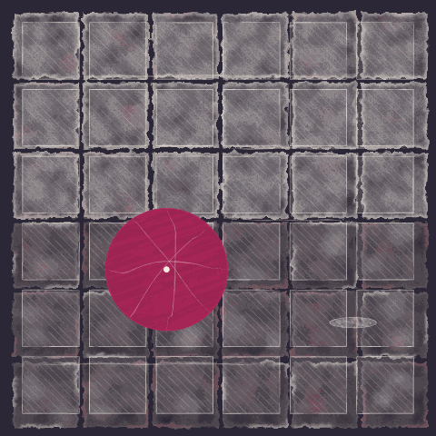
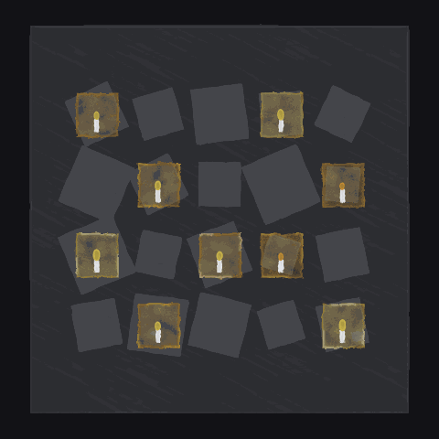
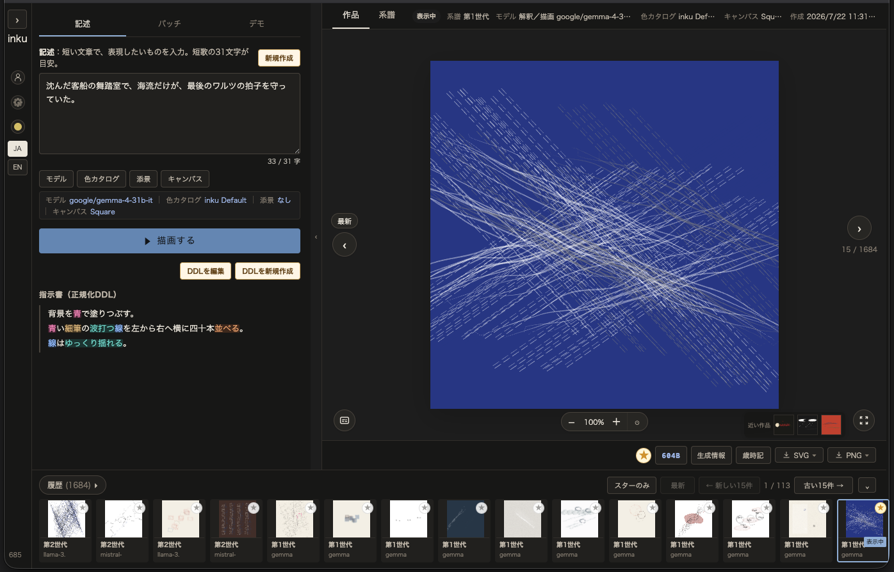

<p align="center">
  
</p>

<p align="center">
  <a href="README.md">English</a> ｜ <strong>日本語</strong>
</p>

# inku

**一文を、絵にする。**

inku は、文章や画像から、編集できるベクター画像（SVG）を生成するアプリケーションです。
LLM が出力するのは画像ではなく、**人が読める描画言語 DDL のコード**です。DDL は型付きコンパイラで検証され、Rust のレンダラーが SVG を出力します。同じ入力と seed からは、同じ SVG が再現されます。

<!-- TODO(作者): キービジュアルの画像。作品 c0e3251b-5f94-4cec-b752-bef70e99408d（親 74dbedfe、Build 1385・描画エンジン 96）の SVG を書き出して置く -->
<p align="center">
  
</p>

<p align="center"><sub>
入力：天つ風　雲の通ひ路　吹き閉ぢよ　をとめの姿　しばしとどめむ[古今和歌集・僧正遍昭・平安時代前期 9世紀]<br>
モデル GPT-6.1 Sol ・ 色カタログ Ink &amp; Season ・ seed 8569402127366273
</sub></p>

---

## 例：文章 → DDL → SVG

入力は、ふつうの文章です。

```
夕立のあと、濡れた石畳に、赤い傘がひとつ開いたまま残されていた。
```

LLM はこれを読み、DDL を書きます。

```
画面比1:1。
背景を黒で埋める。

「濡れた石畳」
画面の横0.02〜0.98、縦0.02〜0.98の範囲に、白・灰の順に段々に移して、幅0.15、高さ0.15の細かく揺れる水彩の薄い塗りの四角を36個敷き詰める。
画面の横0.04〜0.96、縦0.04〜0.96の範囲に、幅0.13、高さ0.13の白の鉛筆の細かい平行線の四角を36個敷き詰める。

「石の表面を覆う薄い水の光」
画面の横0.18、縦0.175から横0.76、縦0.175まで、白の水彩の薄い細い細かく揺れる線を1本引く。
画面の横0.52、縦0.34から横0.94、縦0.34まで、白の水彩の薄い細い細かく揺れる線を1本引く。
画面の横0.57、縦0.505から横0.79、縦0.505まで、白の水彩の薄い細い細かく揺れる線を1本引く。
画面の横0.08、縦0.835から横0.59、縦0.835まで、白の水彩の薄い細い細かく揺れる線を1本引く。
画面の横0.81、縦0.74の位置に、幅0.11、高さ0.025の白の水彩の薄い塗りの楕円を1個置く。

「赤い傘がひとつ開いたまま」
画面の横0.381966、縦0.618034の位置に、直径0.28の赤のガッシュの塗りの円を1個置く。
画面の横0.381966、縦0.478034から横0.381966、縦0.758034まで、白の水彩の薄いごく細い線を1本引く。
画面の横0.241966、縦0.618034から横0.521966、縦0.618034まで、白の水彩の薄いごく細い線を1本引く。
画面の横0.282971、縦0.519039から横0.480961、縦0.717029まで、白の水彩の薄いごく細い線を1本引く。
画面の横0.282971、縦0.717029から横0.480961、縦0.519039まで、白の水彩の薄いごく細い線を1本引く。
画面の横0.381966、縦0.618034の位置に、直径0.012の白のガッシュの塗りの円を1個置く。
```

DDL はコンパイラで JSON の中間表現（Score）になり、レンダラーが SVG を出力します。

<!-- TODO(作者): 作品 eabbd0d6-6187-477c-9a89-a81ec31d513d（親 db0716b4、Build 1385・描画エンジン 96）の SVG を書き出して置く -->
<p align="center">
  
</p>
<p align="center"><sub>モデル GPT-6.1 Sol ・ 色カタログ Dye &amp; Earth ・ seed 108540578245255</sub></p>

DDL は日本語または英語の短い文で、予備知識なしに読め、そのまま書き換えて再生成できます。「濡れた石畳」のような「」の行は図形のまとまりに付けたラベルで、描画には影響しません。

### モデルを替えると

同じ文章でも、DDL を書くモデルが替わると、読み方も絵も変わります。モデルの選択も、表現の変数のひとつです。

<!-- TODO(作者): 同じ入力の文を、モデルを替えて生成したアニメーション。1 コマ目は上の作品（GPT-6.1 Sol）。各コマにモデル名を入れる -->
<p align="center">
  
</p>

---

## 特徴

| | 一般的な画像生成 AI | inku |
|---|---|---|
| 出力 | ラスタ画像 | **SVG**（拡大しても劣化しない。印刷にも Web にも） |
| 生成の中身 | ブラックボックス | **DDL のコード**として読める。一行直して再生成できる |
| 再現性 | 同じプロンプトでも結果が変わる | **同じ Score と seed から同じ SVG** |
| LLM の役割 | 画像そのものを生成 | DDL を書くところまで。その先はコンパイラとレンダラーが決定的に処理する |
| 語彙 | 無制限 | 図形・画材・位置・関係などの**有限の語彙**。どの語が使えるかは辞書で引ける |
| 履歴 | 生成画像の一覧 | 編集と再生成の**派生ツリー**。どの版から何を変えたかが残る |

---

## 抽象から具象まで

inku は抽象画の生成から始まりましたが、いまは具体的なモチーフも描けます。

- **座標と寸法で書ける** — 「画面の横0.6、縦0.4の位置に、幅0.1、高さ0.3の…」のように、画面比で位置と大きさを指定できます。上の赤い傘の例がそれです
- **モチーフの語を足せる** — プラグインで語彙を追加できます。「水流」「海」「雨」「若葉」のような情景の語は、定義した絵をそのまま描きます。「星」のような物の語は、図形と同じように位置・数・大きさ・傾きを指定して置けます（`中心に、｛星｝を3個置く。`）。どちらも中身はコアの図形と画材の組み合わせです
- **構図を組める** — LLM が、絵画・デザイン・音楽の法則から構図を選び、モチーフの位置と大きさを決めてから DDL を書くこともできます
- **画像から始められる** — Vision 対応モデルが写真や絵を見て DDL を書きます。結果は編集できる DDL として残ります

<table><tr><td></td></tr></table>

プラグイン見本「水」の出力です（琳派の流水と日本画の波紋を参照）。→ [プラグインの作例](docs/plugins/README.ja.md)

一方で、「美しく」「悲しげに」のような評価や感情の語は、語彙に入れていません。DDL に書けるのは、見て確かめられること（形・画材・位置・動き・関係）だけです。何を表現するかは書き手が決めます。

---

## 誰のためのものか

- **イラスト・デザイン** — 文章からベクターのイラストを起こし、DDL を直して詰める。色はパレットの切り替えだけで差し替えられます
- **ジェネラティブアート／クリエイティブコーディング** — コードの代わりに文章で書くジェネラティブ作品。seed による揺らぎ、11 種の画材（鉛筆・水彩・油彩・エッチングなど）を描き分けるブラシエンジン、7 種の紙やキャンバスの質感、13 本のカラーパレット
- **言語処理系・コンパイラ** — 日英どちらでも書ける自然文の DSL。ソース位置を保持した型付きの意味表現、読めない句を推測で埋めず、診断付きでその句だけを除外するエラー回復。→ [SPEC.ja.md](SPEC.ja.md)
- **LLM アプリ／エージェント開発** — 非決定的な LLM と決定的なプログラムを交互に挟む構成。JSON Schema の構造化出力で LLM の出力を語彙の範囲に縛る設計。全 API を操作できる CLI。→ [アーキテクチャ](docs/architecture/README.ja.md)

---

## アーキテクチャ

```
  入力                       LLM（非決定的）
  ───────────────────────────────────────────────────────────────
  文章 ─┬─ 直接生成      文章を読み、DDL を書き、レンダリング結果を見て一度修正
        └─ 構造化生成    JSON Schema で縛った構造化出力から、DDL を機械的に生成
  画像 ─── Vision 対応モデルが画像を見て DDL を書く
  手書き ─ ユーザーが DDL を直接書く
                    │
                    ▼
  DDL               人が読める・編集できるソース。ここから先は決定的
                    │  型付きコンパイラ
                    │  （解釈できない句は LLM が補完案を出し、ユーザーが承認する）
                    ▼
  Score（JSON）      DB に保存される中間表現
                    │  レンダラー（seed による揺らぎ）
                    ▼
  SVG
```

**LLM が関わるのは DDL を書くところまでです。** DDL から先は常に決定的で、同じ Score・同じ seed・同じ描画条件からは同じ SVG が出ます。seed を変えると、線の震えや配置が少しずつ違う SVG になります。

**生成モードは二つあります。** Web の既定は直接生成（UI の表示は「言葉で描く」）です。LLM が位置と大きさの数値まで含めて DDL を書きます。コンパイラが「書いたとおりに描けない行」を理由付きで返すと、LLM は一度だけ書き直し、それでも残った行は除外して描画します。構造化生成（「型で描く」）では、LLM は語彙の enum だけで組んだ JSON を返し、DDL はそこから機械的に生成されます。以前は LLM に DDL を直接書かせていて、保存記録 150 件のうち 458 文中 193 文（42%）が語彙や文法の外にありコンパイルできませんでした。構造化生成ではこれがゼロになります。

解釈に使うモデルは選べます（OpenAI・Anthropic・Gemini・NVIDIA・ローカルの Ollama・本人の ChatGPT プラン）。モデルが変わると、出力は大きく変わります。

コンパイラ、Score、レンダラー、生成の状態遷移は **Rust の共有コア**にまとまっていて、サーバー（Python）、Android（Kotlin）、macOS（Swift）が同じコアを呼びます。同じ DDL は、どの環境でも同じ結果になります。

→ Score の実物と各層の詳細は [しくみの詳細](docs/guide/how-it-works.ja.md)、実装の境界は [アーキテクチャ文書](docs/architecture/README.ja.md) にあります。

---

## DDL

```
背景を青で埋める。
和紙。
白いガッシュの線を横に四十本並べる。
線はゆるやかに揺れる。
右端に赤い鉛筆の線を1本引く。
```

設計方針：

1. **人が読める** — 自然言語とプログラミング言語の中間に置く
2. **見て確かめられる語だけを持つ** — 評価語・感情語は持たない
3. **解像度に依存しない** — 位置と大きさは画面に対する比で書き、ピクセル値を持たない。作ったときの縦横比は「画面比1:1。」で宣言でき、別の比のキャンバスにも描ける
4. **出力は静止画**
5. **ランダム性を仕様として扱う** — LLM の解釈と、レンダラーの seed による揺らぎを許容する
6. **自由文は直接実行しない** — いったん DDL に変換し、型付きコンパイラで検証する
7. **レンダラーは後方互換を持たない** — 下の「レンダラーのバージョン方針」

### 一行ずつ積み上がる

DDL は上の行から順に描かれます。下のアニメーションは、DDL の行を一つ足すごとに描いた途中の絵です。左に DDL、右に絵を並べ、いま描いている行を示します。

```
清水へ　祇園をよぎる　桜月夜　こよひ逢ふ人　みなうつくしき[みだれ髪・与謝野晶子・明治34年 1901年]
```

<!-- TODO(作者): 作品 ddb757dd-e40c-4245-9931-4b294172a416（親 55f5278a、Build 1385・描画エンジン 96）の DDL を一行ずつ足したアニメーション。左に DDL（いまの行を強調）、右に SVG -->
<p align="center">
  
</p>
<p align="center"><sub>モデル GPT-6.1 Sol ・ 色カタログ Lantern &amp; Dew ・ seed 754190306630586</sub></p>

最後の絵は、紺の地を白い細い線が左下から右上へ斜めに渡り、横にも一本走ります。線の上に大きさの違う白い円が四つ並び、横の線の周りに小さな円の粒が群れて散ります。歌の「みなうつくしき」に当たる行は、DDL にありません。評価の語は DDL に書けないからです。

<details>
<summary>この絵の DDL（18 行）</summary>

```
画面比1:1。
背景を青で埋める。
画面の横0.118、縦0.882から横0.882、縦0.118まで、白のガッシュの細い線を1本引く。
画面の横0.06、縦0.37から横0.94、縦0.296666まで、白のガッシュの細かく揺れる線を1本引く。
画面の横0.12、縦0.365から横0.25、縦0.26まで、白のガッシュの細かく揺れる細い線を1本引く。
画面の横0.56、縦0.328333から横0.83、縦0.406666まで、白のガッシュの細かく揺れる細い線を1本引く。
画面の横0.05〜0.23、縦0.26〜0.406666の範囲に、中心から外へ薄れさせて、半径0.009の白のガッシュの塗りの円を18個散らす。
画面の横0.44〜0.95、縦0.26〜0.406666の範囲に、中心から外へ薄れさせて、半径0.009の白のガッシュの塗りの円を38個散らす。
画面の横0.333333、縦0.333333の位置に、直径0.095の白のガッシュの細かく揺れる塗りの円を1個置く。
画面の横0.686371、縦0.313629の位置に、幅0.0573、高さ0.061884の白のガッシュの細かく揺れる塗りの楕円を1個置く。
画面の横0.703561、縦0.296439の位置に、直径0.022156の白のガッシュの細かく揺れる薄い塗りの円を1個置く。
画面の横0.703561、縦0.298561の位置に、弦長0.008、矢高0.002の白のガッシュの細い弧を1本引く。
画面の横0.464128、縦0.535872の位置に、幅0.092709、高さ0.100126の白のガッシュの細かく揺れる塗りの楕円を1個置く。
画面の横0.491941、縦0.508059の位置に、直径0.035848の白のガッシュの細かく揺れる薄い塗りの円を1個置く。
画面の横0.491941、縦0.511492の位置に、弦長0.012943、矢高0.003236の白のガッシュの細い弧を1本引く。
画面の横0.2405、縦0.7595の位置に、幅0.15、高さ0.162の白のガッシュの細かく揺れる塗りの楕円を1個置く。
画面の横0.2855、縦0.7145の位置に、直径0.058の白のガッシュの細かく揺れる薄い塗りの円を1個置く。
画面の横0.2855、縦0.720056の位置に、弦長0.020942、矢高0.005236の白のガッシュの細い弧を1本引く。
```

</details>

### 画材の語を替える

DDL の画材の語を一つ替えると、同じ形が別の描き方になります。下のアニメーションは、DDL の画材の語（ガッシュ 23 か所、水彩 9 か所）を、コマごとにすべて同じ一つの画材に替えて描き直したものです。画材の語のほかは同じ DDL で、LLM は呼びません。

```
停電の夜、団地の窓にひとつずつ蝋燭が灯り、闇に不揃いな格子が浮かんだ。
```

<!-- TODO(作者): 作品 2e9ccaa4-7c1c-4657-be5a-931275cf147f（親 ae906b66、Build 1385・描画エンジン 96）の DDL の画材の語 32 か所を、コマごとに 11 の画材のどれか一つに揃えて描いたアニメーション。各コマに画材の名を入れる -->
<p align="center">
  
</p>
<p align="center"><sub>モデル GPT-6.1 Sol ・ 色カタログ Lantern &amp; Dew ・ seed 5755392423451477</sub></p>

元の絵は、黒い地に灰の大きな四角が団地の壁として置かれ、その上に灰の窓の四角が五列四段、少しずつ傾いて並びます。そのうち十の窓が橙や黄にともり、中に白い蝋燭と炎がひとつずつ立ちます。

<details>
<summary>元の DDL（40 行）</summary>

```
画面比1:1。
背景を黒で埋める。

「団地」
画面の横0.5、縦0.5の位置に、幅0.86、高さ0.88の灰のガッシュの薄い塗りの四角を1個置く。

「団地の窓」
画面の横0.22、縦0.26から横0.78、縦0.26まで、幅0.1、高さ0.105の灰のガッシュの塗りの細かく揺れる四角を5個並べる。
画面の横0.22、縦0.42から横0.78、縦0.42まで、幅0.1、高さ0.105の灰のガッシュの塗りの細かく揺れる四角を5個並べる。
画面の横0.22、縦0.58から横0.78、縦0.58まで、幅0.1、高さ0.105の灰のガッシュの塗りの細かく揺れる四角を5個並べる。
画面の横0.22、縦0.74から横0.78、縦0.74まで、幅0.1、高さ0.105の灰のガッシュの塗りの細かく揺れる四角を5個並べる。
画面の横0.22、縦0.26の位置に、幅0.096、高さ0.101の橙の水彩の薄い塗りの細かく揺れる四角を1個置く。
画面の横0.64、縦0.26の位置に、幅0.096、高さ0.101の黄の水彩の薄い塗りの細かく揺れる四角を1個置く。
画面の横0.36、縦0.42の位置に、幅0.096、高さ0.101の橙の水彩の薄い塗りの細かく揺れる四角を1個置く。
画面の横0.78、縦0.42の位置に、幅0.096、高さ0.101の橙の水彩の薄い塗りの細かく揺れる四角を1個置く。
画面の横0.22、縦0.58の位置に、幅0.096、高さ0.101の黄の水彩の薄い塗りの細かく揺れる四角を1個置く。
画面の横0.5、縦0.58の位置に、幅0.096、高さ0.101の橙の水彩の薄い塗りの細かく揺れる四角を1個置く。
画面の横0.64、縦0.58の位置に、幅0.096、高さ0.101の橙の水彩の薄い塗りの細かく揺れる四角を1個置く。
画面の横0.36、縦0.74の位置に、幅0.096、高さ0.101の橙の水彩の薄い塗りの細かく揺れる四角を1個置く。
画面の横0.78、縦0.74の位置に、幅0.096、高さ0.101の黄の水彩の薄い塗りの細かく揺れる四角を1個置く。

「ひとつずつ蝋燭が灯り」
画面の横0.22、縦0.286の位置に、幅0.008、高さ0.027の白のガッシュの塗りの細かく揺れる四角を1個置く。
画面の横0.22、縦0.263の位置に、幅0.011、高さ0.019の黄のガッシュの塗りの細かく揺れる楕円を1個置く。
画面の横0.64、縦0.286の位置に、幅0.008、高さ0.027の白のガッシュの塗りの細かく揺れる四角を1個置く。
画面の横0.64、縦0.261の位置に、幅0.013、高さ0.023の黄のガッシュの塗りの細かく揺れる楕円を1個置く。
画面の横0.36、縦0.446の位置に、幅0.008、高さ0.027の白のガッシュの塗りの細かく揺れる四角を1個置く。
画面の横0.36、縦0.423の位置に、幅0.011、高さ0.019の黄のガッシュの塗りの細かく揺れる楕円を1個置く。
画面の横0.78、縦0.446の位置に、幅0.008、高さ0.027の白のガッシュの塗りの細かく揺れる四角を1個置く。
画面の横0.78、縦0.425の位置に、幅0.009、高さ0.015の橙のガッシュの塗りの細かく揺れる楕円を1個置く。
画面の横0.22、縦0.606の位置に、幅0.008、高さ0.027の白のガッシュの塗りの細かく揺れる四角を1個置く。
画面の横0.22、縦0.581の位置に、幅0.013、高さ0.023の黄のガッシュの塗りの細かく揺れる楕円を1個置く。
画面の横0.5、縦0.606の位置に、幅0.008、高さ0.027の白のガッシュの塗りの細かく揺れる四角を1個置く。
画面の横0.5、縦0.583の位置に、幅0.011、高さ0.019の黄のガッシュの塗りの細かく揺れる楕円を1個置く。
画面の横0.64、縦0.606の位置に、幅0.008、高さ0.027の白のガッシュの塗りの細かく揺れる四角を1個置く。
画面の横0.64、縦0.585の位置に、幅0.009、高さ0.015の橙のガッシュの塗りの細かく揺れる楕円を1個置く。
画面の横0.36、縦0.766の位置に、幅0.008、高さ0.027の白のガッシュの塗りの細かく揺れる四角を1個置く。
画面の横0.36、縦0.743の位置に、幅0.011、高さ0.019の黄のガッシュの塗りの細かく揺れる楕円を1個置く。
画面の横0.78、縦0.766の位置に、幅0.008、高さ0.027の白のガッシュの塗りの細かく揺れる四角を1個置く。
画面の横0.78、縦0.741の位置に、幅0.013、高さ0.023の黄のガッシュの塗りの細かく揺れる楕円を1個置く。
```

</details>

### 語彙

語彙辞書（アプリでの名前は **歳時記 / Saijiki**）は有限です。アプリでは語を選ぶと、描画の見本と効き方が表示されるので、語彙を覚えなくても書けます。

<details>
<summary>語彙の一覧（v3、16 分類）</summary>

| 分類 | 英語 | 語彙 |
|---|---|---|
| 図形 | forms | 円、楕円、三角、四角、線、弧、自由線、点、雲形 |
| 角度 | angles | 水平、垂直、斜め、右上がり、右下がり、回転 |
| 画材 | touches | 銀筆、鉛筆、ペン、チョーク、オイルパステル、ガッシュ、水彩、油彩、ペインティングナイフ、エッチング、コンピュータ |
| 線種 | continuity | 実線、破線、点線、一点鎖線 |
| 面の質感 | surfaces | 空、塗り、刷き、刷毛目、粒、点描、平行線、交差線、アクアチント |
| 濃さ | handling | 濃い、程よい、薄い |
| 質感の細かさ | fineness | 細かい、粗い、密な、疎な |
| 下塗り | underlayer | 下塗り |
| 紙・キャンバス | grounds | 紙、和紙、薄墨地、木炭地、カンバス、画用紙、メゾチント |
| 色 | colors | 白、黒、青、赤、緑、灰、黄、橙、紫 |
| 揺らぎ | movements | 細かく、大きく、ゆるやかに、小刻みに、揺れる、波打つ、にじみ |
| 位置 | places | 上、下、中心、左端、右端、上端、下端、始点、終点、途中、隅 |
| 動作 | motions | 置く、並べる、引く、散らす、埋める、敷き詰める |
| 順序 | order | 交互に、順に |
| 比率 | proportions | 縦長、横長、全幅、半幅、半円、上弦、下弦、三日月 |
| 関係 | relations | 沿う、触れない、切る、間に、触れる、つながる、載る、中に、重なる、横切る、鏡写し |

色名は、選んだカラーパレットの色に置き換えて描かれます。語彙の正本は `core/crates/inku-ddl/assets/saijiki-v3.json` で、`inku-cli reference --md` で一覧を生成できます。プラグインの語（`｛若葉｝` など）はコアの語の組み合わせに展開されるだけで、コアの語彙は変えません。→ [PLUGIN.ja.md](PLUGIN.ja.md)

</details>

---

## 編集と派生履歴

<table><tr><td></td></tr></table>

最初の出力は、たたき台です。DDL を直す、パレットを替える、配置を引き直す。候補から一つ選ぶと、それが次の編集の親になります。親子関係は**派生ツリー**として保存されます。

| 操作 | 変わるもの | 変わらないもの | LLM |
|---|---|---|---|
| DDL を編集 | 編集した行 | ほかのすべて | 呼ばない（解釈できない句の補完案を求めるときだけ呼ぶ） |
| パレットを替える | 色の割り当て | DDL・配置・揺らぎ | 呼ばない |
| 配置を引き直す | 傾きの角度、隅の位置 | DDL、画材・色・数 | 呼ばない |

どの操作も、ユーザーが明示的に行ったときだけ働きます。反復を AI に任せる自動モードもあり、その間の世代もすべて派生ツリーに残ります。→ [編集と派生の詳細](docs/guide/revision.ja.md)

---

## レンダラーのバージョン方針

レンダラーは過去のバージョンを持ちません。古い Score も最新のレンダラーで描けますが、結果は当時と変わります。後方互換のための分岐は持ちません。

その代わり、生成した SVG はそのまま保存されるので、当時の出力はいつでも見られます。再レンダリングすると、最新のレンダラーによる新しい版として保存されます。→ [レンダラーの版史](docs/spec/render-engine-history.ja.md)

---

## はじめる

| 使い方 | 手順 |
|---|---|
| **Mac で、自分の ChatGPT プランを使う**（シングルユーザー） | [Docker Desktop で始める](docs/guide/docker-desktop.ja.md) |
| **リリースイメージをサーバーで動かす**（API キー、マルチユーザー） | [`deploy/README.md`](deploy/README.md) |
| **macOS アプリ**（サーバー不要、Universal、macOS 14 以降） | [apple/README.ja.md](apple/README.ja.md) |
| **Android アプリ**（サーバー不要、Android 15 以降・arm64） | [APK のインストール](docs/guide/android-apk.ja.md) |
| **ソースから動かす** | [SETUP.ja.md](SETUP.ja.md) |

いちばん手軽なのは、Docker Desktop と自分の ChatGPT プランを使う方法です。

```sh
git clone https://github.com/oikawas/inku-lang.git && cd inku-lang
printf 'INKU_CHATGPT_PLAN_ENABLED=1\nINKU_CHATGPT_SELF_HOSTED=1\n' > .env
docker compose up -d --build   # → http://localhost:5173
```

起動後、ChatGPT の認証をコンテナに取り込み、モデルを選びます（[手順](docs/guide/docker-desktop.ja.md)）。

---

## 実装の状況

| | 状況 |
|---|---|
| **Web**（SvelteKit + FastAPI） | 稼働中。文章・画像・バッチ生成・派生ツリー。直接生成と構造化生成を選べる |
| **CLI**（`inku-cli`） | 公開 API だけで、GUI でできることをすべて実行できる。AI エージェントからの操作を想定 |
| **Android** | 稼働中（[`android/VERSION`](android/VERSION)）。端末内で共有コアを呼んで生成。カメラ入力あり |
| **macOS** | 配布中（[`apple/VERSION`](apple/VERSION)）。Mac の中で共有コアを呼んで生成。署名・公証済みの `.dmg` |
| **共有コア**（Rust） | コンパイラ・Score・レンダラー・生成の状態遷移。上のすべてが同じコアを使う |

DDL は日本語と英語に対応し、作者が維持しています。Score の JSON は言語に依存しませんが、DDL は言語ごとの調整が要るため、ほかの言語を足す仕組みはまだありません。ほかの言語での貢献を歓迎します。

---

## 背景

2026年4月2日、東京都現代美術館の「ソル・ルウィット オープン・ストラクチャー」展で構想しました。LeWitt の壁画は、作家が書いた指示書をもとに、職人が壁に描きます。その職人の役を LLM が担えるのではないか、というのが出発点です。

| 着想の元 | inku に取り入れたこと |
|---|---|
| **Sol LeWitt の指示書** | 書かれた記述そのものを作品とみなす。記述する人と描く手を分ける |
| **盆栽** | 語彙を絞ったほうが、よい表現が生まれる |
| **短歌** | 短く、多くの意味を含む文章を入力に想定する |

---

## ドキュメント

- [PROJECT_CONTEXT.ja.md](PROJECT_CONTEXT.ja.md) — 開発者と AI はまずここから
- [SPEC.ja.md](SPEC.ja.md) — 日本語の正本仕様 ／ [SPEC.md](SPEC.md) — 英語の公開仕様
- [しくみの詳細](docs/guide/how-it-works.ja.md) ・ [編集と派生の詳細](docs/guide/revision.ja.md) ・ [ギャラリー](docs/guide/gallery.ja.md)
- [アーキテクチャ文書](docs/architecture/README.ja.md) ・ [PLUGIN.ja.md](PLUGIN.ja.md) ・ [SETUP.ja.md](SETUP.ja.md)
- [CHANGELOG.ja.md](CHANGELOG.ja.md)

## ライセンス

MIT。[LICENSE](LICENSE) を参照してください。
