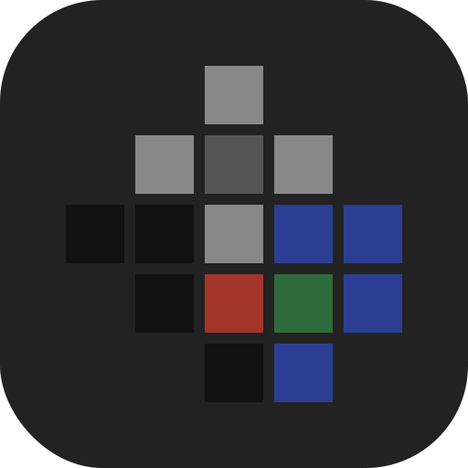
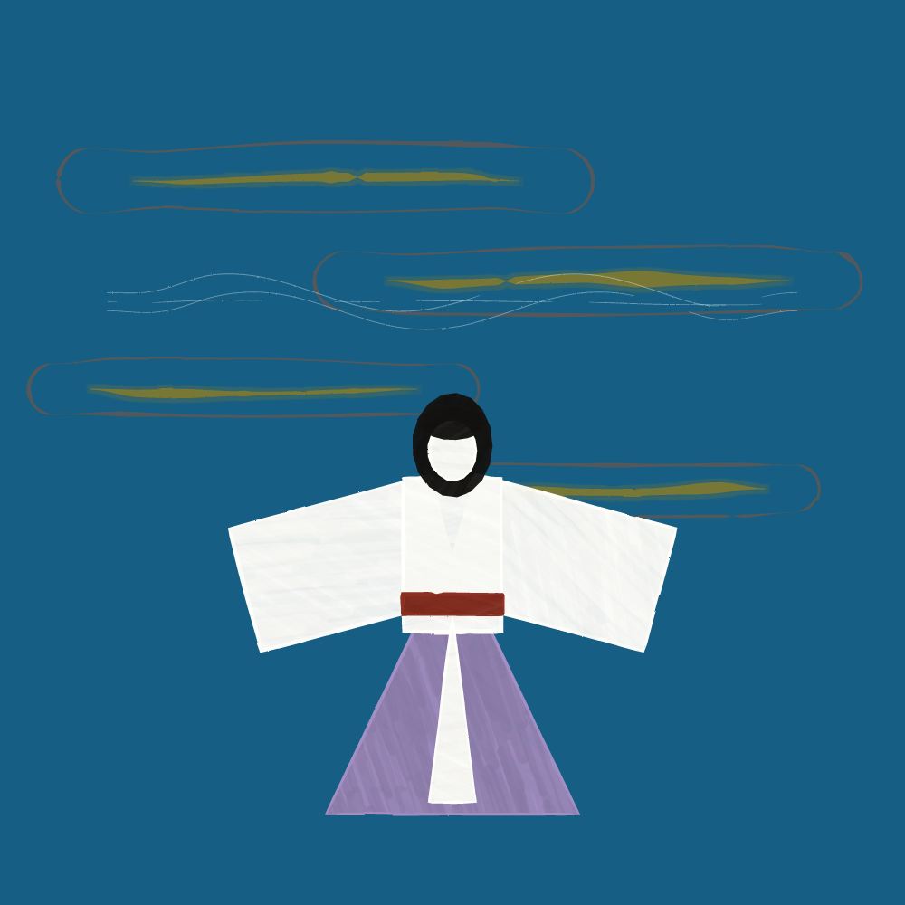
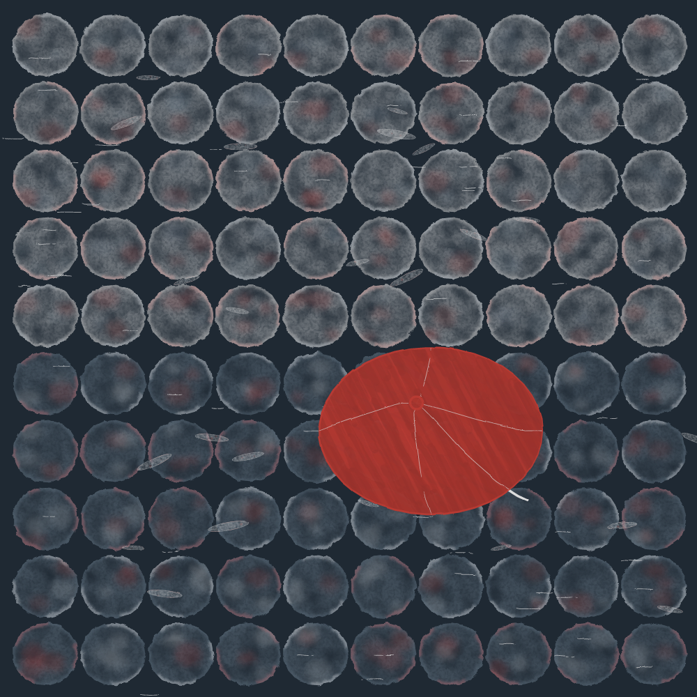
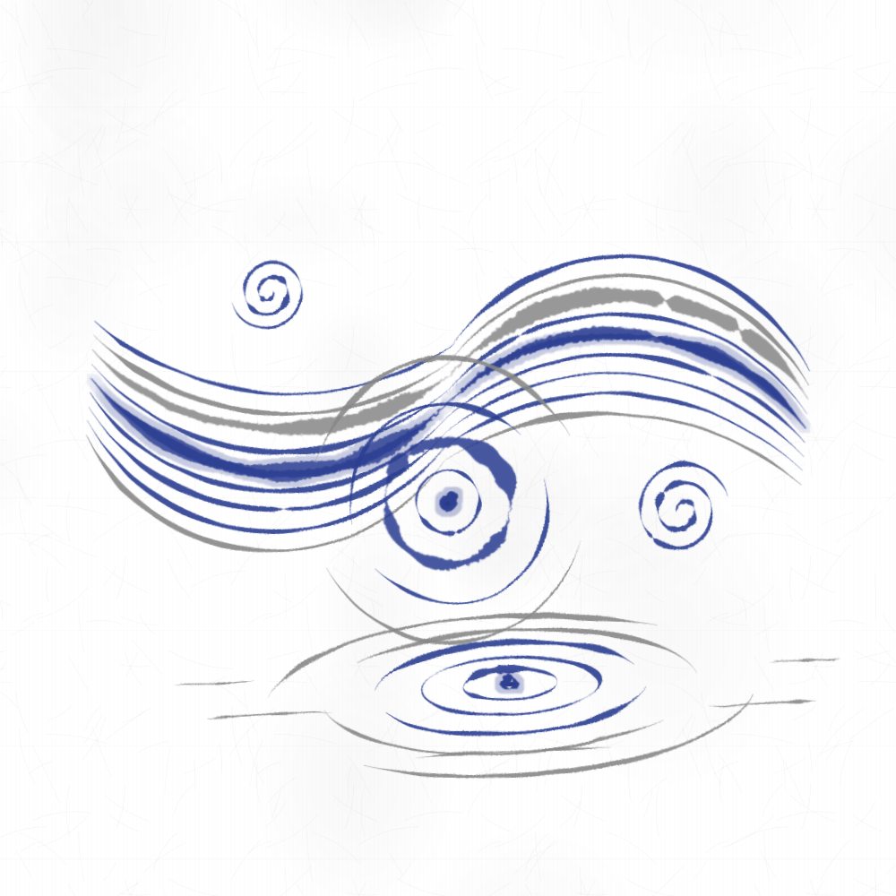
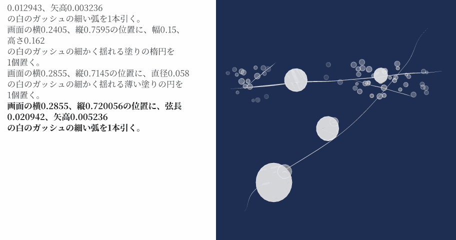
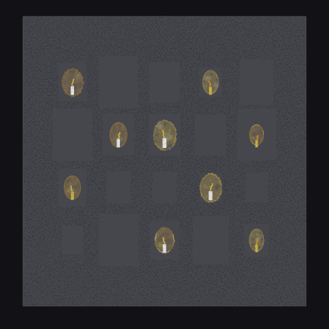
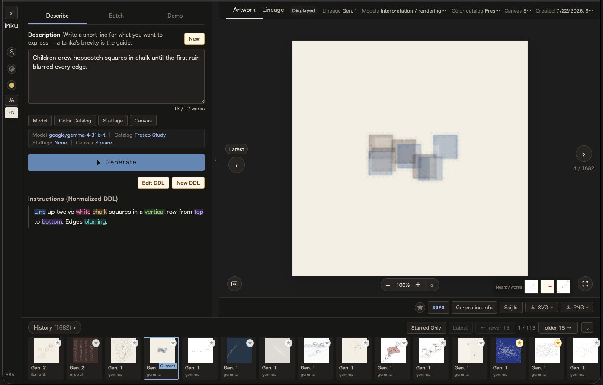

<p align="center">
  
</p>

<p align="center">
  <strong>English</strong> ｜ <a href="README.ja.md">日本語</a>
</p>

# inku

**One sentence, one picture.**

inku is an application that turns text or images into editable vector graphics (SVG).
What the LLM outputs is not an image but **code in DDL, a drawing language people can read**. A typed compiler checks the DDL, and a Rust renderer outputs the SVG. The same input and seed reproduce the same SVG.

<!-- Key visual: the saved SVG of work c0e3251b-5f94-4cec-b752-bef70e99408d (parent 74dbedfe, Build 1385, render engine 96), rasterized by the core's svg_to_png to a 1000×1000 PNG (I-030: large pictures in the body are still PNGs) -->
<p align="center">
  
</p>

<p align="center"><sub>
Input: 天つ風　雲の通ひ路　吹き閉ぢよ　をとめの姿　しばしとどめむ[古今和歌集・僧正遍昭・平安時代前期 9世紀]<br>
(A waka by Archbishop Henjō, from the Kokin Wakashū, 10th century: "Winds of heaven, blow shut the paths through the clouds, and keep the maidens' forms here a little longer." Translation for this README.)<br>
Model GPT-6.1 Sol · color catalog Ink &amp; Season · seed 8569402127366273
</sub></p>

---

## Example: text → DDL → SVG

The input is ordinary text.

```
After the summer rain, a lone red umbrella lay open upon the glistening cobblestones.
```

The LLM reads it and writes DDL.

```
Aspect ratio 1:1.
fill the background with black.

"glistening cobblestones"
Tile 100 watercolor flat ellipses width 0.094, height 0.09 in the range horizontal 0.015 to 0.985, vertical 0.015 to 0.985, shifting through white and gray in order.

"Water leaves a sheen across the paving beneath and around the umbrella."
scatter 58 white pencil thin lines length 0.026 in the range horizontal 0.04 to 0.96, vertical 0.04 to 0.96.
scatter 25 white watercolor faint flat ellipses width 0.045, height 0.009 in the range horizontal 0.06 to 0.94, vertical 0.08 to 0.94.

"a lone red umbrella lay open"
draw one white thick line from horizontal 0.638034, vertical 0.638034 to horizontal 0.758034, vertical 0.718034.
place one red gouache flat ellipse width 0.32, height 0.24 at horizontal 0.618034, vertical 0.618034.
draw one white pencil thin line from horizontal 0.598034, vertical 0.578034 to horizontal 0.458034, vertical 0.618034.
draw one white pencil thin line from horizontal 0.598034, vertical 0.578034 to horizontal 0.618034, vertical 0.498034.
draw one white pencil thin line from horizontal 0.598034, vertical 0.578034 to horizontal 0.778034, vertical 0.618034.
draw one white pencil thin line from horizontal 0.598034, vertical 0.578034 to horizontal 0.618034, vertical 0.738034.
draw one white pencil thin line from horizontal 0.598034, vertical 0.578034 to horizontal 0.731034, vertical 0.702034.
place one red gouache flat circle diameter 0.018 at horizontal 0.598034, vertical 0.578034.
```

The compiler turns the DDL into a JSON intermediate representation (the Score), and the renderer outputs the SVG.

<!-- The saved SVG of work 86a9a876-1eed-4a71-8955-0c021ed54ae5 (parent 07964592, Build 1385, render engine 96), rasterized to a 1000×1000 PNG -->
<p align="center">
  
</p>
<p align="center"><sub>Model GPT-6.1 Sol · color catalog Weathered Heritage · seed 3886759235775369</sub></p>

DDL is written as short sentences in English or Japanese. It can be read without prior knowledge, and edited directly and drawn again. A quoted line such as `"glistening cobblestones"` is a label on a group of shapes; it does not change the drawing.

### Change the model

The same text, read by a different model, gives a different reading and a different picture. The choice of model is one more variable of expression.

<!-- Work 86a9a876 (GPT-6.1 Sol) and its children 009ea32d, 66dc1105, 3de5c74d, dfeddfa2, drawn with "Change the model" in the work edit menu, exported with the web's "Transition animation" (GIF, 480×480, cut, 1.0 s each, endless loop, 0.17 MiB. I-030) -->
<p align="center">
  
</p>
<p align="center"><sub>Frames in order: GPT-6.1 Sol → GPT-6.1 Terra → Gemini 3.8 Flash → Claude Sonnet 5.5 → Claude Opus 5.5</sub></p>

---

## Features

| | Typical image-generation AI | inku |
|---|---|---|
| Output | Raster image | **SVG** (no loss when enlarged; for print and for the web) |
| What is generated | A black box | **DDL code** you can read. Fix one line and draw again |
| Reproducibility | The same request can give a different result | **The same Score and seed give the same SVG** |
| Role of the LLM | Produces the image itself | Writes the DDL, and no more. From there on, the compiler and the renderer work deterministically |
| Vocabulary | Unlimited | A **finite vocabulary** of shapes, tools, positions, relations, and so on. Any word can be looked up in the dictionary |
| History | A list of output images | A **derivation tree** of edits and redraws. It keeps which version was changed and how |

---

## From abstract to figurative

inku began as a generator of abstract pictures. It can now draw concrete motifs as well.

- **Position and size in coordinates** — as in "at horizontal 0.6, vertical 0.4, width 0.1, height 0.3", position and size are given as fractions of the canvas. The red umbrella above is written this way
- **Motif words you can add** — plugins add words to the vocabulary. Scene words, for a stream, the sea, rain, or young leaves, draw their defined picture as it is. Object words, such as one for stars, can be placed like shapes, with position, count, size, and tilt. A plugin word is called by its name in braces, as in `{stars}.` Both kinds are made of the core shapes and tools
- **Composition** — the LLM can also choose a composition from principles of painting, design, and music, decide the position and size of the motifs, and then write the DDL
- **Starting from an image** — a model with Vision looks at a photo or a picture and writes DDL. The result remains as editable DDL

<table><tr><td></td></tr></table>

This is the output of the plugin sample "water" (after the flowing-water motif of the Rinpa school and the ripples of Japanese painting). → [Plugin examples](docs/plugins/README.md)

Words of judgment or feeling, such as "beautifully" or "sadly", are not in the vocabulary. DDL can say only what can be checked by looking: shape, tool, position, motion, and relation. What to express is up to the writer.

---

## Who it is for

- **Illustration and design** — draft vector illustrations from text and refine them by editing the DDL. Colors can be swapped just by changing the color catalog
- **Generative art and creative coding** — generative works written in sentences instead of code. Seed-driven sway, a brush engine that draws 11 tools (pencil, watercolor, oil paint, etching, and more), 7 paper and canvas grounds, and 13 color catalogs
- **Language implementation and compilers** — a natural-language DSL that can be written in English or Japanese. A typed semantic representation that keeps source positions, and error recovery that does not guess at a clause it cannot read but drops only that clause, with a diagnostic. → [SPEC.md](SPEC.md)
- **LLM applications and agent development** — a design that alternates nondeterministic LLM steps with deterministic programs. Structured output under a JSON Schema keeps the LLM's output inside the vocabulary. A CLI that can drive every API. → [Architecture](docs/architecture/README.md)
- **Poets and readers of poetry** — give a poem as it is, and see what its words become in the picture and what does not survive. Words of feeling and judgment cannot be written in DDL, so what remains is what can be checked by looking: shape, color, and position. The key visual and the "One line at a time" example on this page start from classical Japanese waka and tanka

---

## Architecture

```
  Input                      LLM (nondeterministic)
  ───────────────────────────────────────────────────────────────
  Text ─┬─ Direct          reads the text, writes DDL, looks at the rendered result, and fixes it once
        └─ Structured      DDL is built mechanically from structured output bound by a JSON Schema
  Image ── a model with Vision looks at the image and writes DDL
  By hand  the user writes DDL directly
                    │
                    ▼
  DDL               readable, editable source. From here on, everything is deterministic
                    │  typed compiler
                    │  (for a clause it cannot interpret, the LLM proposes a completion and the user approves it)
                    ▼
  Score (JSON)      the intermediate representation stored in the DB
                    │  renderer (seed-driven sway)
                    ▼
  SVG
```

**The LLM takes part only up to writing the DDL.** From DDL on, everything is deterministic: the same Score, the same seed, and the same drawing conditions give the same SVG. A different seed gives an SVG whose line tremor and placement differ a little.

**There are two modes.** The web default is direct (shown in the UI as "Draw with words"). The LLM writes the DDL, including the numbers for position and size. When the compiler returns lines that cannot be drawn as written, with reasons, the LLM rewrites once, and any lines still left are dropped before drawing. In structured mode ("Draw with types"), the LLM returns JSON built only from vocabulary enums, and the DDL is generated from it mechanically. Earlier, the LLM wrote DDL directly; in 150 saved records, 193 of 458 sentences (42%) fell outside the vocabulary or grammar and could not be compiled. Structured mode brings this to zero.

The interpreting model can be chosen (OpenAI, Anthropic, Gemini, NVIDIA, local Ollama, or your own ChatGPT plan). A different model changes the output a great deal.

The compiler, the Score, the renderer, and the state machine of the drawing pipeline live in a **shared Rust core**. The server (Python), Android (Kotlin), and macOS (Swift) all call the same core, so the same DDL gives the same result everywhere.

→ The real Score and the detail of each layer are in [How it works](docs/guide/how-it-works.md); the implementation boundaries are in the [architecture documents](docs/architecture/README.md).

---

## DDL

```
"a lone red umbrella lay open"
draw one white thick line from horizontal 0.638034, vertical 0.638034 to horizontal 0.758034, vertical 0.718034.
place one red gouache flat ellipse width 0.32, height 0.24 at horizontal 0.618034, vertical 0.618034.
```

(The start of one group in the DDL the model wrote for the red umbrella above, as written.)

Design principles:

1. **Readable by people** — placed between natural language and programming languages
2. **Only words that can be checked by looking** — no words of judgment or feeling
3. **Independent of resolution** — position and size are fractions of the canvas, never pixels. The aspect ratio the work was made for can be declared with "Aspect ratio 1:1.", and the work can still be drawn on a canvas of another ratio
4. **The output is a still image**
5. **Randomness is part of the specification** — the LLM's interpretation and the renderer's seed-driven sway are both allowed
6. **Free text is never run directly** — it is first turned into DDL and checked by a typed compiler
7. **The renderer keeps no backward compatibility** — see "Renderer versions" below

### One line at a time

DDL is drawn from the top line down. The animation below shows the picture after each added line of DDL: the DDL on the left, the picture on the right, with the current line marked.

```
清水へ　祇園をよぎる　桜月夜　こよひ逢ふ人　みなうつくしき[みだれ髪・与謝野晶子・明治34年 1901年]
```

(A tanka by Yosano Akiko, from *Midaregami*, 1901: "To Kiyomizu, crossing Gion on a night of cherry blossoms under the moon — everyone I meet tonight is beautiful." Translation for this README.)

<!-- TODO(author): export work ddb757dd-e40c-4245-9931-4b294172a416 (parent 55f5278a, Build 1385, render engine 96) with the line-by-line animation (after the rework). DDL on the left (current line highlighted), the picture on the right. GIF. Under I-030 the first frame is the finished picture. Size and hold are decided after the rework -->
<p align="center">
  
</p>
<p align="center"><sub>Model GPT-6.1 Sol · color catalog Lantern &amp; Dew · seed 754190306630586</sub></p>

In the last picture, a thin white line crosses the navy ground from lower left to upper right, and another runs across it. Four white circles of different sizes sit along the lines, and clusters of small circles gather around the horizontal line. No line of the DDL corresponds to "everyone … is beautiful": DDL has no words of judgment.

The poem is in Japanese, so the model wrote the DDL in Japanese.

<details>
<summary>The DDL of this picture (18 lines, Japanese)</summary>

```
画面比1:1。
背景を青で埋める。
画面の横0.118、縦0.882から横0.882、縦0.118まで、白のガッシュの細い線を1本引く。
画面の横0.06、縦0.37から横0.94、縦0.296666まで、白のガッシュの細かく揺れる線を1本引く。
画面の横0.12、縦0.365から横0.25、縦0.26まで、白のガッシュの細かく揺れる細い線を1本引く。
画面の横0.56、縦0.328333から横0.83、縦0.406666まで、白のガッシュの細かく揺れる細い線を1本引く。
画面の横0.05〜0.23、縦0.26〜0.406666の範囲に、中心から外へ薄れさせて、半径0.009の白のガッシュの塗りの円を18個散らす。
画面の横0.44〜0.95、縦0.26〜0.406666の範囲に、中心から外へ薄れさせて、半径0.009の白のガッシュの塗りの円を38個散らす。
画面の横0.333333、縦0.333333の位置に、直径0.095の白のガッシュの細かく揺れる塗りの円を1個置く。
画面の横0.686371、縦0.313629の位置に、幅0.0573、高さ0.061884の白のガッシュの細かく揺れる塗りの楕円を1個置く。
画面の横0.703561、縦0.296439の位置に、直径0.022156の白のガッシュの細かく揺れる薄い塗りの円を1個置く。
画面の横0.703561、縦0.298561の位置に、弦長0.008、矢高0.002の白のガッシュの細い弧を1本引く。
画面の横0.464128、縦0.535872の位置に、幅0.092709、高さ0.100126の白のガッシュの細かく揺れる塗りの楕円を1個置く。
画面の横0.491941、縦0.508059の位置に、直径0.035848の白のガッシュの細かく揺れる薄い塗りの円を1個置く。
画面の横0.491941、縦0.511492の位置に、弦長0.012943、矢高0.003236の白のガッシュの細い弧を1本引く。
画面の横0.2405、縦0.7595の位置に、幅0.15、高さ0.162の白のガッシュの細かく揺れる塗りの楕円を1個置く。
画面の横0.2855、縦0.7145の位置に、直径0.058の白のガッシュの細かく揺れる薄い塗りの円を1個置く。
画面の横0.2855、縦0.720056の位置に、弦長0.020942、矢高0.005236の白のガッシュの細い弧を1本引く。
```

</details>

### Change the tool

Change one tool word in the DDL, and the same shapes are drawn another way. In the animation below, every drawing sentence of the DDL is set to the same single tool, one tool per frame. Apart from the tool, the DDL is the same, and the LLM is not called.

```
On the night of the blackout, candles flickered to life in the apartment windows, one by one, until an uneven grid of light emerged from the darkness.
```

<!-- Work 763e2b5a and its children 506cc532, e5abfbb4, ff141585, 2bf6d565, a8715026, drawn with "Change the touches" (Same tool for every sentence) in the work edit menu, exported with the web's "Transition animation" (GIF, 480×480, cut, 0.8 s each, endless loop, 0.26 MiB. I-030). The DDL names a tool in only 13 of its 33 drawing sentences; "Same tool for every sentence" writes the tool word into the other 20 too -->
<p align="center">
  
</p>
<p align="center"><sub>Frames in order: the original (pen, watercolor) → silverpoint → etching → watercolor → computer → painting knife</sub></p>
<p align="center"><sub>Model GPT-6.1 Sol · color catalog Lantern &amp; Dew · seed 8069091770428325</sub></p>

In the original picture, a large gray square stands for the apartment block on a black ground, and gray window rectangles are lined up on it, five across and four down. Nine of the windows glow with an orange or yellow oval of light, each with a small candle and a flame inside.

<details>
<summary>The original DDL (43 lines)</summary>

```
Aspect ratio 1:1.
fill the background with black.

"the dark building"
place one gray faint flat square width 0.86, height 0.88 at horizontal 0.5, vertical 0.49.
place one gray faint flat square width 0.86, height 0.88 at horizontal 0.5, vertical 0.49.

"apartment windows"
line up five gray pen flat squares width 0.09, height 0.12 rotated 0.0 degrees from horizontal 0.22, vertical 0.25 to horizontal 0.78, vertical 0.25.
line up five gray pen flat squares width 0.09, height 0.12 rotated 0.0 degrees from horizontal 0.22, vertical 0.41 to horizontal 0.78, vertical 0.41.
line up five gray pen flat squares width 0.09, height 0.12 rotated 0.0 degrees from horizontal 0.22, vertical 0.57 to horizontal 0.78, vertical 0.57.
line up five gray pen flat squares width 0.09, height 0.12 rotated 0.0 degrees from horizontal 0.22, vertical 0.73 to horizontal 0.78, vertical 0.73.

"Small, broken patches of light"
place one orange faint watercolor ellipse width 0.066, height 0.086 at horizontal 0.22, vertical 0.25.
place one yellow faint watercolor ellipse width 0.05, height 0.074 at horizontal 0.64, vertical 0.25.
place one orange faint watercolor ellipse width 0.054, height 0.078 at horizontal 0.36, vertical 0.41.
place one yellow faint watercolor ellipse width 0.072, height 0.094 at horizontal 0.5, vertical 0.41.
place one orange faint watercolor ellipse width 0.045, height 0.064 at horizontal 0.78, vertical 0.41.
place one orange faint watercolor ellipse width 0.052, height 0.074 at horizontal 0.22, vertical 0.57.
place one yellow faint watercolor ellipse width 0.068, height 0.09 at horizontal 0.64, vertical 0.57.
place one orange faint watercolor ellipse width 0.06, height 0.08 at horizontal 0.5, vertical 0.73.
place one yellow faint watercolor ellipse width 0.046, height 0.07 at horizontal 0.78, vertical 0.73.

"candles flickered to life"
place one white flat square width 0.008, height 0.025 at horizontal 0.22, vertical 0.275.
draw one yellow thick swaying line from horizontal 0.22, vertical 0.26 to horizontal 0.223, vertical 0.239.
place one yellow flat square width 0.007, height 0.022 at horizontal 0.64, vertical 0.276.
draw one orange thick swaying line from horizontal 0.64, vertical 0.263 to horizontal 0.636, vertical 0.245.
place one white flat square width 0.008, height 0.024 at horizontal 0.36, vertical 0.435.
draw one yellow thick swaying line from horizontal 0.36, vertical 0.421 to horizontal 0.363, vertical 0.402.
place one white flat square width 0.009, height 0.028 at horizontal 0.5, vertical 0.435.
draw one yellow thick swaying line from horizontal 0.5, vertical 0.419 to horizontal 0.495, vertical 0.395.
place one yellow flat square width 0.006, height 0.02 at horizontal 0.78, vertical 0.437.
draw one orange thick swaying line from horizontal 0.78, vertical 0.425 to horizontal 0.783, vertical 0.411.
place one yellow flat square width 0.007, height 0.023 at horizontal 0.22, vertical 0.595.
draw one yellow thick swaying line from horizontal 0.22, vertical 0.581 to horizontal 0.216, vertical 0.563.
place one white flat square width 0.009, height 0.026 at horizontal 0.64, vertical 0.595.
draw one yellow thick swaying line from horizontal 0.64, vertical 0.58 to horizontal 0.645, vertical 0.557.
place one white flat square width 0.008, height 0.024 at horizontal 0.5, vertical 0.755.
draw one yellow thick swaying line from horizontal 0.5, vertical 0.741 to horizontal 0.496, vertical 0.721.
place one yellow flat square width 0.006, height 0.021 at horizontal 0.78, vertical 0.755.
draw one orange thick swaying line from horizontal 0.78, vertical 0.743 to horizontal 0.783, vertical 0.728.
```

</details>

### Vocabulary

The vocabulary dictionary (called **Saijiki** in the apps) is finite. In the apps, choosing a word shows a sample drawing and what the word does, so you can write without memorizing the vocabulary.

<details>
<summary>The vocabulary (v3, 16 categories)</summary>

| Category | Words |
|---|---|
| forms | circle, ellipse, triangle, square, line, arc, free line, point, cloudform |
| angles | horizontal, vertical, diagonal, rising, falling, rotated |
| touches | silverpoint, pencil, pen, chalk, oil pastel, gouache, watercolor, oil paint, painting knife, etching, computer |
| continuity | solid, dashed, dotted, dash-dot |
| surfaces | empty, flat, sweep, brushmarks, grain, stipple, hatch, crosshatch, aquatint |
| handling | dense, temperate, faint |
| fineness | fine-grained, coarse-grained, packed, sparse |
| underlayer | underpainted |
| grounds | paper, washi, ink wash ground, charcoal ground, canvas, drawing paper, mezzotint |
| colors | white, black, blue, red, green, gray, yellow, orange, purple |
| movements | narrowly, broadly, loosely, tightly, swaying, undulating, bleeding |
| places | top, bottom, center, left-edge, right-edge, top-edge, bottom-edge, start, end, partway, corner |
| motions | place, line-up, draw, scatter, fill, tile |
| order | alternating, in order |
| proportions | tall, wide, full-width, half-width, semicircle, waxing, waning, crescent |
| relations | along, not touching, touching, cutting, between, connected, resting on, inside, overlaps, crossing, mirrored |

Color names are drawn with the colors of the chosen color catalog. The canonical vocabulary is `core/crates/inku-ddl/assets/saijiki-v3.json`, and `inku-cli reference --md` prints the full list. Plugin words (such as `{stars}`) only expand into combinations of core words; they do not change the core vocabulary. → [PLUGIN.md](PLUGIN.md)

</details>

---

## Editing and derivation history

<table><tr><td></td></tr></table>

The first output is a starting point. Edit the DDL, change the color catalog, redraw the placement. Choose one candidate, and it becomes the parent of the next edit. Parent and child are saved as a **derivation tree**.

| Operation | What changes | What stays | LLM |
|---|---|---|---|
| Edit the DDL | The edited lines | Everything else | Not called (called only to propose a completion for a clause that cannot be interpreted) |
| Change the color catalog | Color assignment | DDL, placement, sway | Not called |
| Redraw the placement | Tilt angles, corner positions | DDL, tools, colors, counts | Not called |

Every operation runs only when the user asks for it. There is also an autonomous mode that leaves the iterations to the AI, and every generation of it stays in the derivation tree. → [Editing and derivation in detail](docs/guide/revision.md)

---

## Renderer versions

The renderer keeps no past versions. An old Score can be drawn by the latest renderer, but the result differs from the original. There are no branches for backward compatibility.

Instead, the SVG that was output is saved as it is, so the original output can always be seen. Rendering again saves a new version made by the latest renderer. → [Render engine history](docs/spec/render-engine-history.md)

---

## Getting started

| How to use it | Steps |
|---|---|
| **On a Mac, with your own ChatGPT plan** (single user) | [Start with Docker Desktop](docs/guide/docker-desktop.md) |
| **Run the release image on a server** (API keys, multiple users) | [`deploy/README.md`](deploy/README.md) |
| **macOS app** (no server, Universal, macOS 14 or later) | [apple/README.md](apple/README.md) |
| **Android app** (no server, Android 15 or later, arm64) | [Installing the APK](docs/guide/android-apk.md) |
| **From source** | [SETUP.md](SETUP.md) |

The easiest way is Docker Desktop with your own ChatGPT plan.

```sh
git clone https://github.com/oikawas/inku-lang.git && cd inku-lang
printf 'INKU_CHATGPT_PLAN_ENABLED=1\nINKU_CHATGPT_SELF_HOSTED=1\n' > .env
docker compose up -d --build   # → http://localhost:5173
```

After it starts, bring your ChatGPT sign-in into the container and choose a model ([steps](docs/guide/docker-desktop.md)).

---

## Status

| | Status |
|---|---|
| **Web** (SvelteKit + FastAPI) | Running. Text, images, batch drawing, derivation tree. Direct and structured modes |
| **CLI** (`inku-cli`) | Can do everything the GUI can, through the public API only. Meant for use by AI agents |
| **Android** | Running ([`android/VERSION`](android/VERSION)). Calls the shared core on the device. Camera input |
| **macOS** | Distributed ([`apple/VERSION`](apple/VERSION)). Calls the shared core on the Mac. A signed and notarized `.dmg` |
| **Shared core** (Rust) | Compiler, Score, renderer, and the state machine of the drawing pipeline. Everything above uses the same core |

DDL supports English and Japanese, and the author maintains both. The Score JSON does not depend on language, but DDL needs tuning for each language, and there is no mechanism yet for adding other languages. Contributions in other languages are welcome.

---

## Background

The idea came on April 2, 2026, at the exhibition "Sol LeWitt: Open Structure" at the Museum of Contemporary Art Tokyo. LeWitt's wall drawings are painted on the wall by craftspeople, following instructions the artist wrote. The starting point was the question: could an LLM take the craftsperson's part?

| Source of the idea | What inku took from it |
|---|---|
| **Sol LeWitt's instructions** | The written description itself is the work. The one who describes and the hand that draws are separate |
| **Bonsai** | A narrower vocabulary leads to better expression |
| **Tanka** | Short text that holds many meanings is the expected input |

---

## Documentation

- [PROJECT_CONTEXT.md](PROJECT_CONTEXT.md) — start here, for developers and AI
- [SPEC.md](SPEC.md) — the public English specification (the canonical specification is [SPEC.ja.md](SPEC.ja.md) in Japanese)
- [How it works](docs/guide/how-it-works.md) · [Editing and derivation](docs/guide/revision.md) · [Gallery](docs/guide/gallery.md)
- [Architecture documents](docs/architecture/README.md) · [PLUGIN.md](PLUGIN.md) · [SETUP.md](SETUP.md)
- [CHANGELOG.md](CHANGELOG.md)

## License

MIT. See [LICENSE](LICENSE).
