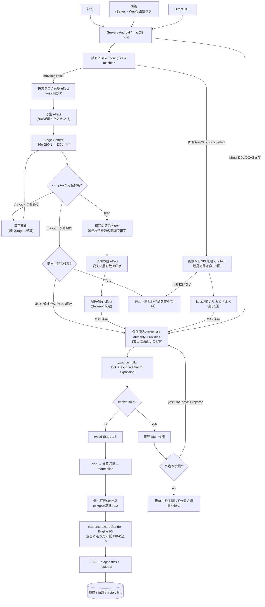
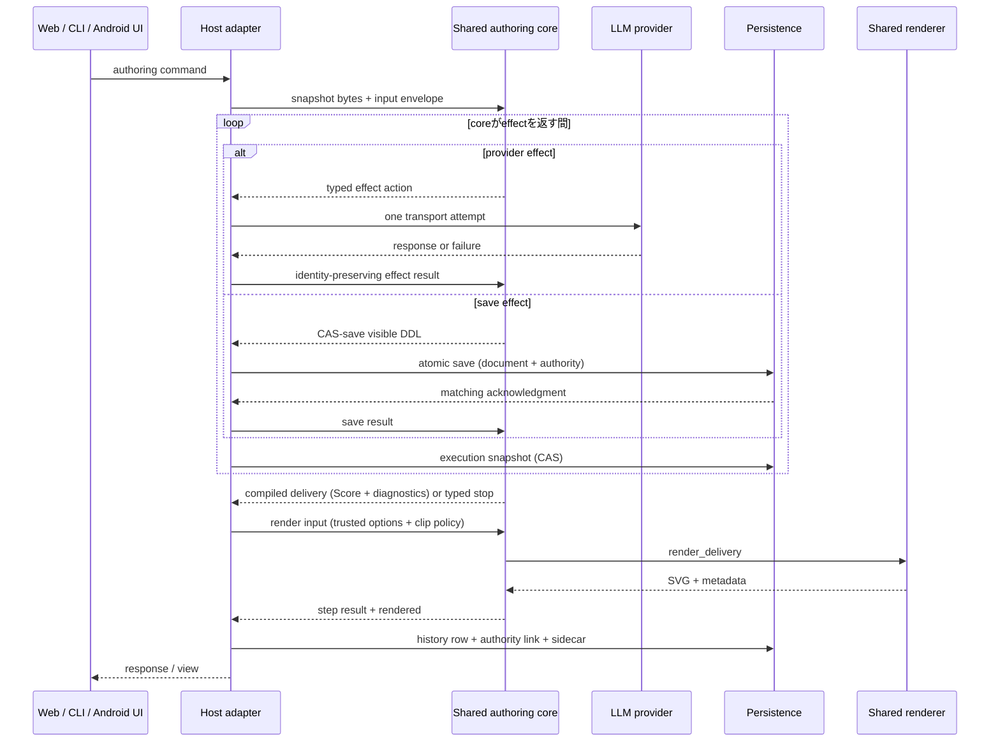

# DDL処理pipeline

通常Server／Web、Android、macOSは、同じ共有Rust authoring state machine、typed compiler、lowerer、renderer、providerへの要求本文と答えの読み（`provider_wire`）を使用する。旧Python / KotlinのStage 1・Stage 1.5・Stage 2・coerceは2026-09-14のcutoverで新作経路から外れ、runtime selectorやPython fallbackは無い。

## 段階と所有者

| 段階 | 入力 → 出力 | 契約 | 所有module |
|---|---|---|---|
| Host入力 | 記述、画像（Server・Webの画像タブ）、direct DDL、保存作品からの法則の手 → typed command | 記述起点と画像起点と法則の手だけLLM段を要求する。記述は行頭の連番と角括弧のコメントを切ってからcoreへ渡し、作品には書いたままを残す（Server）。Direct DDLは自然文へ戻さない | Server / Android / macOS pipeline host |
| Authoring state machine | snapshot + command/effect result → next snapshot + event + 最大1 effect | 決定的。provider transportと保存はtyped effectとして外出しし、再試行・fallback・authority遷移はcoreが決める | `core/crates/inku-pipeline` |
| 色カタログ選択 effect（任意） | 記述 + カタログ候補 → カタログID | `catalog_mode=auto`の記述起点だけ。失敗・予算切れは`default`へ落とし`auto_fallback_default`を記録して続行する | `inku-pipeline` prompt/action; host provider adapter |
| 写生 effect（任意） | 記述 → 場所と光の補足文 | 作者が「あり」を選んだときだけ。記述を書き換えず、失敗しても`fallback`として記述だけで続行する | `inku-pipeline` prompt/action; host provider adapter |
| Stage 1 effect | 記述（+ 写生文）→ 下絵JSON → visible normalized DDL候補 | LLMはDDL文字列を書かず、閉じた型の下絵だけを返す。coreが範囲外の値をfield単位で落とし、要求言語のDDLへ決定的に印字する。Scoreを書かず、Macro本文やhidden meaningを受け取らない | `inku-pipeline/src/prompts.rs`; `inku-ddl/src/work_plan.rs`; host provider adapter |
| Stage 1の再正規化・残部採用 | compilerが完全採用しない候補 → 置換DDL要求、または描画可能な残部 | 同じStage 1予算の中で、原文・未採用DDL・理由とspanを添えた新しいactionとして再要求する。予算が尽きたら、sealed execution projectionが描画可能な残部を持つ場合だけ候補全文をそのまま保存へ提案する | `inku-pipeline/src/machine.rs` (`correct_stage1`, `residual_execution_preflight`) |
| 構図の読み effect | 落ち着いたStage 1の下絵 + 記述 → 層の置き場所 → 数の範囲で印字したDDL | 記述が置き場所を言わない層の置き場所を記述から読み（`read_composition`、prompt `inku.composition-reading-prompt.v4`）、紙が見せられる値だけを残す。端末内のVisionモデルでは読まずに既定の置き場所にする。Stage 1のmodelを使い、予算は無ければ色カタログ選択のもの | `inku-pipeline/src/{composition_reading,composition}.rs` |
| 法則の段 effect | 構図を入れた文書 + 楽譜の層の要約 → 選んだ法則 → 変えた層だけを数の形で印字し直したDDL | 絵画・意匠・音楽の法則から読み手が選び（`choose_laws`、prompt `inku.laws-prompt.v1`）、coreが答えを確かめ、拒んだ理由を添えて予算内で聞き直す。当てられなければ構図のままcommitする。作品に法則の記録（`laws_layers`・`laws_basis`）を残す | `inku-pipeline/src/{laws,laws_record}.rs`; `inku-ddl/src/work_plan.rs` |
| 配色の段 effect（Serverの既定） | 法則の段の後の文書 + 描いた見え方の見積もり → 選んだ配色 → 色を書き換えたDDL | 色の法則から読み手が選び（`choose_colors`、prompt `inku.colors-prompt.v1`）、地から見えない色や法則の成り立たない色は選び直させる。記述が言った色と地は替えない。当てられなければ法則の段の後の文書のままcommitする | `inku-pipeline/src/{colors,appearance}.rs` |
| 画像から書く作品 effect（Server・Web） | 画像の参照 + DDLの手引き → Visionのモデルが書いたDDL → 見比べて直したDDL | 写生・作品計画・構図・法則・配色は通らない。画像から色カタログを選び（任意）、DDLを書かせ（`write_image_ddl`）、compilerの所見で一度だけ聞き直す。hostが描いた画（`draw_image_review`）と元の画像を見比べて一度直させる（`review_image_ddl`）。画像はcoreに入らない | `inku-pipeline/src/{image_ddl,machine/image}.rs`; host provider adapter |
| CAS保存 | DDL候補 + revision → 保存済みvisible DDL | 一致するatomic save acknowledgment後だけsourceとauthorityを進め、exact saved bytesを再parseする。新しいDDL（記述からのcommit、残部のcommit、親の無い新しいdirect DDL）は1文目に紙の比を、画像からのcommitは画像の比を宣言する（DDL 26）。保存作品の編集・描き直しでは足さない | authority store / pipeline host |
| Typed compiler | visible DDL + definition locks → verified meaning + diagnostics | source、provenance、Macro definitionをlock検証し、bounded expansionする。曖昧さをfirst/nearest/lastで推測しない。lockは`canonical_ready` / `incomplete_known_hole` / `blocked_conflict` / `blocked_diagnostic`のいずれか。形の無い文は、抱える穴が無ければ範囲つきの止める診断で名指して省く（DDL engine 71） | `core/crates/inku-ddl` |
| Hole補完（Stage 2） | known hole → patch候補 → 作者承認 | known holeだけをspanとdigestに閉じて自動要求する。HoleなしではStage 2 LLMを呼ばない。承認patchもCAS保存後に再parseする。辞退・失敗は保存済みDDLを保って作者の編集を待つ | shared state machine + host provider/store |
| Typed Stage 1.5 | verified meaning + composition seed → effective meaning | LLMを使わずに入力を検証し、effective meaningの同一性を固定する（focusの読み替えは2026-09-27、明示変奏は2026-10-04に外した）。原文の意味や明示属性を上書きしない | `core/crates/inku-ddl` |
| Plan・資源選択・materialize | verified effective meaning → symbolic Plan → compact Score recipe | 一度だけ下ろし、個体化前にhard policyとoperational budgetで需要を検査する。表現に必要な最小Score版を選ぶ。compact基準は0.10で、使う表現に応じて0.11〜0.22へ上がる（鏡写し0.15、太い側0.16、塗り以外の濃さ0.17、数の範囲の塗り0.18、写しの区画0.19、継ぎ目0.20、自由線0.21、刷毛目0.22） | `core/crates/inku-ddl`; `core/crates/inku-score` |
| Render Engine | Score + 保存policy + seeds + 解決済みhost option → SVG + metadata | compileに使ったoptionと一致するときだけ演奏する。recipeからsamplingし、clip不能な単位は元source全体を省略して再演奏する。宣言と違う比の紙では、hostの`canvas_fit`で比を保って紙の中央の枠に描く（render engine 93）。同じScore、seed、条件は同じ演奏を再現する | `core/crates/inku-render` |
| 履歴・系譜 | DDL / Score / SVG / authority context → DB row/node/edge + history link | Historyは当該revisionのsource、config、seed、catalog、budget、definition lock、4種の診断、補完の控え、法則の記録を保持し、親子を類似性から推測しない。画像から書いた作品は来歴とcoreの記録を持つ | Server DB / Android Room / macOS GRDB |

判定単位の詳細は [SPEC.ja.md](../../SPEC.ja.md) §12.6–§12.8が正本である。1件ずつの判定の道筋は`description-to-svg.ja.md`が持つ。

## 通常authoring

Provider patchは候補にすぎず、hostが直接採用しない。Hostは一つのeffectにつきproviderを一度だけ呼び、失敗結果をcoreへ返す。要求本文と答えの読みは共有coreの`provider_wire`（`inku.provider-wire.v1`）が作り、hostは鍵・HTTP・流量・観測だけを持つ。次のeffectまたは有限な終了はcoreが決める。構図の読み・法則の段・配色の段は、使えない答えや予算切れでも描画を止めない。構図の読みは既定の読みで置いて続け（`composition_fallback`）、法則の段と配色の段は前の段の文書のまま進む。残部採用で保存したrevisionからはknown-hole補完を始めず、`complete_with_omissions`と元の診断を保存まで運ぶ。holeがあってScoreも成立する場合、hostは補完の要求より先に安全な演奏を保存する（Server・Android・macOSで同じ）。画像起点の実行は、読めない行を確定の後に補完しない（画像を見ない補完は推測になる）。

## APIとplatform境界

ServerのPython adapter、AndroidのKotlin/JNI adapter、macOSのSwift/UniFFI adapterはhost処理を行う薄い境界で、意味を別実装しない。Androidの通常UIは`InkuRepository` → `AndroidWorkPipeline` → `SharedPipelineHost` → JNIで、macOSは`PipelineHost.swift` → UniFFIで共有coreへ到達する。画像起点の実行では、hostが見比べの画を描くeffect（`draw_image_review`）も1回だけ行う（Serverだけ）。WebとCLIは既存HTTP APIを通してServerの同じpipeline serviceを使う。`/api/interpret`は保存済みDDLまで、`/api/compose`はdirect DDLから演奏まで、`/api/paint`は記述から演奏（`save_history`指定時は履歴保存）までを1回の応答へ投影する。補完案の承認が要る場合、これらの互換routeは409と現在のviewを返し、作者の操作は`/api/pipeline/executions/{id}/commands`へ移る。

## 再入点

| 操作 | 保つもの | 再開点 |
|---|---|---|
| DDL編集 | authoring origin、CAS、元history | 同じ設定なら作者DDLのCAS保存後にcompilerへ再入。設定が変わるなら親付きのdirect-DDL variation |
| 補完案の承認・辞退 | base revisionとproposal digest | 承認はbaseを再検証してCAS保存。辞退は保存済みDDLのまま |
| 別の構図 | 保存済みvisible DDL、元meaning、描画属性 | 新しい`composition_seed`でtyped Stage 1.5／lowerer。数の範囲の選び直しは可視DDLだけから読む（`pipeline_recompose`） |
| catalog / canvas変更 | 元variationを変更しない | 現在optionsを持つ親付きnew variation |
| てざわり・支持体・配色の差し替え | 保存Score、DDL、種、記述の扱い | 共有coreの`saved_variants`が保存Scoreの一部だけを替えて描き直し、子として保存する（runを作らない） |
| はめ込み | 保存Score、版、指示書、種 | 宣言と違う比の紙へ、保存Scoreを版を変えずに枠へ描き直す（`fit_render`）。系譜は`はめ込み`の子 |
| 法則の手（AI自動推敲、保存作品から） | 親の指示書と記述、設定・種・色・比・限り、補完の控え、法則の記録 | 入力`SavedLaws`で法則の段をやり直す。Stage 1と構図の読みはやり直さず、親の設定に配色の段があれば続けて行う |
| 取り合わせ（推敲、AI自動推敲の手） | 元作品 | 共有coreの`juxtaposition`が選ばせた一文を記述の後ろに足し、`description_edit`の子を描く |
| 見比べる前の指示書から描く（画像起点の作品） | 元作品と記録の`image_ddl.before_review` | その本文を作品の親付きDDL編集（`ddl_edit`）として描く |
| 旧作品からの派生 | 元history行を変更しない | `legacy/{history_id}/fork`で`legacy_description_fork` / `legacy_ddl_fork`の新variation |

過去historyを選んだときは、そのrevisionに保存されたcontextを使う。同じvariationの最新snapshotから推測せず、壊れたsidecarも再compileで補わない。

## 保存互換とplatform境界

- 保存済みSVGは当時の表示の正本であり、旧Scoreと旧artifactはread compatibilityを保つ。
- 新しい作品の意味は共有Rustが決定する。旧作品は保存済みScore／SVGと保存時のcontextを優先し、旧DDLを再解釈して置き換えない。
- 保存済みScoreの再演は版で分かれる。compact Score（0.10〜0.22）は共有coreの`render_saved`へ、保存時の資源policyと再計算した需要を渡す。0.10未満の旧Scoreは`saved_score_compat.py`の構造互換（欠けたgeometryの既定、fill表記の橋渡し、解決不能relationの除去、記録上限）を当ててから従来のchecked performanceで演奏する。どちらも記述やDDLを読まない。
- AndroidのカメラDDL promptも共有RustのStage 1語彙projectionを使う。履歴は保存された記述・DDL・model情報を表示し、記録されていない送信promptを後から推測しない。
- Serverは配布用の同じnative wheelにauthoring pipelineとrendererを含める。Androidは同じ共有coreへJNIで、macOSはUniFFI（XCFramework）で接続する。
- 画像から書く作品（画像タブ）はServer・Webだけにある。iPad／iPhoneのアプリは別途保留する。

## 生成条件と同一性

`rh3`の直接材料はScore、render seed、wild、engine identity、render color catalog IDである。その他の設定は、Scoreまたは直接材料を変える場合にedition同一性へ効く。

| 条件 | 解決する層 | 保存先 |
|---|---|---|
| visible DDL source / authority / revision | authoring state machine + CAS store | snapshot / history link |
| Macro definition / catalog / canvas identity | compiler inputとしてlock検証、host optionとして解決 | definition lock / config / history |
| 色カタログ（auto選択を含む） | 色カタログ選択effectとhost palette解決 | `catalog_id` / `catalog_mode` / `render_color_map` |
| 写生文 | 写生effect、または作者・保存済みの写生文 | snapshotの`sketch`記録 / `sketch_text` / `sketch_state` |
| 構図の読み・法則・配色 | 構図の読み・法則の段・配色の段のeffectが可視DDLへ数と色で印字する（印字した後はDDLが正本） | 可視DDL / history link sidecarの`laws_layers`・`laws_basis` / 送信promptの記録 |
| 画面比の宣言 / はめ込み | DDLの1文目（DDL 26）とhostの`canvas_fit` | Scoreの`canvas.declared_ratio`・`canvas.fit` |
| 画像入力 | 画像起点のeffectとhostの受取（画像はrunのメモリだけ） | history rowの`image_provenance`・`image_ddl` |
| `composition_seed` / variation | typed Stage 1.5 + lowerer | config / render metadata |
| resource policy / operational budget | materializer + checked performance | Score policy / history |
| `render_seed` / `wild` / concrete color map | Render Engine | render metadata / history |
| model choice | 各provider effectのhost transport | effect metadata / history |

## 実装位置

| 境界 | 主な実装 |
|---|---|
| Shared state machine / byte protocol | `core/crates/inku-pipeline`（`machine.rs`、`machine/image.rs`、`protocol.rs`）, `core/crates/inku-pipeline-uniffi` |
| 構図の読み・法則・配色 | `inku-pipeline/src/{composition_reading,composition,recompose,laws,laws_entry,laws_record,colors,appearance}.rs` |
| 画像から書く作品 | `inku-pipeline/src/{image_ddl,machine/image}.rs` |
| providerへの要求本文と答えの読み | `inku-pipeline/src/provider_wire.rs`、`provider_wire/chatgpt.rs` |
| 保存作品の推敲の規則 | `inku-pipeline/src/{saved_variants,retouch,juxtaposition,autonomous_refine}.rs` |
| 作品の同一性 | `inku-pipeline/src/identity.rs` |
| Typed compiler / 下絵 / Stage 1.5 / lowerer / 画面比の宣言 | `core/crates/inku-ddl`（`canvas_ratio.rs`、`completion_record.rs`を含む） |
| Score schema / compatibility / resource policy | `core/crates/inku-score` |
| SVG performance | `core/crates/inku-render` |
| Server host | `server/src/inku_server/pipeline_runtime.py`, `pipeline_api.py`, `pipeline_candidate.py`, `pipeline_product.py`, `pipeline_provider.py`, `pipeline_compat.py`, `pipeline_images.py`, `autonomous_refine.py` |
| 旧Score互換 | `server/src/inku_server/saved_score_compat.py`, `render_engines/default/adapter.py` |
| Android host | `android/.../pipeline/SharedAuthoringPipeline.kt`, `SharedPipelineHost.kt`, `AndroidWorkPipeline.kt`, `NativePipelineBridge.kt` |
| macOS host | `apple/Packages/InkuHost/Sources/InkuHost/PipelineHost.swift`、`apple/Packages/InkuCore/` |
| Product contract | [SPEC.ja.md](../../SPEC.ja.md) §12.6–§12.8、§12.11、§18、§19 |
