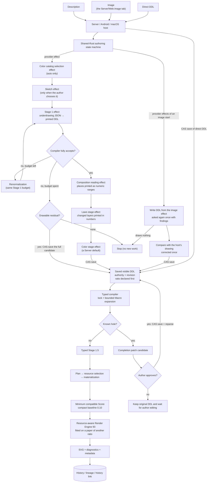
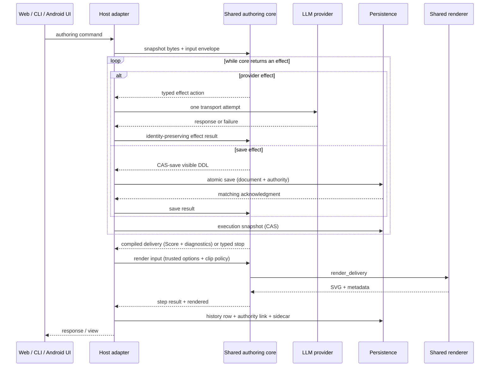

# DDL processing pipeline

The normal Server, Web, Android, and macOS paths use the same shared-Rust authoring state machine, typed compiler, lowerer, renderer, and provider request bodies and answer reading (`provider_wire`). The 2026-09-14 cutover removed the old Python/Kotlin Stage 1, Stage 1.5, Stage 2, and coerce from the path of new works; there is no runtime selector and no Python fallback.

## Stages and owners

| Stage | Input → output | Contract | Owning module |
|---|---|---|---|
| Host input | Description, image (the Server/Web image tab), direct DDL, or the laws move from a saved work → typed command | Only a description start, an image start and the laws move request model stages. The description reaches the core with leading numbers and bracketed comments cut, while the work keeps it as written (Server). Direct DDL is never sent back through prose | Server / Android / macOS pipeline host |
| Authoring state machine | Snapshot + command/effect result → next snapshot + event + at most one effect | Deterministic. Provider transport and persistence leave core as typed effects; core decides retry, fallback, and authority transitions | `core/crates/inku-pipeline` |
| Color catalog selection effect (optional) | Description + catalog candidates → catalog ID | Only for a description start with `catalog_mode=auto`. Failure or an exhausted budget falls back to `default`, records `auto_fallback_default`, and continues | `inku-pipeline` prompt/action; host provider adapter |
| Sketch effect (optional) | Description → a supplement about place and light | Only when the author chooses it. It never rewrites the description; a failure continues as `fallback` with the description alone | `inku-pipeline` prompt/action; host provider adapter |
| Stage 1 effect | Description (+ sketch) → underdrawing JSON → visible normalized DDL candidate | The model writes no DDL string; it returns only a closed-typed underdrawing. Core drops out-of-range values field by field and prints the plan deterministically as DDL in the requested language. The model does not write Score or receive Macro bodies or hidden meaning | `inku-pipeline/src/prompts.rs`; `inku-ddl/src/work_plan.rs`; host provider adapter |
| Stage 1 renormalization / residual adoption | A candidate the compiler does not fully accept → a replacement request, or a drawable residual | Within the same Stage 1 budget, core asks again with a new action carrying the description, the rejected DDL, and the reasons and spans. Once the budget is spent, the full candidate is proposed for saving unchanged only if the sealed execution projection has a drawable residual | `inku-pipeline/src/machine.rs` (`correct_stage1`, `residual_execution_preflight`) |
| Composition reading effect | A settled Stage 1 underdrawing + description → where the layers go → DDL printed with numeric ranges | Reads from the description where the layers it gives no place go (`read_composition`, prompt `inku.composition-reading-prompt.v4`) and keeps only the values the canvas can show. With an on-device Vision model it reads nothing and uses the default places. It uses the Stage 1 model and, when it has none of its own, the color catalog selection's budget | `inku-pipeline/src/{composition_reading,composition}.rs` |
| Laws stage effect | The composed document + a summary of the Score's layers → chosen laws → DDL with only the changed layers printed again in numbers | A reader chooses from laws of painting, design and music (`choose_laws`, prompt `inku.laws-prompt.v2`); the core checks the answer and asks again within the budget with the reasons it refused. When no law can be laid, the composition is committed as it is. The work keeps a laws record (`laws_layers`, `laws_basis`) | `inku-pipeline/src/{laws,laws_record}.rs`; `inku-ddl/src/work_plan.rs` |
| Color stage effect (a Server default) | The document after the laws stage + an estimate of how it looks drawn → a chosen color arrangement → DDL with its colors rewritten | A reader chooses from laws of color (`choose_colors`, prompt `inku.colors-prompt.v2`) and is asked to choose again a color that would not show from the ground or with which the law would not hold. Colors and a ground the description names are kept. When no colors can be laid, the document after the laws stage is committed as it is | `inku-pipeline/src/{colors,appearance}.rs` |
| Image-start effects (Server/Web) | Image reference + DDL guide → DDL a Vision model wrote → DDL corrected after the comparison | The sketch, work plan, composition, laws and colors are not used. The model may choose a catalog from the image, writes the DDL (`write_image_ddl`) and is asked once again with the compiler's findings; it then corrects the DDL once after comparing the host's drawing (`draw_image_review`) with the original image (`review_image_ddl`). The image never enters the core | `inku-pipeline/src/{image_ddl,machine/image}.rs`; host provider adapter |
| CAS persistence | DDL candidate + revision → saved visible DDL | Source and authority advance only after a matching atomic save acknowledgment; core reparses the exact saved bytes. A new DDL (a commit from a description, a residual commit, a new direct DDL without a parent) declares the paper's ratio as its first sentence, and a commit from an image declares the image's ratio (DDL 26). Editing or redrawing a saved work adds none | Authority store / pipeline host |
| Typed compiler | Visible DDL + definition locks → verified meaning + diagnostics | Verifies source, provenance, and Macro definitions, then performs bounded expansion. Ambiguity is not guessed by first/nearest/last. The lock is one of `canonical_ready` / `incomplete_known_hole` / `blocked_conflict` / `blocked_diagnostic`. A sentence without a shape that no hole holds is named by a blocking diagnostic with its span and left out (DDL engine 71) | `core/crates/inku-ddl` |
| Hole completion (Stage 2) | Known hole → patch candidate → author approval | Requested automatically, closed over the hole's span and digests. With no hole there is no Stage 2 LLM call. An approved patch is reparsed only after CAS save. A decline or failure keeps the saved DDL and waits for the author's edit | Shared state machine + host provider/store |
| Typed Stage 1.5 | Verified meaning + composition seed → effective meaning | Deterministic and model-free; verifies its input and fixes the identity of effective meaning (the focus reinterpretation was removed on 2026-09-27 and explicit variation on 2026-10-04), and does not overwrite source meaning or explicit attributes | `core/crates/inku-ddl` |
| Plan, resource selection, materialization | Verified effective meaning → symbolic Plan → compact Score recipe | Lowers once and checks demand against the hard policy and the operational budget before any instance is made. Selects the minimum Score version the work needs: compact output starts at 0.10 and rises to 0.11 through 0.22 with the forms the work uses (mirror 0.15, the thick side 0.16, intensity off flat fills 0.17, numeric fill ranges 0.18, cells for copies 0.19, joints 0.20, the free line 0.21, brushmarks 0.22) | `core/crates/inku-ddl`; `core/crates/inku-score` |
| Render Engine | Score + saved policy + seeds + resolved host options → SVG + metadata | Performs only when the options match those used for compilation. Samples from the recipe; a unit that cannot be clipped is omitted as its whole source and the performance is repeated. On a paper of another ratio than the declaration, the host's `canvas_fit` draws the work in a centred frame keeping its ratio (render engine 93). The same Score, seeds, and conditions reproduce the same performance | `core/crates/inku-render` |
| History/lineage | DDL / Score / SVG / authority context → DB row/node/edge + history link | History retains that revision's source, config, seeds, catalog, budget, definition locks, the four diagnostic channels, the completion record, and the laws record; lineage is never inferred from similarity. A work written from an image keeps its source note and the core's record | Server DB / Android Room / macOS GRDB |

The decision-level contract is canonical in [SPEC.md](../../SPEC.md) §12.6–§12.8. The decision path of a single request lives in `description-to-svg.md`.

## Normal authoring

A provider patch remains a candidate; a host never adopts it directly. The host attempts provider transport once for each effect and returns the failure to core. The shared core's `provider_wire` (`inku.provider-wire.v1`) builds the request body and reads the answer; the host keeps only keys, HTTP, rate limits and observation. Core decides the next effect or a finite stop. The composition reading, the laws stage and the color stage never stop the drawing on an unusable answer or a spent budget: the composition reading places the layers with the default reading and goes on (`composition_fallback`), and the laws stage and the color stage go on with the previous stage's document. A revision saved by residual adoption never starts known-hole completion; it carries `complete_with_omissions` and the original diagnostics through to the save. When there is a hole and a Score also exists, the host saves the safe performance before requesting completion (Server, Android and macOS alike). An image-start run does not complete unread lines after the commit (completion that does not see the image would be a guess).

## API and platform boundary

The Server's Python adapter, Android's Kotlin/JNI adapter and macOS's Swift/UniFFI adapter are thin host boundaries and do not reimplement meaning. Android's normal UI reaches the shared core through `InkuRepository` → `AndroidWorkPipeline` → `SharedPipelineHost` → JNI, and macOS through `PipelineHost.swift` → UniFFI. In an image-start run the host also performs, once, the effect that draws the review drawing (`draw_image_review`; Server only). Web and the CLI use the Server's same pipeline service through the existing HTTP APIs. `/api/interpret` projects the path up to the saved DDL, `/api/compose` from direct DDL to the performance, and `/api/paint` from the description to the performance (and a history save when `save_history` is set) into one response. When a completion proposal needs approval, these compatibility routes answer 409 with the current view, and the author's command moves to `/api/pipeline/executions/{id}/commands`.

## Reentry points

| Operation | Preserved | Reentry |
|---|---|---|
| DDL edit | Authoring origin, CAS, and original history | With unchanged settings, the compiler after CAS-saving the author DDL. With changed settings, a parent-linked direct-DDL variation |
| Approve or decline a proposal | Base revision and proposal digest | Approval revalidates the base and CAS-saves. A decline keeps the saved DDL |
| Another composition | Saved visible DDL, source meaning, and drawing attributes | Typed Stage 1.5 / lowerer with a new `composition_seed`. Choosing the numeric ranges again reads the visible DDL alone (`pipeline_recompose`) |
| Catalog / canvas change | Original variation remains unchanged | A parent-linked new variation with current options |
| Replacing touches, ground or color arrangement | Saved Score, DDL, seeds and the description's authority | The shared core's `saved_variants` replaces one part of the saved Score, draws it again and saves a child (no run) |
| Fit | Saved Score, version, instructions and seeds | Draws the saved Score into the frame of a paper of another ratio without changing its version (`fit_render`); the lineage records a `Fit` child |
| Laws move (autonomous refinement, from a saved work) | The parent's instructions and description, settings, seeds, colors, ratio and limits, the completion record and the laws record | Runs the laws stage again with the `SavedLaws` input. Stage 1 and the composition reading are not run again; a color stage follows when the parent's settings carry one |
| Juxtaposition (a refinement, and a move of autonomous refinement) | The original work | The sentence the shared core's `juxtaposition` had chosen is added after the description, and a `description_edit` child is drawn |
| Paint from the instructions before review (a work written from an image) | The original work and its record's `image_ddl.before_review` | Draws that text as the work's parent-linked DDL edit (`ddl_edit`) |
| Derivation from an older work | The original history row is never changed | A new `legacy_description_fork` / `legacy_ddl_fork` variation through `legacy/{history_id}/fork` |

Selecting old history uses the context saved for that revision. It never infers from the latest snapshot of the same variation, and a corrupt sidecar is not repaired by recompiling.

## Saved compatibility and platform boundaries

- Saved SVG is canonical for the original display; saved Scores and artifacts retain read compatibility.
- Shared Rust determines the meaning of new work. Old works use their saved Score, SVG, and context; they are not replaced by reinterpreting old DDL.
- Replay of a saved Score depends on its version. A compact Score (0.10 through 0.22) goes to the shared core's `render_saved` with the resource policy saved with it and a recomputed demand. An older Score below 0.10 first receives the structural compatibility of `saved_score_compat.py` (defaults for omitted geometry, a bridge between the fill spellings, removal of unresolvable relations, the recorded limits) and is then performed through the established checked performance. Neither reads a description or DDL.
- Android camera DDL uses the shared Rust Stage 1 vocabulary projection. History displays saved description, DDL, and model information without inferring an unrecorded prompt.
- The Server distribution includes the authoring pipeline and renderer in the same native wheel. Android connects to the same shared core through JNI, and macOS through UniFFI (an XCFramework).
- Works written from an image (the image tab) exist only on Server/Web. The iPad and iPhone apps remain pending.

## Generation conditions and identity

The direct inputs to `rh3` are Score, render seed, wild, engine identity, and the render color catalog ID. Other settings affect edition identity when they change Score or one of those direct inputs.

| Condition | Resolving layer | Persistence |
|---|---|---|
| Visible DDL source / authority / revision | Authoring state machine + CAS store | Snapshot / history link |
| Macro definitions / catalog / canvas identity | Compiler lock input and resolved host options | Definition lock / config / history |
| Color catalog (including automatic selection) | Color catalog selection effect and host color resolution | `catalog_id` / `catalog_mode` / `render_color_map` |
| Sketch | The sketch effect, or a sketch the author supplied or one already saved | The snapshot's `sketch` record / `sketch_text` / `sketch_state` |
| Composition reading, laws and colors | The composition reading, laws stage and color stage effects print numbers and colors into the visible DDL (once printed, the DDL is canonical) | Visible DDL / `laws_layers` and `laws_basis` in the history-link sidecar / the sent-prompt record |
| Canvas ratio declaration / fitting | The DDL's first sentence (DDL 26) and the host's `canvas_fit` | The Score's `canvas.declared_ratio` and `canvas.fit` |
| Image input | The image-start effects and the host's intake (the image stays in the run's memory) | `image_provenance` and `image_ddl` on the history row |
| `composition_seed` / variation | Typed Stage 1.5 + lowerer | Config / render metadata |
| Resource policy / operational budget | Materializer + checked performance | Score policy / history |
| `render_seed` / `wild` / concrete color map | Render Engine | Render metadata / history |
| Model choice | Host transport for each provider effect | Effect metadata / history |

## Implementation locations

| Boundary | Main implementation |
|---|---|
| Shared state machine / byte protocol | `core/crates/inku-pipeline` (`machine.rs`, `machine/image.rs`, `protocol.rs`), `core/crates/inku-pipeline-uniffi` |
| Composition reading, laws and colors | `inku-pipeline/src/{composition_reading,composition,recompose,laws,laws_entry,laws_record,colors,appearance}.rs` |
| Works written from an image | `inku-pipeline/src/{image_ddl,machine/image}.rs` |
| Provider request bodies and answer reading | `inku-pipeline/src/provider_wire.rs`, `provider_wire/chatgpt.rs` |
| Rules of saved-work refinements | `inku-pipeline/src/{saved_variants,retouch,juxtaposition,autonomous_refine}.rs` |
| Work identity | `inku-pipeline/src/identity.rs` |
| Typed compiler / underdrawing / Stage 1.5 / lowerer / canvas ratio declaration | `core/crates/inku-ddl` (including `canvas_ratio.rs` and `completion_record.rs`) |
| Score schema / compatibility / resource policy | `core/crates/inku-score` |
| SVG performance | `core/crates/inku-render` |
| Server host | `server/src/inku_server/pipeline_runtime.py`, `pipeline_api.py`, `pipeline_candidate.py`, `pipeline_product.py`, `pipeline_provider.py`, `pipeline_compat.py`, `pipeline_images.py`, `autonomous_refine.py` |
| Older Score compatibility | `server/src/inku_server/saved_score_compat.py`, `render_engines/default/adapter.py` |
| Android host | `android/.../pipeline/SharedAuthoringPipeline.kt`, `SharedPipelineHost.kt`, `AndroidWorkPipeline.kt`, `NativePipelineBridge.kt` |
| macOS host | `apple/Packages/InkuHost/Sources/InkuHost/PipelineHost.swift`, `apple/Packages/InkuCore/` |
| Product contract | [SPEC.md](../../SPEC.md) §12.6–§12.8, §12.11, §18, and §19 |
