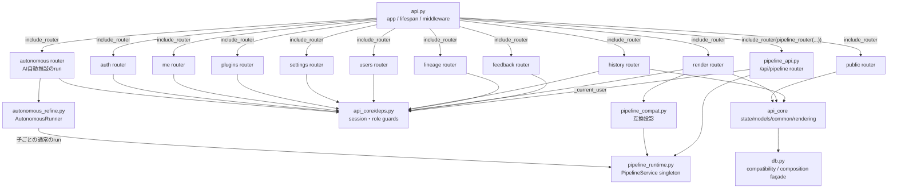
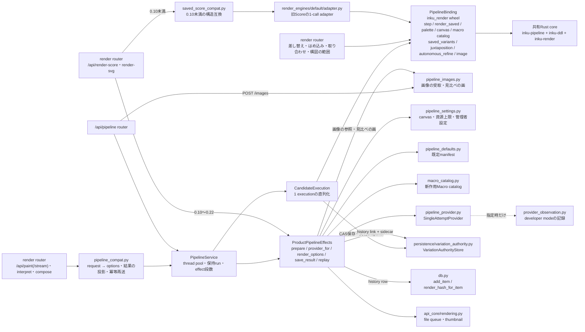
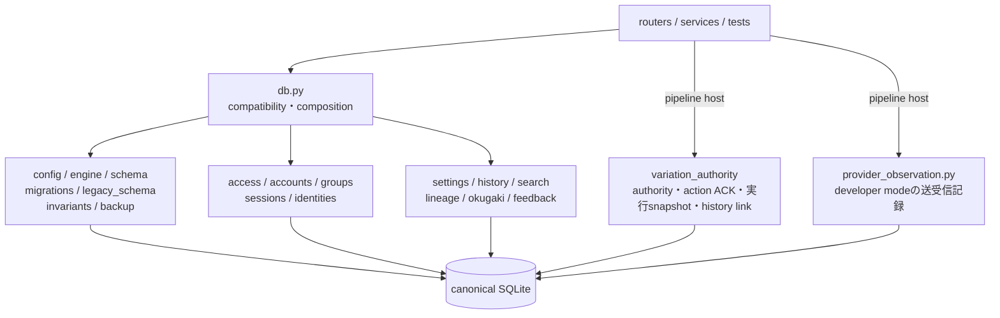
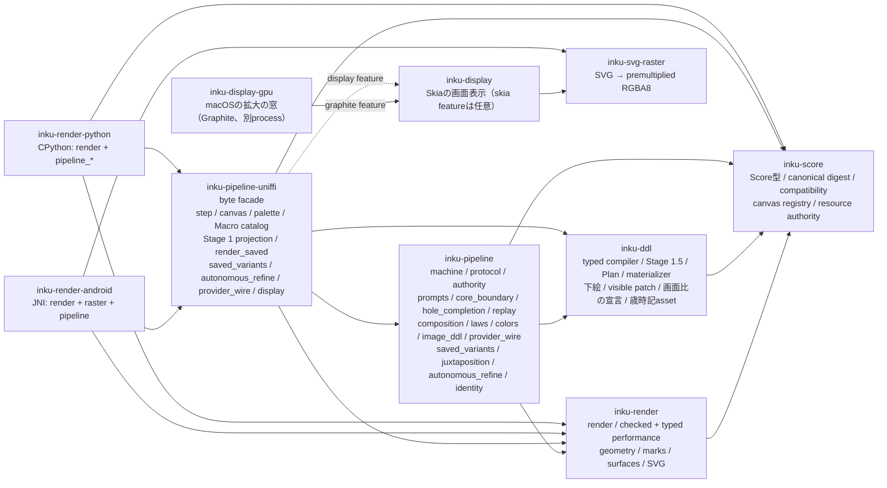

# Server components

## API面

`api.py` はprocess-wideな組立てを持ち、endpoint本体は用途別routerと共有pipeline routerへ分かれる。router-level default dependencyと個別dependencyの両方が認可を作る。`test_route_module_split.py` はlive routeの`endpoint.__module__`を検査し、endpointが`api.py`へ戻る退行を防ぐ。本人用ChatGPT routerはOAuth/profile/catalogの公開境界を持ち、専用auth・store・transfer・runtime・provider moduleへ接続する。

依存方向は `api.py → routers → api_core共有module / domain module` である。`server/src/inku_server/api_core/routers/` から `inku_server.api` へのimport検索は0件だった。共有pipelineのserviceは`pipeline_runtime.py`が遅延生成するprocess内のsingletonで、render routerの互換経路と`/api/pipeline` routerの両方が同じserviceを使う。

## 処理面

正規経路は、router → `pipeline_compat.py`（またはHTTPの`/api/pipeline`）→ `PipelineService` → `CandidateExecution` → native wheelの`step` である。`CandidateExecution`は1 executionのcallを直列化し、coreが返したeffectを`ProductPipelineEffects`へ渡して1回ずつ実行し、結果をcoreへ返す。effectごとの次snapshotは`VariationAuthorityStore`へcompare-and-setで保存され、worker交代後も保存済みsnapshotから再開できる。clientはsnapshot、authority sidecar、effect結果、資源policyを送れず、`render` commandも直接は受けない（hostが信頼済みoptionを付けた`perform`だけ）。

`ProductPipelineEffects`は意味を決めない5つのhost責任を持つ。`prepare`はoption検証、指示文言語、Macro catalog、canvas、seed、色カタログとpaletteの解決、stage modelの解決を行う（画像の実行ではVisionのmodelと`image`の設定を足す）。`provider_for`はcoreが要求したactionを`SingleAttemptProvider`で1回だけ送り、経過時間とprovider失敗を実行contextへ記録する。要求本文と答えの読みは共有coreの`provider_wire`が作り、画像の実行ではrunのメモリにある画像を参照どおりに添える。`render_options`は保存済みsnapshotから信頼済みrender optionを組む。`save_result`は演奏を履歴rowとhistory linkへ保存する（画像起点の作品は来歴と`image_ddl`も）。`replay`はcompact Scoreを保存policyで演奏し直す。`pipeline_images.py`は画像を受け取ってrunのメモリに預け、coreの`draw_image_review` effectに、実描画と同じ設定で描いた見比べの画（`pipeline_image_review_svg` → resvgのPNG）を返す。

保存作品のてざわり・支持体・配色の差し替えとはめ込み（`/api/render-tool-variant`、`/api/render-ground-variant`、`/api/render-color-arrangement`と各`plan`、`/api/render-canvas-fit`）は、runを作らずにnative wheelの共有coreの規則（`saved_variants`）を呼ぶ。取り合わせ（`/api/refine/juxtaposition`）は共有coreの`juxtaposition`で候補を集めて頼む文を作り、Visionのmodelが選んだ一文を返す。子は記述に一文を足した`description_edit`のrunで描く。AI自動推敲のrunは`autonomous_refine.py:AutonomousRunner`が進め、子を通常のpipeline runで描き、手番・見える差・辺の記録を共有coreの`autonomous_refine`に尋ねる。

0.10未満の旧Scoreの再演だけは`saved_score_compat.py`の構造互換を通り、`api_core/rendering.py` → `render_engines` registry → `default/adapter.py` → native wheelの`render`を1回呼ぶ。`renderer.py`はSVGだけを必要とする既存callerの互換facadeで、同じregistryへ委譲する。旧`interpreter.py`、`composer.py`、`ddl_expander.py`、`coerce/compose.py`、`coerce/normalize.py`は削除済みで、`coerce/`に残るのは保存済み観測記録の互換（`observability.py`）だけである。

## 永続化面

`db.py`は既存callerを一度に書き換えないためのpublic compatibility façadeであり、同時にcall-time dependencyを組み立てるcomposition seamである。`persistence/schema.py`がORM schema、`config.py`と`engine.py`がSQLite-only設定とconnection PRAGMA、`migrations.py`がversioned registryと起動判定、`backup.py`と`invariants.py`がsnapshotとdata-loss guardを所有する。domain CRUDとqueryは変更理由ごとのmoduleが所有する。共有pipelineの状態（variation authority、action ACK、実行snapshot、history link）は`persistence/variation_authority.py`が、developer modeのprovider送受信記録は`provider_observation.py`が、façadeを通らずに所有する。

現在の`db.py`に直接SQL、transaction、migration session、metadata create、commit、flushの実装ownerは残らない。compatibility re-exportと薄いdelegateは意図したboundaryであり、readerがゼロと証明されたものだけを削除する。新しい永続化処理をfaçadeへ戻さないことは、単なる行数削減より優先する。

## Rust core内部

10 crateのうち6つのhost非依存crate（`inku-score`、`inku-ddl`、`inku-pipeline`、`inku-render`、`inku-svg-raster`、`inku-display`）は`#![forbid(unsafe_code)]`で、残る4つ（`inku-pipeline-uniffi`、`inku-render-python`、`inku-render-android`、`inku-display-gpu`）は薄いadapterかhost用のprogramである。`inku-display`のSkiaは任意のfeatureで、AndroidとmacOSはUniFFIの`display` feature（Androidは`inku-render-android`経由）で取り込む。`inku-display-gpu`はmacOSが別processとして起動し、標準入出力で窓の要求とpixelを受け渡す。依存は一方向である。`inku-score`が最下層でScore型と資源authorityを持ち、`inku-ddl`と`inku-render`は互いに依存しない。`inku-pipeline`だけが両者を結び、compileしたdeliveryを同じcompiler optionでだけ演奏する。`inku-pipeline-uniffi`は所有したUTF-8 JSON byte bufferだけを受け渡すfacadeで、Python・JNI adapterはこの上に薄く載り、意味分岐を複製しない。panicはplatform例外ではなく安定した`internal_invariant` error envelopeへ閉じる。

```mermaid
flowchart LR
    SRC["document / parser / clause / numeric_range\nsource-preserving lexeme・clause"]
    EVID["noun_phrase / phrase / attachment\nrelation_reference / opaque_head\n意味中立のevidence"]
    MACRO["macro_resolution / macro_parameter_binding\nmacro_expansion / macro_seed / macro_definition"]
    SEM["semantic_association / semantic_instruction\nsemantic_document / composition\ngeometry / shape_constraint / fluctuation"]
    LOCK["compiler_lock\ncanonical meaning・4状態のlock"]
    PROJ["execution_projection\n非canonical時のsealed projection"]
    S15["stage15_transform\n意味の確定"]
    PLAN["composition_plan / group_quantity\nplan_reference_extent"]
    RES["plan_resources\nhard policy + operational budget"]
    MAT["score_materialization / score_lowering\nscore_angle → compact Score"]
    AUX["work_plan / visible_patch / completion_record\ncanvas_ratio / saijiki\nauthoring補助とasset"]

    SRC --> EVID --> MACRO --> SEM --> LOCK
    LOCK -->|"canonical_ready"| S15
    LOCK -->|"それ以外"| PROJ --> S15
    S15 --> PLAN --> RES --> MAT
    AUX -.->|"Stage 1印字・hole patch・語彙"| SRC
```

`inku-ddl`の入口は`compile_ddl_to_score_with_resources`（`compiler_execution.rs`）で、元の`NormalizedDdlDocument`を一度だけcompileしてから、Stage 1.5、Plan、資源選択、materializeを順に行う。source・provenance・Macro definitionの照合はlock構築時に済ませ、Stage 1.5へ渡すのはlock検証済みのmeaningだけである。

`inku-render`では`render.rs`が唯一の全体統率で、`render_with_resources`は`checked_performance`でScoreの版を見分け、compact Scoreを`typed_performance`（recipeからの個体化と`arrangement_performance`）へ、旧Scoreを従来の`anchor_execution`（`anchor_schedule`による依存順）へ振り分ける。geometry群（`geometry`、`affine`、`affine_geometry`、`arc`、`cloudform`、`contact`、`fill_geometry`、`surface_geometry`、`free_line`、`joint_relation`）は副作用のない点列計算、material群（`marks`、`mark_paths`、`stroke`、`flat_brush`、`fills`、`accepted_fills`、`surfaces`、`support`、`materials`、`ink_spread`）はmark／stroke／surfaceとsupportの相互作用、canvas群（`ground`、`ground_patterns`、`layers`、`palette`）はground／presence／色割当、`compat_clip`と`render_fill_scopes`は塗りの境界clipとpaint順、`svg.rs`は小さいdocument treeと最終serializeを所有する。`geometry_export`は通常のSVG経路から呼ばれない読み取り専用のgeometry境界である。`determinism.rs`は横断的に使われるがhost entropyは作らない。

## Router分類

| Router | endpoint数 | 主責任 | default guard |
|---|---:|---|---|
| `public` | 11 | health、info、catalog、models、saijiki、plugin preview、reference、client config、demo、第三者通知 | なし。health・info・第三者通知以外は個別guard |
| `auth` | 4 | auth config、login/logout | なし。login以外は個別guard |
| `me` | 13 | profile、user settings、各user storage | `_current_user` |
| `plugins` | 5 | plugin閲覧・検証・CRUD・enable | `_current_user`、変更はadmin |
| `settings` | 22 | server-wide settings、backup、取り合わせの設定、画像のアップロードの警告 | `_admin_user` |
| `users` | 8 | user/group管理 | `_user_manager` |
| `history` | 17 | 履歴、SVG、thumbnail、mark、trash、共有、artifact再作成、animation・card書き出し | `_current_user` |
| `lineage` | 8 | lineage graph/group、promote、colophon | `_current_user` |
| `render` | 15 | compose、interpret、render-score/svg、paint、paint stream、構図の範囲、てざわり・支持体・配色の候補と差し替え、はめ込み、取り合わせ | `_current_user` |
| `feedback` | 3 | unread words | `_current_user` |
| `description` | 2 | 記述の音数・音節 | `_current_user` |
| `chatgpt` | 12 | 本人の接続状態・認可・profile・モデル公開設定 | `_current_user`、操作は本人owner判定 |
| `autonomous` | 4 | AI自動推敲のrunの開始・一覧・取得・停止 | `_current_user` |
| `pipeline` | 15 | canvas形式、画像の受取、variationの開始・取得・記述からのfork、variationが送ったsystem prompt、execution command、author DDL、補完の範囲の状態、history link・fork、作品のDDL書き出し（名指すplugin定義つき）、旧作品の読取・fork、provider観測 | 各routeで`_current_user`。provider観測はさらにdeveloper modeだけ |

合計139。推敲の変奏seed採番とVisionの助言の入口は廃止した。公開allowlistは `/health`、`/api/info`、`/api/auth/login`、`/api/notices`、`/api/notices/{notice_id}` の5 pathである（`test_route_authorization.py`）。通知の2つは固定した配布ライセンスの読取りだけを提供し、任意ファイルや本人情報を返さない。それ以外はログインに必要な入口だけを公開する。

router別の件数は、live appのrouteを`test_route_authorization.py`と同じ数え方（`iter_route_contexts`）でendpointのmoduleごとに数えたもの（2026-10-25）。合計の正本は`test_route_authorization.py`の`EXPECTED_ROUTE_COUNT`（139）で、live appのOpenAPIから作った`tests/data/api-surface-baseline.json`も139 operation（201 schema）を記録する。OpenAPI（`/docs`）はrouterごとに1つのtag（14）を付け、139 routeすべてに要約と説明を、引数と要求・応答の欄に英語の説明を持つ（v2.15.243から）。

## 主要flow

- `/api/paint`、`/api/paint/stream`、`/api/interpret`、`/api/compose`は`pipeline_compat.py`を通って同じ`PipelineService`を使う。streamは実行を読み直して`sketch`・`stage1`・`score`・`done`を順に知らせ、最初のeventの後の失敗を本文の`error` eventで返す。補完案の承認が要る場合、stream以外の3つは409と現在のviewを返し、streamは最初のeventより前なら409、後なら`error` eventを返す。記述起点の開始は札を切った記述だけをcoreへ渡し、札だけの記述を400で断る。
- `/api/pipeline/variations`は記述、direct DDL、画像（`kind: image`、`/api/pipeline/images`が預けた一時ID）からvariationを始め、`/executions/{id}/commands`が作者の操作（承認・辞退・補完要求・再生成・演奏・取消し）を、`/executions/{id}/author-ddl`がDDL編集を受ける。設定が変わるDDL編集は元を変えず親付きのvariationを新設する。`/variations/{id}/fork-description`は記述を変えた子を、`/completion-range-states`はDDLエディタが示す補完の範囲の状態を返す。
- `/api/refine/autonomous`はAI自動推敲のrunを始め・一覧し・停止する。runはServerが進め、子は通常のpipeline runで描かれる。
- 保存作品の差し替え（`/api/render-tool-variant`等）とはめ込み（`/api/render-canvas-fit`）は共有coreの`saved_variants`で、runを作らずに子を描く。
- `/api/pipeline/history/{id}`は共有pipelineで保存した作品のvariation・revisionを返し、`/history/{id}/fork`はその時点のconfig・host context・Macro定義から派生する。`/history/{id}/ddl-export`は作品の可視DDLを、それが名指すplugin定義とともに書き出す。`/legacy/{id}`と`/legacy/{id}/fork`はlinkを持たない旧作品を読み、元行を変えずに派生する。
- `/api/render-score`と`/api/render-svg`はScoreの版で分かれ、compact Scoreは`ProductPipelineEffects.replay`、0.10未満は`saved_score_compat.py`を通る。
- provider/modelはrequest指定、userのStage設定、manifestの既定を`resolved_stage_model`で解決する。

## 根拠対応

| 図要素 | Evidence ID | 根拠 |
|---|---|---|
| app/router/deps | `SYS-API`, `API-ROUTERS`, `API-AUTH` | `api.py`, `api_core/routers`, `pipeline_api.py:pipeline_router`, `deps.py` |
| pipeline host | `PIPE-HOST`, `PIPE-LIMITS`, `API-LIMIT`, `PIPE-IMAGE` | `pipeline_runtime.py`, `pipeline_api.py`, `pipeline_candidate.py`, `pipeline_product.py`, `pipeline_settings.py`, `pipeline_defaults.py`, `pipeline_images.py` |
| AI自動推敲・差し替え | `PIPE-REFINE` | `autonomous_refine.py`, `routers/autonomous.py`, `routers/render.py` |
| 共有Rust core | `SYS-CORE`, `PIPE-MACHINE`, `PIPE-TYPED-DDL`, `PIPE-LOWER`, `PIPE-RENDER`, `PIPE-WIRE`, `PIPE-DISPLAY` | `core/Cargo.toml`, 各crateの`lib.rs` |
| 旧Score互換 | `PIPE-COMPAT` | `saved_score_compat.py`, `render_engines/default/adapter.py` |
| persistence | `PIPE-HISTORY`, `SYS-DB`, `DATA-MIGRATION`, `DATA-AUTHORITY` | `pipeline_product.py:save_result`, `db.py`, `persistence/*`, `provider_observation.py` |
| shared rasterizer | `SYS-FILES` | `shared/src/inku_analysis/rasterizer.py`, `api_core/thumbnails.py` |
