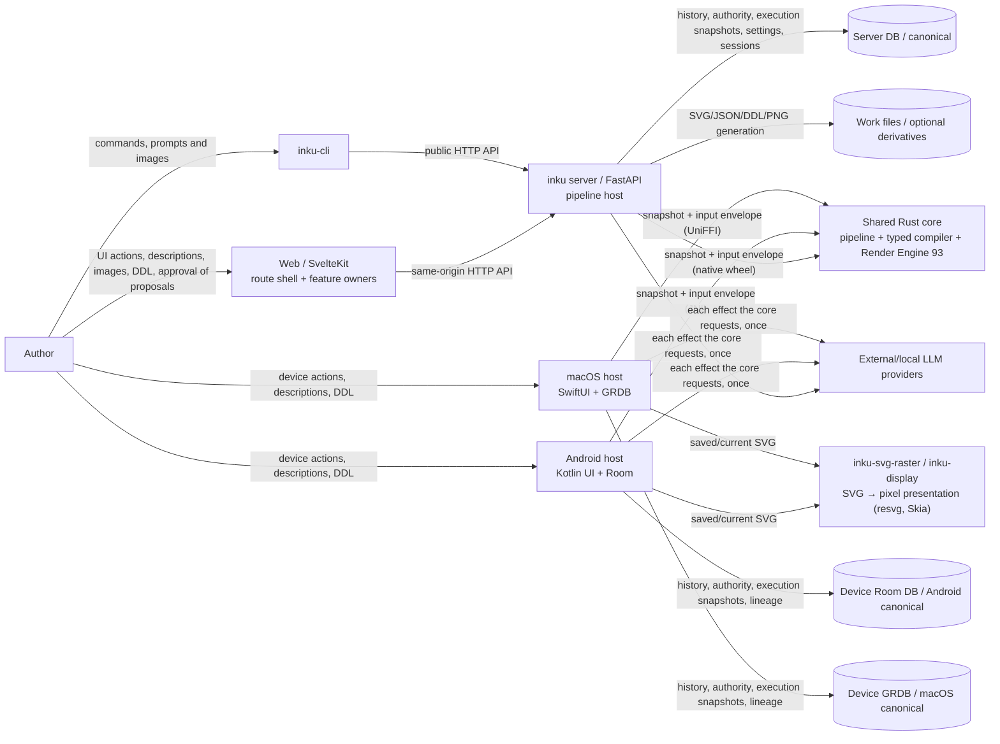

# System context

Web and the CLI use the Server HTTP API. Android and macOS do not go through the Server: a host on the device calls the same shared Rust core (Android from Kotlin through JNI, macOS from Swift through UniFFI) and saves to its own DB (Room, GRDB). On the Server, Android and macOS alike, the shared Rust core owns every decision about meaning from the description (and, on Server/Web, an image) through visible DDL and Score to SVG, and the rules of saved-work refinements. The Python, Kotlin and Swift hosts handle provider transport, atomic saves, UI, and host-specific settings. The Server DB is canonical for Server works; automatic work files are optional derivatives.

The shared Rust core consists of six host-neutral crates (`inku-score`, `inku-ddl`, `inku-pipeline`, `inku-render`, `inku-svg-raster`, `inku-display`) and four binding or host crates (`inku-pipeline-uniffi`, `inku-render-python`, `inku-render-android`, `inku-display-gpu`). The authoring state machine (`inku-pipeline`) takes a snapshot and an input and returns the next snapshot, progress events, and at most one effect. The host performs that effect (an LLM call, a CAS save of visible DDL, or the review drawing of an image run) exactly once and returns an identity-preserving result. The core also owns provider request bodies and answer reading (`provider_wire`); hosts keep only keys and HTTP. The core decides retries, fallback, authority transitions, and when to compile. The typed compiler (`inku-ddl`) lowers visible DDL to a Score once, and the Render Engine (`inku-render`) performs the SVG. Android and macOS display works with Skia (`inku-display`; macOS's zoomed windows use the separate `inku-display-gpu` process), send thumbnails and PNG through the raster crate (resvg), and treat pixels as derived UI presentation.

Within Web, `+page.svelte` retains route lifecycle, view composition, and owner wiring while route-instance owners hold Session, Work, Batch, Demo, Refinement, Settings, history/lineage, and viewport state. For shared-pipeline executions (DDL edits, approval of completion proposals, forks from a description), the controller in `features/pipeline/` reads the saved state, displays it, and forwards only the author's commands to the Server. The canonical owner diagram lives in `client-boundaries.md`; the Server internals and the Rust crate diagram live in `server-components.md`.

## External and trust boundaries

| Boundary | Contract | Evidence |
|---|---|---|
| Browser → Web | Route-instance feature owners hold UI state; localStorage, IndexedDB, and File System Access stay in the browser | `+page.svelte`; `features/session/state.svelte.ts`; `features/work/state.svelte.ts`; `features/canvas/refinement-coordinator.svelte.ts`; `features/export/save-target.ts` |
| Web → API | Vite proxy during development and SvelteKit hook proxy in distribution. A client cannot send snapshots, authority sidecars, effect results, or resource policies | `vite.config.ts`; `web/src/hooks.server.ts`; `pipeline_candidate.py` (module docstring) |
| CLI → API | HTTP through `urllib` only; no Server package imports | `cli/src/inku_cli/cli.py` |
| API → Rust core | Passes trusted configuration and the snapshot as owned byte buffers and receives the next snapshot and the performance. Requires matching binding and protocol versions at startup | `pipeline_candidate.py:PipelineBinding`; `inku-render-python`; `inku-pipeline-uniffi` |
| API → provider | After the model reference is resolved, performs each effect the core requests with one transport attempt and never retries on its own. The shared core's `provider_wire` builds the request body and reads the answer. In an image run, the image held in the run's memory is attached as its reference names it | `pipeline_provider.py:SingleAttemptProvider`; `model_settings.py`; `provider_wire.rs`; `pipeline_images.py` |
| Android → Rust core | Passes the same byte protocol through JNI. New performances use the core's render input; replay of a saved Score uses `renderSaved` under the restored resource policy (only the device-only legacy 9:5 format uses `AndroidRenderHost`) | `SharedPipelineHost.kt`; `NativePipelineBridge.kt`; `AndroidWorkPipeline.kt`; `inku-render-android` |
| Android SVG → raster / display | Sends canonical SVG and target geometry, then receives explicit premultiplied RGBA8/stride data. Ordinary display uses Skia (`inku-display`); thumbnails and PNG use resvg | `RustArtworkRasterizer.kt`; `AndroidDisplayRenderer.kt`; `core/crates/inku-svg-raster`; `core/crates/inku-display` |
| macOS → Rust core | Passes the same byte protocol through UniFFI. Work identity, the rules of saved-work refinements, autonomous refinement and provider request bodies call the same core. It never calls the Server API | `PipelineHost.swift`; `apple/Packages/InkuCore/`; `inku-pipeline-uniffi` |
| macOS display | Ordinary display uses Skia (`inku-display`). On Apple silicon, zoomed windows are drawn by a separate `inku-display-gpu` process (Skia Graphite); a GPU driver that ends that process does not end the app | `DisplayComposite.swift`; `core/crates/inku-display-gpu` |
| API → DB | Saves the CAS of visible DDL and authority, action acknowledgments, execution snapshots, Server-generated history, lineage, settings, and authentication state | `persistence/variation_authority.py`; `db.py`; `pipeline_product.py:save_result` |
| API → files | A best-effort queue independent of DB save; when full, only the file job is skipped | `api_core/state.py`; `rendering.py:_submit_history_artifact_save` |
| Android | A separate trust and storage boundary. Meaning, rendering, and the `dh1`/`rh3` computation are shared Rust; Room and provider settings remain host-owned | `InkuRepository`; `InkuDatabase`; `RoomSharedPipelineStore`; `AndroidWorkPipeline` |
| macOS | A trust and storage boundary apart from the Server and Android. Meaning, rendering and identity are shared Rust; GRDB, provider settings and the Keychain remain host-owned | `apple/Packages/InkuPersistence/`; `ProviderTransport.swift`; `PipelineHost.swift` |

## Node and edge evidence

| Diagram element | Evidence ID | Main evidence |
|---|---|---|
| Author/Web/CLI/Android | `SYS-USER`, `SYS-WEB`, `SYS-CLI`, `SYS-ANDROID` | Entry points and UI/parser code |
| FastAPI/provider | `SYS-API`, `PIPE-HOST`, `SYS-LLM` | `api.py`, `pipeline_runtime.py`, `pipeline_provider.py` |
| Shared Rust core | `SYS-CORE`, `PIPE-MACHINE`, `PIPE-TYPED-DDL`, `PIPE-RENDER`, `PIPE-WIRE`, `PIPE-REFINE` | `core/Cargo.toml`, `inku-pipeline`, `inku-ddl`, `inku-render` |
| Raster / display | `PIPE-RASTER`, `PIPE-DISPLAY` | `inku-svg-raster`, `inku-display`, `inku-display-gpu`, `RustArtworkRasterizer.kt` |
| Server DB/files | `SYS-DB`, `DATA-AUTHORITY`, `SYS-FILES` | `db.py`, `variation_authority.py`, `rendering.py` |
| Android Room | `SYS-ANDROID` | `data/db/InkuDatabase.kt`, `RoomSharedPipelineStore.kt` |
| macOS GRDB | `SYS-MACOS` | `apple/Packages/InkuPersistence/`, `PipelineHost.swift` |
