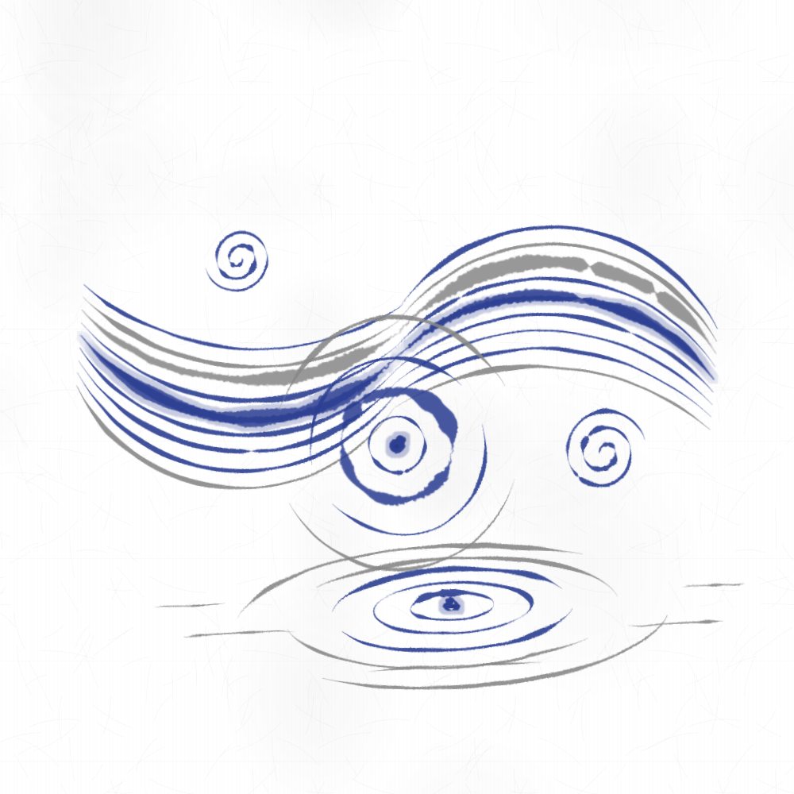

# v2 プラグインの作例

[作成ガイド](../../PLUGIN.ja.md) の `inku.plugin-package.v2` に従う、Server へ追加できる三つの見本です。各 zip は最上位の `package.json` と歳時記の PNG を含みます。見本のファイルは製品には同梱しません。

- [水の五語（zip）](water-nihonga.zip)・[JSON](water-nihonga/package.json)
- [空の四語（zip）](sky-nihonga.zip)・[JSON](sky-nihonga/package.json)
- [秋草の三語（zip）](akikusa-nihonga.zip)・[JSON](akikusa-nihonga/package.json)
- [語の定義を作るスクリプト](scripts/README.ja.md)（Python。十二の語のv2定義を作り、上のファイルと照らす）

| id | 日本語の主の名 | 英語の主の名 | 種類 | note（日本語） | note（英語） |
|---|---|---|---|---|---|
| `Water.Stream` | 水流 | stream | 情景 | 琳派の流水のように、渦を伴って流れるS字の水流。 | An S-shaped stream with eddies, like Rinpa flowing water. |
| `Water.Ripples` | 波紋 | ripples | 情景 | 真上から見た波紋。滲む雫と、外ほど途切れる輪。 | A ripple seen from above: a bleeding drop and rings that break toward the outside. |
| `Water.Rings` | 水輪 | rings | 情景 | 斜めから見た波紋。横長の輪と、水面の映り。 | A ripple seen at a low angle: flattened rings and reflections on the water. |
| `Water.River` | 川 | river | 情景 | 遠くへ曲がりながら細まる川。 | A river bending as it narrows into the distance. |
| `Water.Sea` | 海 | sea | 情景 | 水平線まで続く海原と波頭。 | Open sea to the horizon, with crests. |
| `Sky.Clouds` | 雲 | clouds | 情景 | すやり霞の雲。金の芯を通した横長の帯。 | Suyari-gasumi clouds: long bands with gold cores. |
| `Sky.Heavens` | 大空 | heavens | 情景 | 一文字ぼかしの空。上端から暈す群青。 | An ichimonji-bokashi sky: ultramarine shaded down from the top. |
| `Sky.Rain` | 雨 | rain | 情景 | 風に斜めに降る夕立。三層の雨脚に雨雲と雨霞を添える。 | A sudden shower slanting on the wind: three layers of rain with a rain cloud and mist. |
| `Sky.Snow` | 雪 | snow | 情景 | 胡粉の牡丹雪。暗い地に向く。 | Gofun peony snow, for a dark ground. |
| `Akikusa.Susuki` | すすき | silver grass | 物 | 風に靡くすすきの株。銀の穂を付けた茎三本と、根元から弧を描く葉。色の語で穂の色が替わる。 | A clump of silver grass in the wind: three stems with silvery ears and arching blades. |
| `Akikusa.Obana` | 尾花 | silver grass plume | 物 | すすきの穂ひとつの近景。細い小穂が扇に開き、風下へ弓なりに垂れる。 | A close view of one silver grass ear: fine spikelets fanning and bowing downwind. |
| `Akikusa.SusukiField` | すすき原 | silver grass field | 情景 | 画面の下に並び、風にそろって靡くすすきの群れ。武蔵野図のように。 | Silver grass along the bottom of the picture, all bowing together in the wind. |

「空」は基本語と重なるので、`Sky.Heavens` の名を「大空」にしました。DDL は `｛水流｝。`、`｛大空｝。` のように括弧の主の名で書きます。名に名前空間を付ける旧形式は、保存済みの作品のために移行期間だけ読めます。

**物と情景。** `｛すすき｝`と`｛尾花｝`は物の語で、四角と同じく`右端に大きな｛すすき｝を置く。`・`3本の｛すすき｝を下に並べる。`のように置き場・大きさ・数を書けます。色の語は主の色（穂と茎の灰）を替え、`黄色の｛すすき｝`は夕日の金、薄墨地の`白い｛すすき｝`は抱一の秋草のような白い穂になります。ほかの語は情景で、画面の上の位置を定義が決め、数は中の数（線・輪・株など）として受けます。

**歳時記 v3。** 定義の画材は歳時記 v3 の語です。v2 の太筆・細筆はガッシュに替わり、直に書いた太筆は太さ`thick`を伴います。`cycle`の表で画材を選ぶ所（水流の線・波紋の輪・大空の筆）は、移行で太さを運べないので、名だけがガッシュになっています。歳時記の絵は v3 の描画で描き直しました。

**図形の数。** 一つの作品の図形の指示は64までです。物の語の中身もこの数に入ります（｛すすき｝は29、｛尾花｝は14、｛すすき原｝は株一つにつき7）。2026-11-01の確かめでは、物を含む作品が64を超えると、物が消えるか作品ができないことがありました（例：6本の｛すすき原｝と大きな｛すすき｝）。並べる語が多いときは数を書いて抑えてください。

## DDL の書き出し見本

各 `*.ddl.json` は `inku.ddl-export.v2` です。`plugins` は `{definition,note}` の並びで、v2 の見える名を括弧で呼びます。Web の新しい指示書の「読み込む」か CLI の `paint --input-mode ddl --file` で、一つの新しい作品だけに定義を渡せます。

- 全語：[水・日本語](water.ja.ddl.json)／[英語](water.en.ddl.json)、[空・日本語](sky.ja.ddl.json)／[英語](sky.en.ddl.json)、[秋草・日本語](akikusa.ja.ddl.json)／[英語](akikusa.en.ddl.json)
- 単語：[水流](water-stream.ja.ddl.json)、[波紋](water-ripples.ja.ddl.json)、[水輪](water-rings.ja.ddl.json)（それぞれ `.en.ddl.json` もあります）

水の線は琳派の流水、たらしこみ、近現代の日本画の間を参照しました。空はすやり霞、一文字ぼかし、雨脚、胡粉の牡丹雪を参照しました。秋草は酒井抱一・鈴木其一の秋草図と武蔵野図の、風に靡く薄を参照しました。これらは新しい図形や実行コードを足さず、core の `emit`、`repeat`、`vary`、`transform` と意味語で構成しています。preview は zip の PNG です。Web のパッケージ検査は定義だけでなく日英の例文を実際に描いて確かめます。
