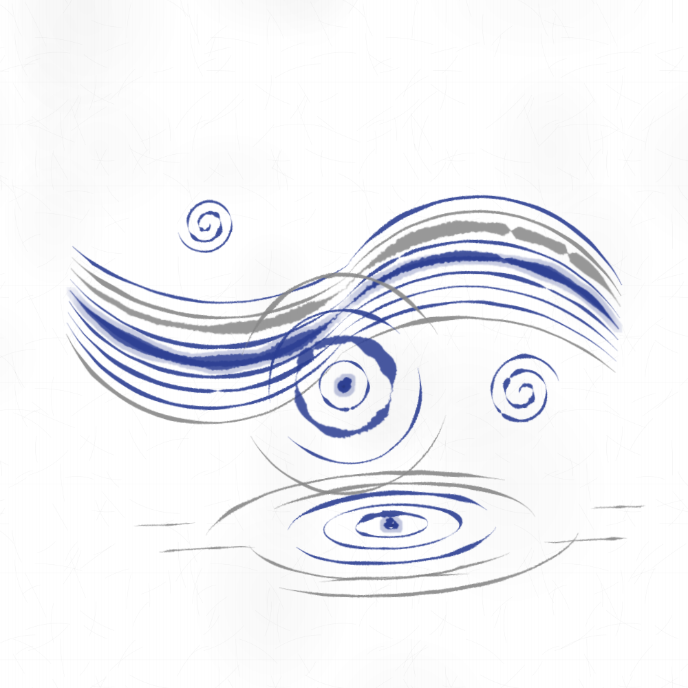
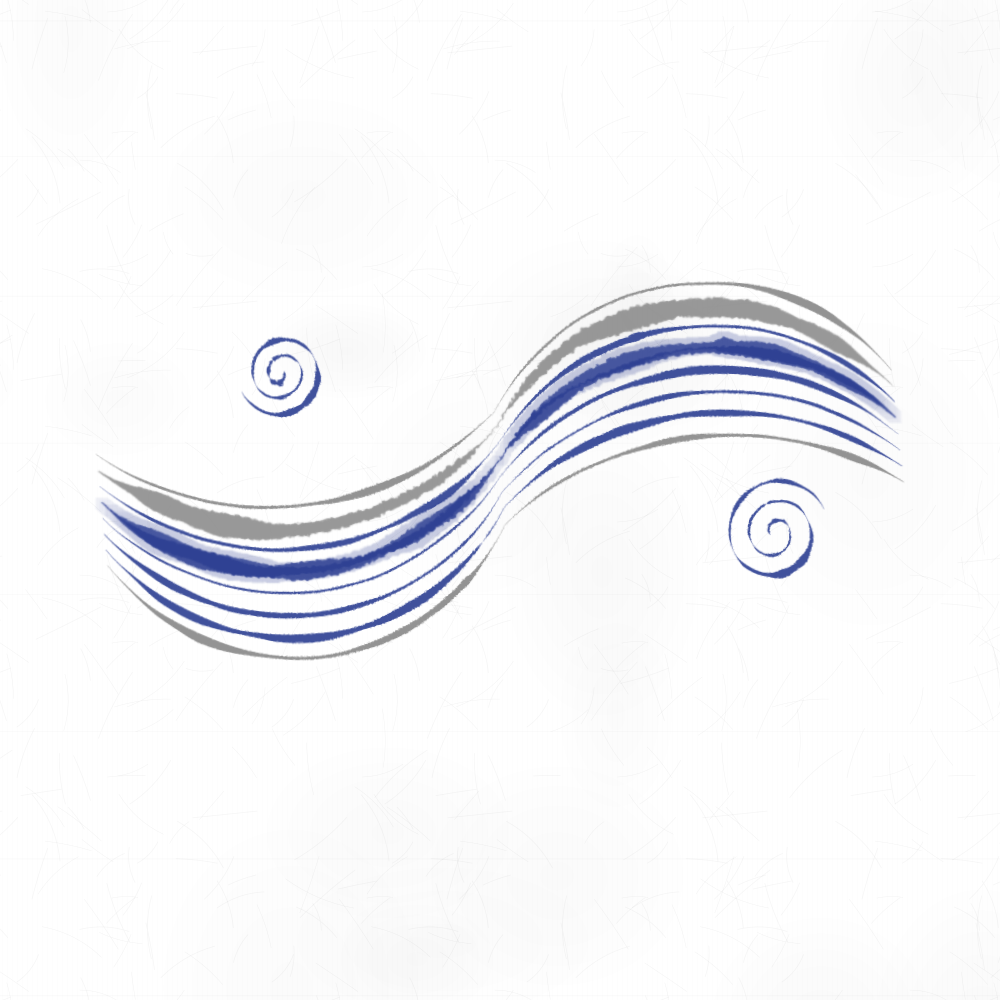
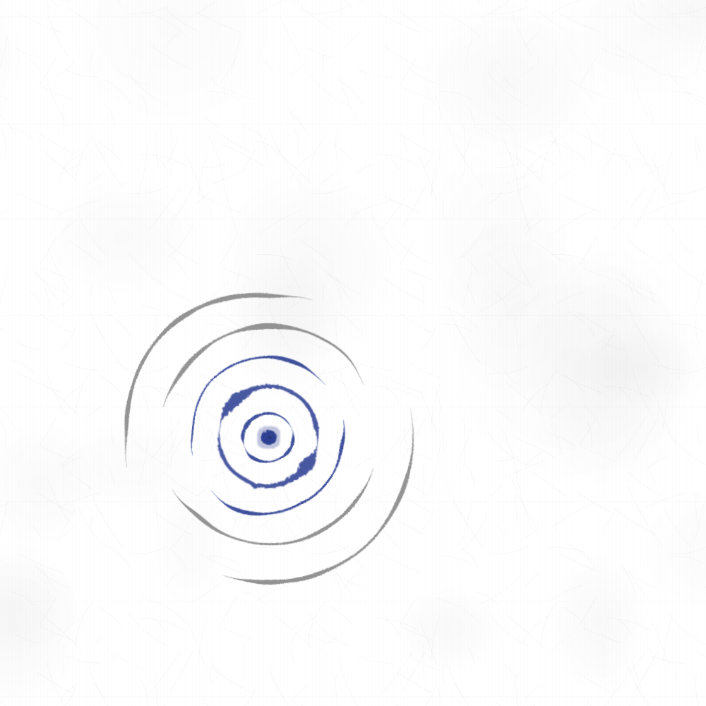
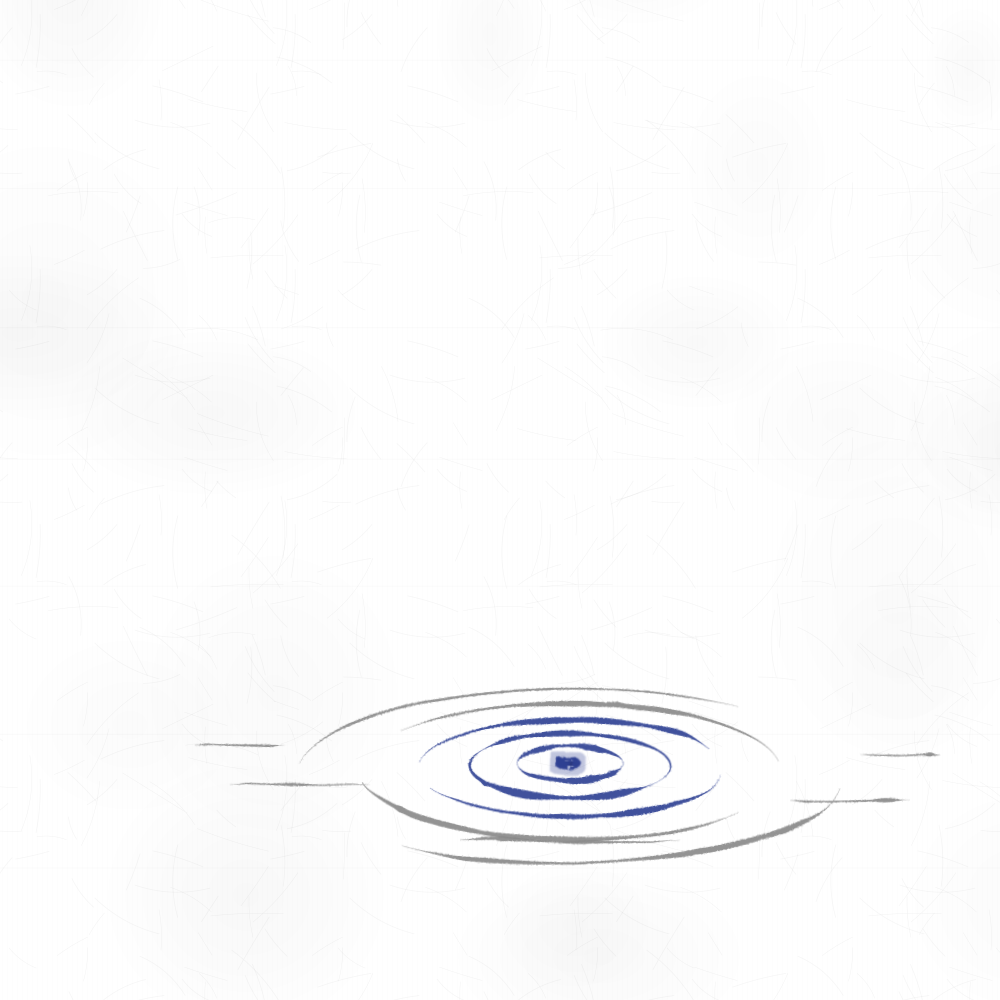
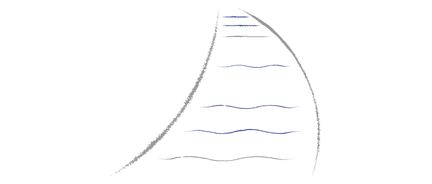
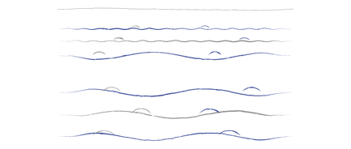
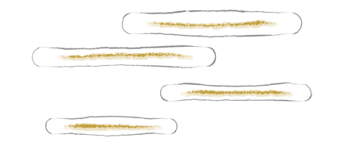
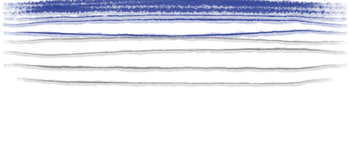
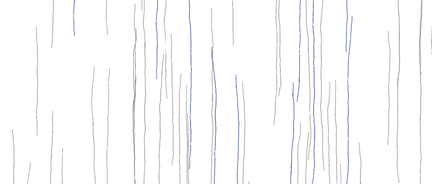

<p align="center">
  <a href="README.ja.md">日本語</a> ｜ <strong>English</strong>
</p>

# Example plugins

Vocabulary plugins written to the specification in [PLUGIN.md](../../PLUGIN.md). None of them is bundled with the product.

- **Plugin files (zip)**: an `inku.plugin-package.v1` holding definitions, summaries, notes, examples and Saijiki pictures. Added to a Server from the Web,
  its words are used by every new work on that Server and appear in the Saijiki ([PLUGIN §5.1](../../PLUGIN.md#51-adding-a-plugin-file-from-the-web-a-server-administrator)).
  The contents are kept as they are in the folder of the same name.
  - [water-nihonga.zip](water-nihonga.zip): five water words (`Water.nihonga` 1.1.0), contents in [water-nihonga/](water-nihonga/)
  - [sky-nihonga.zip](sky-nihonga.zip): four sky words (`Sky.nihonga` 1.0.0), contents in [sky-nihonga/](sky-nihonga/)
- **DDL export files**: use the words in the one new work that reads the file in, without adding them to a Server ([PLUGIN §5.2](../../PLUGIN.md#52-a-ddl-export-file-immediately-usable-by-an-author)).

| Word | Alias | Version | Zip | Export file |
|---|---|---|---|---|
| `Water.Stream` | `Water.水流` | 1.0.0 | water-nihonga | [water-stream.en](water-stream.en.ddl.json) / [ja](water-stream.ja.ddl.json), water |
| `Water.Ripples` | `Water.波紋` | 3.0.0 | water-nihonga | [water-ripples.en](water-ripples.en.ddl.json) / [ja](water-ripples.ja.ddl.json), water |
| `Water.Rings` | `Water.水輪` | 2.0.0 | water-nihonga | [water-rings.en](water-rings.en.ddl.json) / [ja](water-rings.ja.ddl.json), water |
| `Water.River` | `Water.川` | 1.0.0 | water-nihonga | water |
| `Water.Sea` | `Water.海` | 1.0.0 | water-nihonga | water |
| `Sky.Clouds` | `Sky.雲` | 1.0.0 | sky-nihonga | sky |
| `Sky.Heavens` | `Sky.空` | 1.0.0 | sky-nihonga | sky |
| `Sky.Rain` | `Sky.雨` | 1.0.0 | sky-nihonga | sky |
| `Sky.Snow` | `Sky.雪` | 1.0.0 | sky-nihonga | sky |

"water" is [water.en.ddl.json](water.en.ddl.json) / [water.ja.ddl.json](water.ja.ddl.json), holding the five water words;
"sky" is [sky.en.ddl.json](sky.en.ddl.json) / [sky.ja.ddl.json](sky.ja.ddl.json), holding the four sky words.



The `ddl` of `water.ja.ddl.json` drawn with composition seed 7 ([water.svg](water.svg)).

## The idea

Water and sky are drawn not as clearly outlined figures but as a rhythm of lines and the gaps (ma) between them. The following ways of modern Japanese painting (nihonga),
and of the yamato-e, Rinpa and ukiyo-e it carried on, were the reference, built within inku's nine shapes and the saijiki words.

- **Rinpa flowing water** (the stream in Ogata Kōrin's *Red and White Plum Blossoms* and the modern nihonga that carried it on): the flow becomes a bundle of lines running side by side and a pattern of eddies curling in its bends. → the band and eddies of `Stream`
- **The flowing lines of Yokoyama Taikan's *Metempsychosis* (Seisei ruten)**: lines with thick and thin passages flow, drawing together and apart. → the `Stream` band swells in the middle of each half and narrows at both ends and at the center
- **Tarashikomi** (the Rinpa technique of dropping a second color into wet ink or paint so it bleeds): the saijiki word `bleeding` makes the core line of `Stream` and the drops of `Ripples` and `Rings` bleed
- **Fukuda Heihachirō's *Ripples* (Sazanami)**: the water surface becomes a rhythm of broken lines. → the rings of `Ripples` and `Rings` break more toward the outside, the breaks turning from ring to ring
- **Higashiyama Kaii's still water**: light reflected on the surface laid down as pale horizontal lines. → the reflection strokes of `Rings`
- **Kawai Gyokudō's rivers and hills**: a river bending as it narrows into the distance, its flow drawing closer farther away. → `River`
- **Open sea to the horizon**: rows of waves, finer and closer far away, larger and looser toward the viewer. → `Sea`
- **Suyari-gasumi of yamato-e and Rinpa**: cloud bands with rounded ends crossing the picture, with gold through their cores. → `Clouds`
- **Ichimonji bokashi** (the ukiyo-e and nihonga technique of shading color down from the top edge). → `Heavens`
- **Utagawa Hiroshige's *Sudden Shower over Shin-Ōhashi Bridge and Atake***: thin straight rain lines in two tones covering the picture. → `Rain`
- **Gofun peony snow** (the nihonga way of laying white gofun for falling snow): bleeding white points of several sizes scattered. → `Snow`

The colors are based on `blue`, standing for ultramarine, and `gray`, standing for pale ink: ultramarine for the inner rings and the cores, pale ink for the outer rings and the side lines. Only the cores of `Clouds` use `yellow`, standing for gold, and only `Snow` uses `white`, standing for gofun.
The lines are based on the thin brush (`brush_thin`), with only the key lines in the thick brush (`brush_thick`) for modulation. The export files' `ddl` sets the ground to `Washi.`
The ultramarine lines sink into a blue ground, so apart from `Snow` the words suit a light ground such as white, washi or pale ink wash. `Snow` is white, so it belongs on ink wash, charcoal, blue or black.

## What the words share

- They receive a count (`5 Water.Ripples.`, `8 Water.Stream.`, `48 Sky.Rain.`). A count outside the range drops that word only.
- Position and direction are chosen by the work's composition seed. The same seed gives the same picture. `Rain` and `Snow` use the saijiki's `scatter`, so one instruction scatters many marks, the way chosen by the seed.
- The fluctuation sways (`swaying`) loosely (`loosely`): narrowly (`narrowly`) for the inner and core lines, broadly (`broadly`) for the outer rings.
- A definition has no arithmetic, so each word is built around the canvas center (0.5, 0.5) and a `transform` then moves, turns and flattens the whole.
  If a figure leaves the canvas after the `transform`, nothing in that group is drawn (`numeric_transform_group_position_conflict`),
  so the sizes keep every candidate inside the canvas.

## `Water.Stream` (alias `Water.水流`)



One stream of water crossing the middle of the canvas ([water-stream.svg](water-stream.svg) draws the Japanese `ddl`).

- It receives the line count. The range is 1–12; with no count written it draws 7–9. The core line and the two eddies are always drawn, apart from the count.
- Each line is an S: an arc bulging upward in the left half joined to an arc bulging downward in the right half (each chord 0.40).
  The line ends are 0.016 apart, and the upper lines bulge more in the left half, the lower lines more in the right half (sagitta 0.090, changing by 0.006 per line).
- The lines take their tool and color from a table that mixes thin and thick brush, ultramarine and pale ink. The core line is thick-brush ultramarine with `bleeding`.
- An eddy is a spiral of five joined semicircles, each half turn 0.010 smaller in radius, written as a component (`eddy` in `components`) and called twice.
- The band lies in one of six ways.

  | Candidate | Tilt | Left-right | Vertical shift |
  |---|---|---|---|
  | 1 | −12° | as is | 0.000 |
  | 2 | 10° | as is | 0.040 |
  | 3 | −6° | mirrored | −0.040 |
  | 4 | 14° | mirrored | 0.020 |
  | 5 | −16° | as is | 0.050 |
  | 6 | 4° | mirrored | −0.050 |

## `Water.Ripples` (alias `Water.波紋`)



A ripple on the water seen from straight above ([water-ripples.svg](water-ripples.svg) draws the Japanese `ddl`).

- It receives the ring count. The range is 1–6; with no count written it draws 4–5.
- An ultramarine drop with `bleeding` (a point of radius 0.007) sits at the center.
- Each ring is an upper and a lower arc. The radii are 0.035, 0.070, 0.110, 0.155, 0.205 and 0.260 from the inside out (fractions of the short side).
  The arcs open 180, 180, 150, 135, 120 and 100 degrees from the inside out, so the inner two are closed and the rest break.
  The rings are turned 0, 30, −8, 14, −22 and 34 degrees to shift the breaks.
- The inner three are ultramarine and the outer three pale ink. Only the second ring is in thick brush.
- The center is one of the five below, and the whole is turned by 0, 40, 80, 120 or 160 degrees.

  | Candidate | x | y |
  |---|---|---|
  | 1 | 0.500 | 0.560 |
  | 2 | 0.380 | 0.620 |
  | 3 | 0.620 | 0.580 |
  | 4 | 0.440 | 0.680 |
  | 5 | 0.580 | 0.460 |

Changed from 2.0.0: the rings are broken upper and lower arcs instead of closed ellipses. A drop was added, and ultramarine and pale ink, thick and thin brush are used by ring.
With no count written it now draws 4–5 rings instead of 3–4.

## `Water.Rings` (alias `Water.水輪`)



A ripple on the water seen at a low angle across it ([water-rings.svg](water-rings.svg) draws the Japanese `ddl`).

- It receives the ring count. The range is 1–6; with no count written it draws 4–5.
- The same drop and broken rings as `Ripples` (radii 0.050, 0.095, 0.145, 0.200, 0.260 and 0.320 from the inside out, all thin brush)
  are scaled by a `transform` to 1.05 times the width and 0.34 times the height. Each outer ring's center is lower (0, 0.006, 0.014, 0.024, 0.036, 0.050), so the rings open toward the viewer.
- Five thin pale-ink horizontal strokes lie to the sides of and below the rings (reflections on the water).
- The whole is moved by one of the five offsets below and tilted by −3, −1.5, 0, 1.5 or 3 degrees. The center after the move is listed as well.

  | Candidate | Offset (x, y) | Center |
  |---|---|---|
  | 1 | (0.000, 0.200) | (0.500, 0.700) |
  | 2 | (−0.070, 0.160) | (0.430, 0.660) |
  | 3 | (0.070, 0.240) | (0.570, 0.740) |
  | 4 | (−0.040, 0.260) | (0.460, 0.760) |
  | 5 | (0.050, 0.120) | (0.550, 0.620) |

Changed from 1.0.0: the same broken rings and drop as `Ripples`, with reflection strokes added. With no count written it now draws 4–5 rings instead of 3–5.

## `Water.River` (alias `Water.川`)



A river bending as it narrows into the distance, looked down on (the Saijiki picture, drawn from the example `7 Water.River.`).

- It receives the flow line count. The range is 1–9; with no count written it draws 6–7. The table order is spread over distance, so any count reaches from far to near.
- The banks are two thick-brush pale-ink arcs, the left from (0.08, 0.98) to (0.52, 0.30) and the right from (0.90, 0.98) to (0.60, 0.30), both bulging the same way with sagittas 0.10 and 0.14.
  The arcs are long, so they are made at the canvas center and then turned and moved into place by a `transform` (placed as they are, they would leave the canvas before turning and be dropped).
- The flow lines lie at nine heights from y = 0.335 to 0.91; at each height the width between the two bank arcs is computed and the line is 0.76 of it.
  The three farthest undulate tightly (`tightly`), the rest loosely (`loosely`).
- It lies in one of four ways (as is or mirrored, shifted by 0 or −0.020 vertically).

## `Water.Sea` (alias `Water.海`)



Open sea reaching to the horizon (the Saijiki picture, drawn from the example `6 Water.Sea.`).

- It receives the wave row count. The range is 1–8; with no count written it draws 5–6. Any count reaches from far to near.
- The horizon is a fine pen line at y = 0.40. The wave rows lie at y = 0.44, 0.48, 0.53, 0.59, 0.66, 0.74, 0.83 and 0.92; the three farthest undulate tightly, the rest loosely.
- Each row carries one small pale-ink and one ultramarine thin-brush arc crest. The crest chords grow from 0.024 in the farthest row to 0.094 in the nearest.
- The horizon's height is one of three (shifted by 0, −0.040 or −0.070).

## `Sky.Clouds` (alias `Sky.雲`)



Clouds like the suyari-gasumi of yamato-e and Rinpa (the Saijiki picture, drawn from the example `4 Sky.Clouds.`).

- It receives the band count. The range is 1–5; with no count written it draws 3–4.
- A band is an outline with rounded ends, made of an upper and a lower line and a semicircle arc at each end (turned upright by a `transform`). A thick-brush line in `yellow`, standing for gold, runs through its core, bleeding with `bleeding`.
- The bands' left ends, right ends, center heights and thicknesses are as follows.

  | Band | Left | Right | Center height | Thickness |
  |---|---|---|---|---|
  | 1 | 0.10 | 0.62 | 0.20 | 0.072 |
  | 2 | 0.38 | 0.92 | 0.31 | 0.064 |
  | 3 | 0.06 | 0.50 | 0.43 | 0.056 |
  | 4 | 0.50 | 0.88 | 0.54 | 0.052 |
  | 5 | 0.18 | 0.56 | 0.64 | 0.048 |

- It lies in one of four ways (as is or mirrored, shifted by 0, 0.040, 0.080 or −0.020 vertically).
- The thicknesses are multiples of 0.002. A semicircle's sagitta is half the thickness, and if rounding pushes it past half the chord the arc cannot be drawn (`geometry_dimension_mismatch`).

## `Sky.Heavens` (alias `Sky.空`)



A sky shaded down from the top edge in ichimonji bokashi (the Saijiki picture, the top band of the example `10 Sky.Heavens.`).

- It receives the stroke count. The range is 1–12; with no count written it draws 8–10, from the top down.
- The strokes run the full width (0.98) and all bleed with `bleeding`. They lie from y = 0.010 to 0.334, farther apart lower down.
- The top three are thick brush, the rest thin brush; the top six are ultramarine, the lower six pale ink. The lowest three shorten to 0.90, 0.82 and 0.74.

## `Sky.Rain` (alias `Sky.雨`)



Rain falling over the whole canvas (the Saijiki picture, the middle band of the example `48 Sky.Rain.`).

- It receives the rain count. The range is 1–80; with no count written it draws 36–48. The count is the number of pale-ink lines; the 12 ultramarine lines are always drawn.
- The pale-ink lines are 0.38 long and the ultramarine ones 0.52, both thin vertical pen lines laid with `scatter`. That is only two figure instructions.

## `Sky.Snow` (alias `Sky.雪`)


Gofun peony snow scattered over the whole canvas (the Saijiki picture, the middle band of the example `Ink wash ground. 48 Sky.Snow.`).

- It receives the flake count. The range is 1–80; with no count written it draws 36–48. The count is the number of small flakes (radius 0.005); 14 middle ones (0.010) and 6 large peony flakes (0.017) are always drawn.
- The flakes are bleeding white points laid with `scatter`. That is only three figure instructions.
- Being white, they cannot be seen on a light ground; the example sets the ground to `Ink wash ground.` as well.

## Reading it in

### Adding it from the Web as a plugin (Server administrator)

1. Download [water-nihonga.zip](water-nihonga.zip) and [sky-nihonga.zip](sky-nihonga.zip) (on GitHub, open the file and choose "Download raw file"). Do not unpack them.
2. In the Web settings, open "Plugins", press "Add a plugin" and choose a zip.
3. The Server checks the file's shape, the definitions and each word's Japanese and English example. Each word shows its Saijiki picture and example; check them and press "Add".
   Add the other zip the same way.
4. Write `Water.River.` or `48 Sky.Rain.` in DDL. When drawing from a description, Stage 1 picks a word when the description names it (river, rain and the like).

On a Server that already has `water-nihonga.zip` 1.0.0 (Stream, Ripples and Rings), 1.1.0 is a "Replace". The definitions of those three words are unchanged.

What the zips hold:

```text
water-nihonga.zip                   sky-nihonga.zip
├── package.json  (Water.nihonga)   ├── package.json  (Sky.nihonga)
└── previews/                       └── previews/
    ├── stream.png   Stream             ├── clouds.png   Clouds
    ├── ripples.png  Ripples            ├── heavens.png  Heavens
    ├── rings.png    Rings              ├── rain.png     Rain
    ├── river.png    River              └── snow.png     Snow
    └── sea.png      Sea
```

| Field | Content |
|---|---|
| `namespace`, `name`, `version` | `Water`, `nihonga`, `1.1.0` and `Sky`, `nihonga`, `1.0.0` |
| `description_ja`, `description_en` | The description shown in the settings |
| `license` | `MIT` (the same as this repository) |
| each word's `summary_*` | The summary given to Stage 1. For Stream, Ripples and Rings, the same text as the export files' `summary` |
| each word's `note_*` | The Saijiki's description line |
| each word's `example_*` | The example in each word's section, and its English |
| each word's `preview` | A picture in `previews/` (432×184): each word's example drawn with several composition seeds, one chosen. Heavens, Rain and Snow draw over the whole canvas, so a band in the frame's proportion was cut from it (the top for Heavens, the middle for Rain and Snow); the others are cut the way the Server cuts a picture drawn from an example |

The zips can be rebuilt from the folders (with the same timestamps they come out byte for byte the same).

```sh
cd docs/plugins/water-nihonga   # sky-nihonga likewise
TZ=UTC touch -t 202610260000 package.json previews previews/*.png
zip -X -r ../water-nihonga.zip package.json previews
```

### Using it in one work (export files)

- Web: open "New instructions" under the Describe tab and choose the file with "Load".
- CLI: `uv run inku-cli paint --input-mode ddl --file docs/plugins/water.en.ddl.json`
- Android: choose the file with "Open" on the DDL screen. Android and macOS do not call the Server, so words added by zip cannot be used there yet; use this way instead.

The five water words are in `water.*.ddl.json` and the four sky words in `sky.*.ddl.json`. To use water and sky words in one work, list the `plugins` of both files in one export file.

## Limits

A work holds at most 64 figure instructions (PLUGIN §8). With n rings or lines, each word draws the following number of figures.

| Word | Figures | No count written | Maximum |
|---|---|---|---|
| `Stream` | 12 + 2n | 26–30 | 36 |
| `Ripples` | 1 + 2n | 9–11 | 13 |
| `Rings` | 6 + 2n | 14–16 | 18 |
| `River` | 2 + n | 8–9 | 11 |
| `Sea` | 1 + 3n | 16–19 | 25 |
| `Clouds` | 5n | 15–20 | 25 |
| `Heavens` | n | 8–10 | 12 |
| `Rain` | 2 (n + 12 marks) | 2 | 2 |
| `Snow` | 3 (n + 20 marks) | 3 | 3 |

Stream, Ripples and Rings together with no counts written come to 49–57 and fit; with all three at their maximum they come to 67, and the word over the limit is dropped (`Rings`, when checked on 2026-10-26).
Heavens, Clouds and Sea together with no counts written come to 39–49 and fit. With many words in one work, write counts to keep the figures down.

## What was checked (2026-10-26)

All nine definitions passed `compile-score` (PLUGIN §7.1).

| Word | Version | Digest |
|---|---|---|
| `Water.Stream` | 1.0.0 | `sha256:d9b813cb7f9303095728c8c2b8534895a62ab92a5ef0430d86593a52bda7d3c2` |
| `Water.Ripples` | 3.0.0 | `sha256:7881b2c4390a65a1c13e7d45760c863cc8842bc6bf5a0fe0ed90baf4131f030c` |
| `Water.Rings` | 2.0.0 | `sha256:470723a10ffa90984da40a2fd64c49688985d3d4ed0ca684d736d94398f124b7` |
| `Water.River` | 1.0.0 | `sha256:e19c27844daaa50e06cd4e8ef6e946287b41e448c6f7880e9d938536cbba2fda` |
| `Water.Sea` | 1.0.0 | `sha256:de45214867f54b89b38ced561ef391e169c0b7f8f2f8a00317e4c8b3ab0ca5d1` |
| `Sky.Clouds` | 1.0.0 | `sha256:3bd2d4d8e0c1412a7a5964b6e48c912de7c85f19f5e2174c5c6636edb9a9de0d` |
| `Sky.Heavens` | 1.0.0 | `sha256:246ebbbb6c788a4a480d38e4211057875b50bf8f733e06d0a70b8031ce1cba7b` |
| `Sky.Rain` | 1.0.0 | `sha256:960bdf268bbc5323758b8929e0d321b10ff9fd756383bb6e012699f683956444` |
| `Sky.Snow` | 1.0.0 | `sha256:51872b6737687175fe310f69c4b9f4ac9c2a4c93f5bab97b60ed5747e6ecf87f` |

Passing the two zips to the Server's `POST /api/plugins/packages/validate` (the same check as "Add a plugin" in the Web):

- Both passed with no problems. The Japanese and English examples of all nine words drew without diagnostics, and the Saijiki used the zips' pictures.
- With both added, the following DDL was drawn using only the added words, without `imported_plugins`, all without diagnostics:
  `和紙。` `10本のSky.空。` `4本のSky.雲。` `6本のWater.海。` / `和紙。` `Sky.雲。` `Water.川。` / `和紙。` `Sky.雨。` `Water.水輪。` /
  `薄墨地。` `Sky.雪。` `Water.波紋。` / the same in English / `和紙。` `9本のWater.川。` `8本のWater.海。`
- The out-of-range `6本のSky.雲。` dropped that word only with `macro_binding_count_out_of_range`, and the rest of the same DDL was drawn.
- Both were exported, the exported zips passed the check again, and both were deleted.

Passing the export files' `plugins` to the Server's `/api/compose` as `imported_plugins`, with the shared core:

- The `ddl` of all ten files drew without diagnostics, in Japanese and English.
- Under both the Japanese alias and the English name, Stream, Ripples and Rings drew no count, 1 and the maximum count as that many without diagnostics.
  One more than the maximum dropped that word only with `macro_binding_count_out_of_range`, and the rest of the same DDL was drawn.
- Changing the composition seed, `6個のWater.水輪。` was drawn 40 ways, `12本のWater.水流。`, `Water.水流。` and `6個のWater.波紋。` 24 ways each,
  and the DDL with all three 8 ways; none left the canvas and none had diagnostics.
- River, Sea, Clouds, Heavens, Rain and Snow were each drawn at their maximum and with no count across 12 composition seeds, and at a count of 1;
  Heavens and Rain were drawn again at their maximum and at 1 across 8 seeds. None left the canvas and none had diagnostics.
