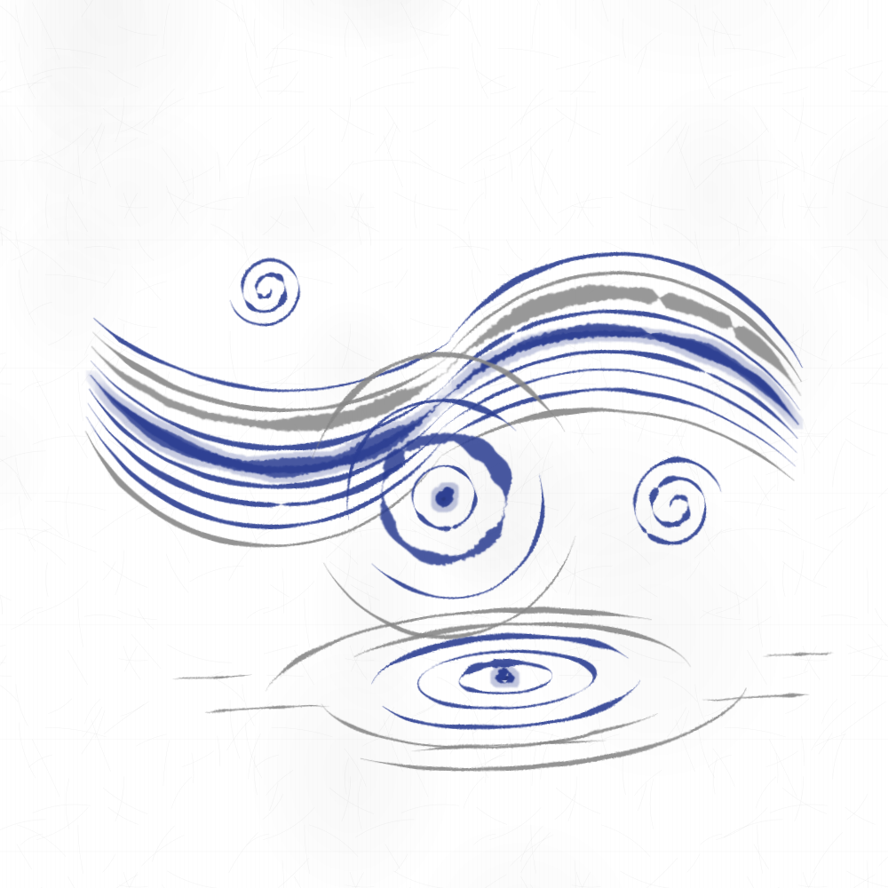

# V2 plugin examples

These three installable examples follow the [authoring guide](../../PLUGIN.md) for `inku.plugin-package.v2`. Each zip holds `package.json` at its root and Saijiki PNGs. The examples are not bundled with the product.

- [Five water words (zip)](water-nihonga.zip) and [JSON](water-nihonga/package.json)
- [Four sky words (zip)](sky-nihonga.zip) and [JSON](sky-nihonga/package.json)
- [Three autumn grass words (zip)](akikusa-nihonga.zip) and [JSON](akikusa-nihonga/package.json)
- [Scripts that make the word definitions](scripts/README.md) (Python; they build the twelve words' v2 definitions and check them against the files above)

| id | Primary Japanese name | Primary English name | Kind | Japanese note | English note |
|---|---|---|---|---|---|
| `Water.Stream` | 水流 | stream | scene | 琳派の流水のように、渦を伴って流れるS字の水流。 | An S-shaped stream with eddies, like Rinpa flowing water. |
| `Water.Ripples` | 波紋 | ripples | scene | 真上から見た波紋。滲む雫と、外ほど途切れる輪。 | A ripple seen from above: a bleeding drop and rings that break toward the outside. |
| `Water.Rings` | 水輪 | rings | scene | 斜めから見た波紋。横長の輪と、水面の映り。 | A ripple seen at a low angle: flattened rings and reflections on the water. |
| `Water.River` | 川 | river | scene | 遠くへ曲がりながら細まる川。 | A river bending as it narrows into the distance. |
| `Water.Sea` | 海 | sea | scene | 水平線まで続く海原と波頭。 | Open sea to the horizon, with crests. |
| `Sky.Clouds` | 雲 | clouds | scene | すやり霞の雲。金の芯を通した横長の帯。 | Suyari-gasumi clouds: long bands with gold cores. |
| `Sky.Heavens` | 大空 | heavens | scene | 一文字ぼかしの空。上端から暈す群青。 | An ichimonji-bokashi sky: ultramarine shaded down from the top. |
| `Sky.Rain` | 雨 | rain | scene | 風に斜めに降る夕立。三層の雨脚に雨雲と雨霞を添える。 | A sudden shower slanting on the wind: three layers of rain with a rain cloud and mist. |
| `Sky.Snow` | 雪 | snow | scene | 胡粉の牡丹雪。暗い地に向く。 | Gofun peony snow, for a dark ground. |
| `Akikusa.Susuki` | すすき | silver grass | object | 風に靡くすすきの株。銀の穂を付けた茎三本と、根元から弧を描く葉。色の語で穂の色が替わる。 | A clump of silver grass in the wind: three stems with silvery ears and arching blades. |
| `Akikusa.Obana` | 尾花 | silver grass plume | object | すすきの穂ひとつの近景。細い小穂が扇に開き、風下へ弓なりに垂れる。 | A close view of one silver grass ear: fine spikelets fanning and bowing downwind. |
| `Akikusa.SusukiField` | すすき原 | silver grass field | scene | 画面の下に並び、風にそろって靡くすすきの群れ。武蔵野図のように。 | Silver grass along the bottom of the picture, all bowing together in the wind. |

The name `空` conflicts with a core word, so `Sky.Heavens` now uses `大空`. DDL calls the braced primary name, such as `{stream}.` or `{heavens}.` The old qualified spelling remains readable during the saved-work migration period.

**Objects and scenes.** `{silver grass}` and `{silver grass plume}` are objects: like a square, they take a place, a size and a count, as in `Place a large {silver grass} at the right edge.` or `Line up 3 {silver grass} at the bottom.` A colour word replaces their main colour (the gray of the ears and stems): `黄色の｛すすき｝` is gold in the evening light, and `白い｛すすき｝` on an ink wash ground gives white ears like Hōitsu's autumn grasses. The other words are scenes: the definition decides where they lie on the canvas, and their count is an inner count (lines, rings, plants and so on).

**Saijiki v3.** The definitions' tools are Saijiki v3 words. The v2 thick and thin brushes became gouache, and a thick brush written directly carries the thickness `thick`. Where a `cycle` table chooses the tool (the lines of stream, the rings of ripples, the strokes of heavens), the migration cannot carry the thickness, so only the name became gouache. The Saijiki pictures were redrawn with the v3 renderer.

**Figure count.** A work holds at most 64 figure instructions, and an object's content counts toward them ({silver grass} 29, {silver grass plume} 14, {silver grass field} 7 per plant). When checked on 2026-11-01, a work with an object that went over 64 lost the object or was not made at all (for example, 6 {silver grass field} with a large {silver grass}). With many words in one work, write counts to keep it down.

## DDL export examples

Every `*.ddl.json` is `inku.ddl-export.v2`. Its `plugins` carry `{definition,note}` and its DDL calls visible names in braces. Import through Web's new DDL dialog or CLI `paint --input-mode ddl --file`; definitions apply to that one new work without installation.

- All words: [water in Japanese](water.ja.ddl.json) / [English](water.en.ddl.json), [sky in Japanese](sky.ja.ddl.json) / [English](sky.en.ddl.json), [autumn grasses in Japanese](akikusa.ja.ddl.json) / [English](akikusa.en.ddl.json)
- Single words: [stream](water-stream.en.ddl.json), [ripples](water-ripples.en.ddl.json), [rings](water-rings.en.ddl.json) (Japanese counterparts are also present)

The water words refer to Rinpa flowing water, bleeding ink, and the gaps in modern Japanese painting. The sky words refer to suyari-gasumi bands, ichimonji bokashi, rain strokes, and gofun snow. The autumn grasses refer to the windswept silver grass of Sakai Hōitsu's and Suzuki Kiitsu's autumn-grass paintings and the Musashino screens. They use the core's `emit`, `repeat`, `vary`, `transform`, and meaning words rather than new primitives or executable code. The zip supplies each preview PNG. The Web package check draws both Japanese and English examples as well as validating definitions.
